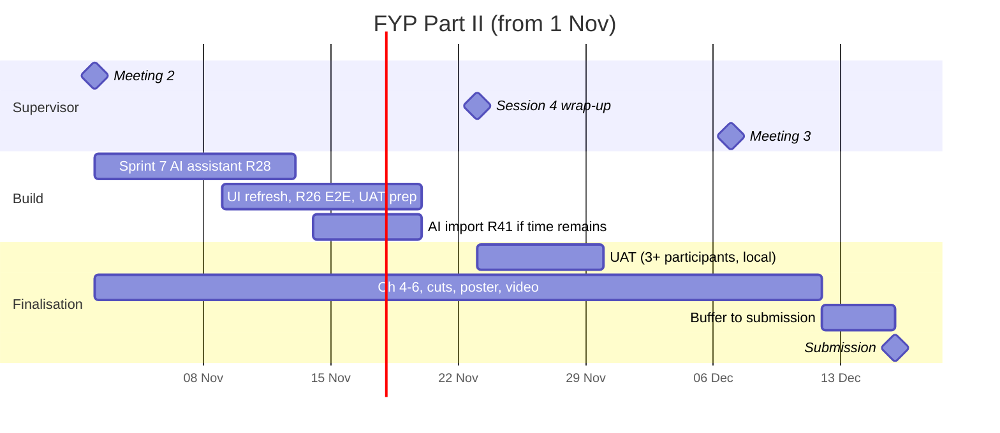

# FYP Part II plan (milestones only; work items are GitHub issues)

Semester Week 1 began 21 Sep 2026. Dates follow the official timeline (`../FYP_TIMELINE.pdf`, semester 2). Submission:
**Wed 16 Dec 2026, before 11:59 pm** (Word document, source code zip, at least 6 meeting log sheets). Presentation:
physical, week of 4 Jan 2027 onwards. Current state and next issues: `HANDOVER.md`. History: `sprints/` (reviews,
`backlog_R0-R41.md`), `DECISIONS.md` and `adr/`.

## Where we are (1 Nov 2026, week 6)
- Every IR FR (FR1-FR18) is built and tested. FR19 (lecturer approval) is the first addition beyond the IR (ADR 0092). Sprint 6 (Stabilise) closed 29 Oct with 14 issues
  (`sprints/sprint6_review_retrospective.md`): NFR3 holds on the labelled seed (ADR 0089), 10x latency measured
  (ADR 0090), R5 admin Modules page done.
- Next: Sprint 7 R28 AI assistant (spec approved, D83; overdelivery, ADR 0085), then R41 if time remains (R35 and R36
  are future work). R28 outline schema and limits in `shared/` done (#111, AI-TC1-5). R28 outline draft route `POST /api/ai/outline` done (#112, AI-TC6-20, ADR 0093). Video is a frozen addition (ADR 0091). Later: R26 E2E (#81), UAT prep (#82-#84), limitations (#85).

## Milestones
| Milestone | Target | Done when |
|---|---|---|
| Meeting #2 | week of 2 Nov | R14 Plan A (B as fallback), the AI additions (ADR 0085) and FR20+ numbering (ADR 0092) put to the supervisor (`OPEN_QUESTIONS.md`) |
| Feature complete | 20 Nov | R28 merged (R41 only if time remains); R26 E2E green in CI (#81); UAT seed and evidence pipeline ready (#82, #83) |
| UAT | 30 Nov (proposed); must finish before 6 Dec | at least three participants (#86; 5 students, 1 lecturer, 1 admin as a stretch), results and NFR5 weight review in `testing/uat/` (#84) |
| Report complete | 12 Dec (proposed; was 20 Dec) | Chapters 1-6 in the .docx, cuts applied, meeting #1 feedback folded in, 25 screenshots, 3 code snippets, poster, 3-min video |
| Submission | 16 Dec, 11:59 pm | deliverables named per the `fyp-standards` skill; cover page fields checked; 6 meeting log sheets |
| Presentation | week of 4 Jan | demo runs locally (D82) |

## Admin (user)
- Log meeting #1 on PG Bank; hold meeting #2 (week of 2 Nov; prep pack
  `../FYP_Resources/FYP_Pack/Personal/Supervisor/FYP_SV_Meet-2_prep.md`).

## Supervisor feedback to fold in (meeting #1, 9 Oct; `FYP_SV_Meet-1_09_Oct_2026.txt`)
- Deeper appraisal of technological implications (Ch 2).
- More detailed analysis of survey results, not just interpretation (Ch 3).
- Indent every paragraph; make referencing consistent (APA).
- Every diagram and feature gets an explanatory paragraph beneath it.
- FR changes are fine if justified (L36): each FR20+ addition carries its justification (ADR 0092).
- None of these five report points has a follow-up yet: a report-lane task for the writer.
