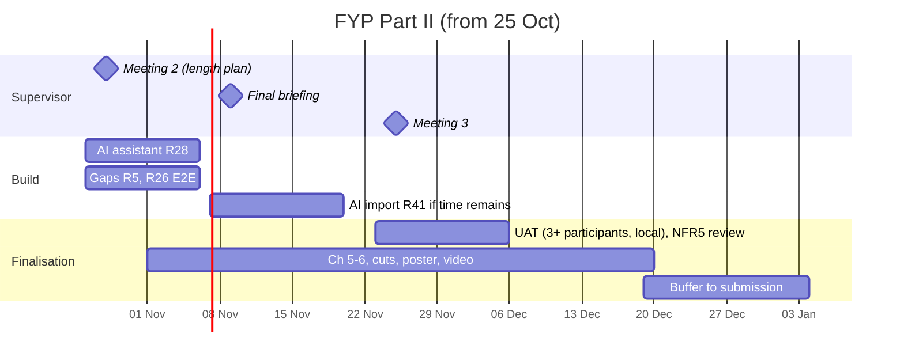

# FYP Part II plan (milestones only; work items are GitHub issues)

Semester Week 1 began 21 Sep 2026. Submission: end Dec 2026 / early Jan 2027 (exact date at the final briefing, week
of 9 Nov). Current state and next issues: `HANDOVER.md`. History: `sprints/backlog_R0-R41.md` (14-25 Oct backlog),
`DECISIONS.md` and `adr/`.

## Where we are (25 Oct 2026)
- Every IR FR (FR1-FR19) is built and tested; NFR1 has local load evidence (D80); NFR5 is reviewed at UAT.
- Done since 13 Oct: Sprints 0-5 build, Sprint D UI, R11 deploy code (live deploy optional, D82), R20 local audit,
  R27 local evidence, R14 cut plan. Workflow restructured to issues, ADRs and AGENTS.md (ADR 0084).
- Open: R28 AI assistant (spec approved, D83), then R41 if time remains (R35 and R36 are future work, ADR 0085); Playwright E2E suite (R26);
  report Chapters 5-6 and the meeting #2 length plan.

## Milestones
| Milestone | Target | Done when |
|---|---|---|
| Meeting #2 | 28 Oct | R14 Plan A (B as fallback) and the supervisor questions in `OPEN_QUESTIONS.md` answered |
| Feature complete | 20 Nov | R28 merged (R41 only if time remains after R28; R35 and R36 are future work, ADR 0085); R5 and R26 closed; E2E smoke suite green in CI |
| UAT | 6 Dec | three or more participants, results and NFR5 weight review recorded in `testing/uat/` |
| Report complete | 20 Dec | Chapters 1-6 in the .docx, cuts applied, 25 screenshots, 3 code snippets, poster, 3-min video |
| Submission | early Jan | deliverables named per the `fyp-standards` skill |

## Admin (user)
- Log meeting #1 on PG Bank; book meeting #2 (~28 Oct); confirm the exact deadline at the final briefing.

## Supervisor feedback to fold in (meeting #1)
- Deeper appraisal of technological implications (Ch 2).
- More detailed analysis of survey results, not just interpretation (Ch 3).
- Indent every paragraph; make referencing consistent (APA).
- Every diagram and feature gets an explanatory paragraph beneath it.
