# 4.4 Interface Design

	The wireframes below were produced before implementation to fix the layout and navigation of NotaLah. There are 57 screens: 49 desktop screens at 1440 by 900 pixels and 8 mobile screens at 390 by 844 pixels for the views most affected by NFR2. They are deliberately low fidelity and greyscale: avatars, slides and images are crossed placeholders, descriptive copy is lorem ipsum, and only navigation icons remain, so that review concentrates on layout, hierarchy and flow rather than visual styling. The layout follows TikTok on the web and on phones, because the target users already know where the feed, the action buttons, the comments and the inbox sit, and the slide editor follows Canva for the same reason. Every screen is generated from one source (`docs/chapter4/wireframes/screens.mjs`, rendered by `build.mjs`) as an editable vector SVG that imports into Figma, with a PNG copy used for the figures below, so a change agreed with the supervisor is applied consistently everywhere. Each screen is traced to the use cases in Section 4.2 and to the functional requirements and later additions (R-items) it covers; the full mapping is listed in `docs/chapter4/wireframes/INDEX.md`.

## 4.4.1 Guest and account screens

	These screens cover the Welcome page, registration and login (UC01, UC02) and what a signed-out guest can see and do (R31).

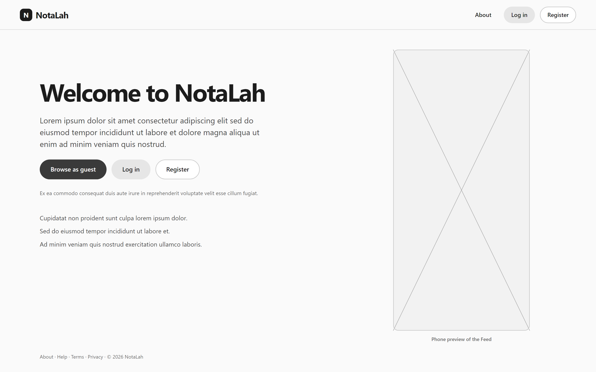

*Figure 4.x: Welcome page*

	The Welcome page is the first screen for a signed-out visitor. It states what NotaLah is in one heading and one sentence and offers three actions of equal reach: Browse as guest, Log in and Register. Browse as guest opens the public feed without an account (R31), while the other two open the dialogs for UC01 and UC02. The box on the right stands for a phone preview of the feed.

*Figure 4.x: Register dialog*

	Registration (UC01) opens as a dialog over the Welcome page, so the visitor keeps the context of the product. A Student or Lecturer switch sits at the top; the Lecturer state is shown because it adds a staff ID field, and lecturer features stay locked until an administrator approves the application (UC22). Programme is picked from a list rather than typed, which keeps profile values consistent for search.

*Figure 4.x: Log in dialog (error state)*

	The login dialog (UC02) is shown in its error state. One message under the password field says that the email or password is incorrect without saying which, so the form does not reveal which accounts exist. The password field has a Show control, accepts pasted input for password managers and is the same size as the email field. A link at the bottom switches to Register.

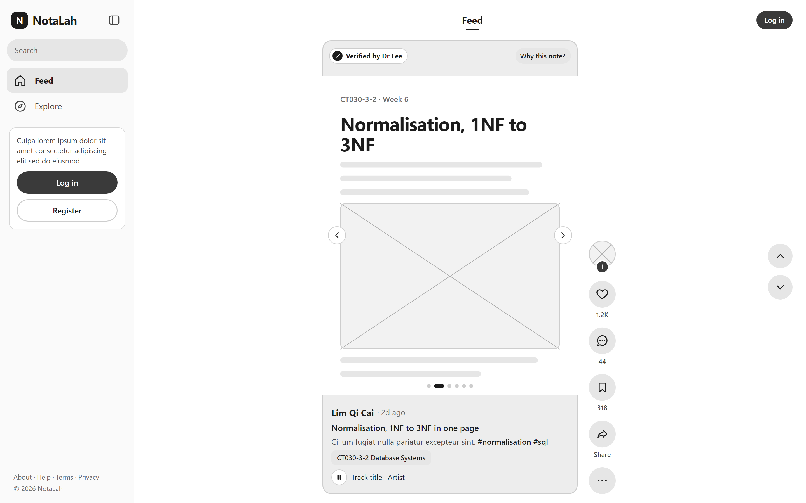

*Figure 4.x: Guest feed*

	The guest feed is the Feed as a signed-out visitor sees it (R31, UC09). Only public notes appear, the Following tab is absent and the navigation offers Feed and Explore with a Log in and Register box. The card, slide dots and action rail match the signed-in feed, so the layout does not change after login; tapping Like, Comment, Save or Follow asks the visitor to log in.

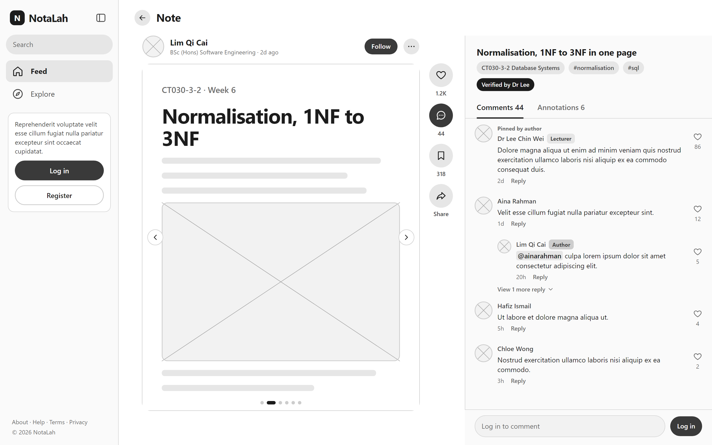

*Figure 4.x: Guest note view with comments*

	A guest can open a public note and read it with its comments (R31, UC11). The slide is on the left with the action rail beside it, and the right panel lists the title, module, hashtags, the verified badge and the comment thread with its pinned lecturer comment. The comment box is replaced by "Log in to comment" with a Log in button, so reading is open but writing needs an account.

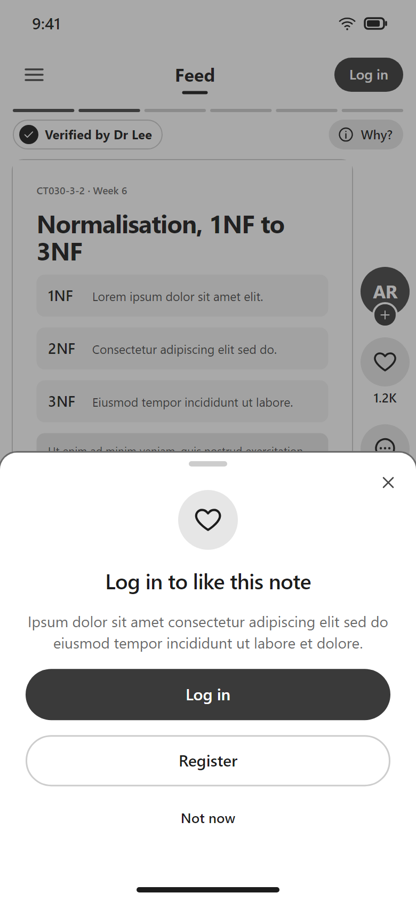

*Figure 4.x: Log in / Register sheet (mobile)*

	On the phone, a guest who taps Like is shown a bottom sheet instead of being sent to another page (R31, UC01, UC02, UC10). The sheet names the action that needs an account and offers Log in, Register and Not now. After logging in the visitor returns to the same note, so the action can be completed without searching for it again.

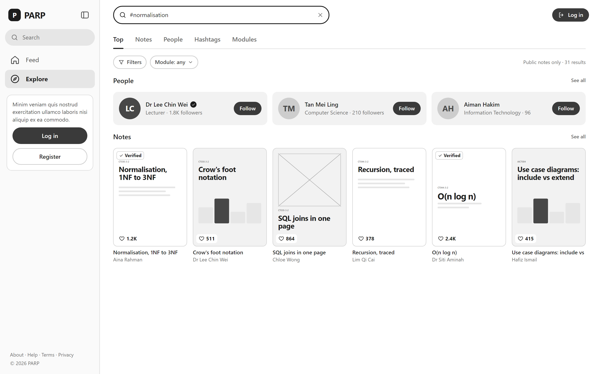

*Figure 4.x: Guest search results*

	Guests can search public content (R31, UC14, FR4). The results use the same tabs as the signed-in search (Top, Notes, People, Hashtags, Modules) and a short filter row, and the result count states that only public notes are included. People appear with Follow buttons and notes as tiles with like counts; any action on them opens the log in sheet.

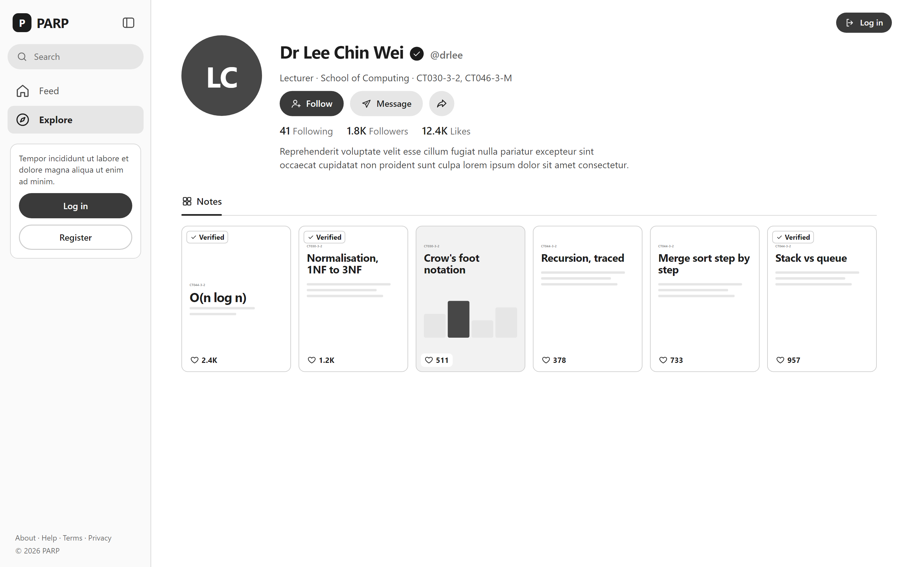

*Figure 4.x: Guest view of a public profile*

	A guest viewing a public profile sees the name, programme, counts and bio, and a grid of public notes only (R31, UC04). Follow and Message are visible so the visitor knows they exist, but both open the log in prompt. Friends-only notes are not listed, which keeps the visibility rules of FR10 the same for guests and signed-in non-friends.

## 4.4.2 Feed and note screens

	These screens cover the ranked feed, comments, annotations, the ranking explanation, saving, reporting and the lecturer Super Like (UC09 to UC13, UC19).

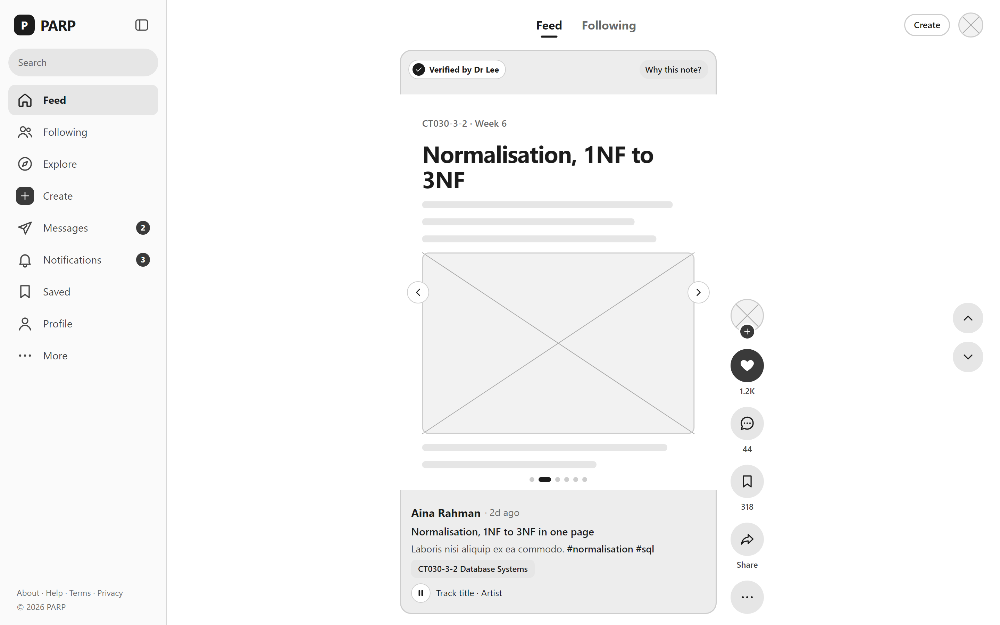

*Figure 4.x: Ranked feed (desktop)*

	The ranked Feed is the home screen after login (UC09, FR11). One note fills the centred card, with a dot indicator at the bottom of the slide, the "Verified by Dr Lee" badge (FR2) and a "Why this note?" button at the top. The caption gives author, title, hashtags, module and the background track (FR17), and the rail on the right holds Follow, Like, Comment, Save, Share and More.

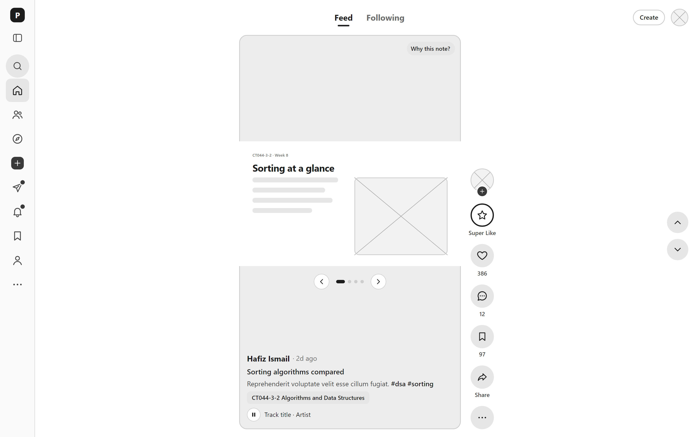

*Figure 4.x: Feed, collapsed nav, lecturer view*

	This screen shows the navigation collapsed to an icon rail and a widescreen 16:9 note letterboxed inside the vertical card, with arrows and the slide dots below it (UC09, FR1). It is the lecturer view, so the rail adds a Super Like control above Like (UC19). The collapsed rail keeps every destination one click away while giving the card more room.

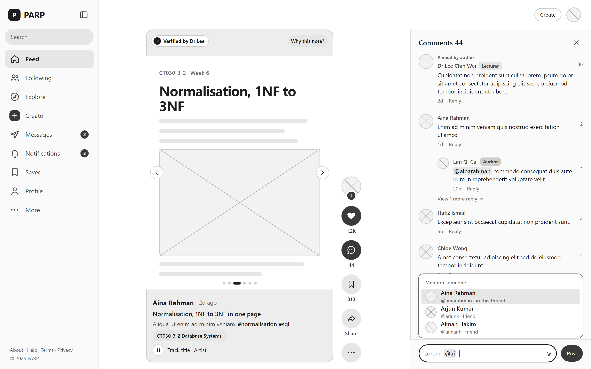

*Figure 4.x: Feed with comments panel*

	Comments open as a panel beside the note rather than on a new page, so the slide stays visible while reading (UC11, FR16). The lecturer's comment is pinned at the top, replies are one level deep with "View more replies", and typing @ in the comment box opens a picker of thread participants and friends. Each comment shows its age, a Reply link and a like count.

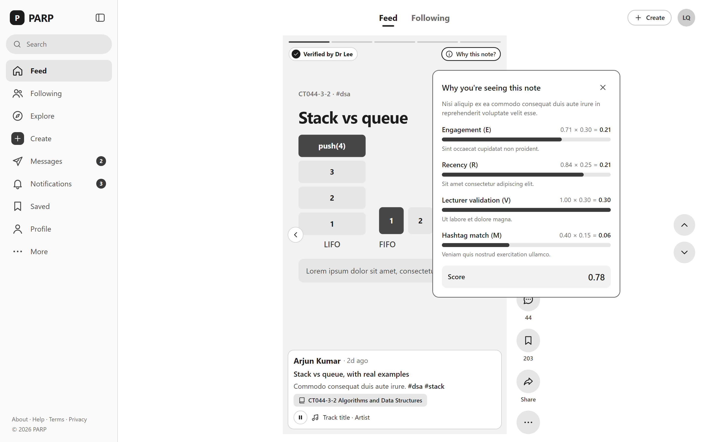

*Figure 4.x: "Why this note?" ranking panel*

	"Why this note?" opens a panel that explains the ranking for the note on screen (FR3, NFR5, UC09). It lists the four parts of the score (engagement, recency, lecturer validation and hashtag match), each with its value, weight and product, and the total at the bottom. This makes the deterministic heuristic visible to users and gives the tuning after UAT a screen to check against.

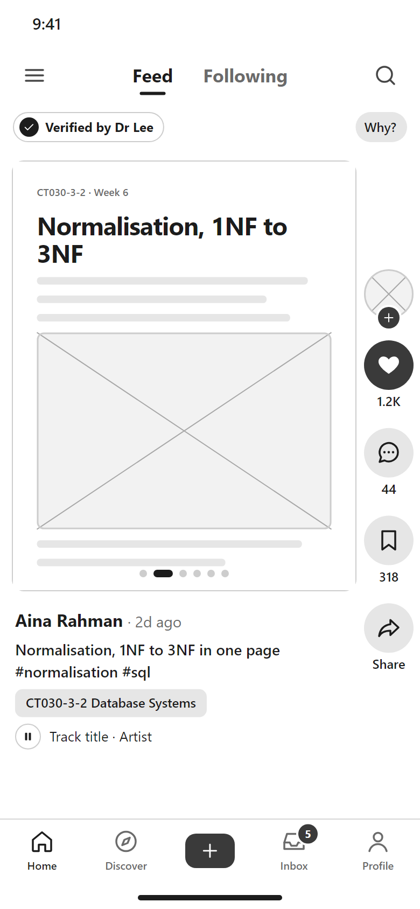

*Figure 4.x: Ranked feed (mobile)*

	The phone feed follows the TikTok mobile layout (UC09, FR11, NFR2). Feed and Following tabs sit at the top with menu and search, the verified badge and "Why?" sit above the slide, and the slide dots are at its bottom edge. The action rail floats on the right and the caption sits under the slide, with the tab bar for Home, Discover, Create, Inbox and Profile at the bottom.

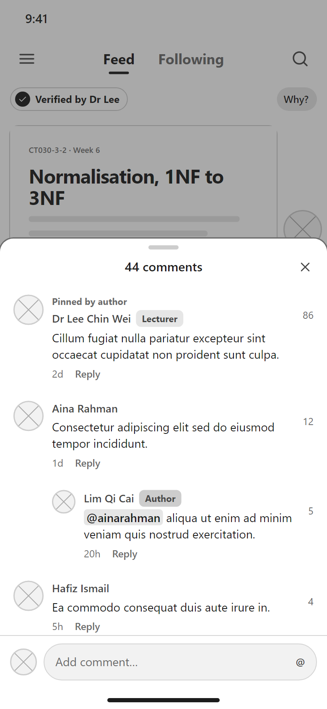

*Figure 4.x: Comments sheet (mobile)*

	On the phone, comments open as a bottom sheet over the note (UC11, FR16, NFR2). The sheet shows the comment count, the pinned lecturer comment, a reply thread and a comment field with an @ control at the bottom. Dismissing the sheet returns to the same note and slide, so reading comments does not lose the reader's place in the feed.

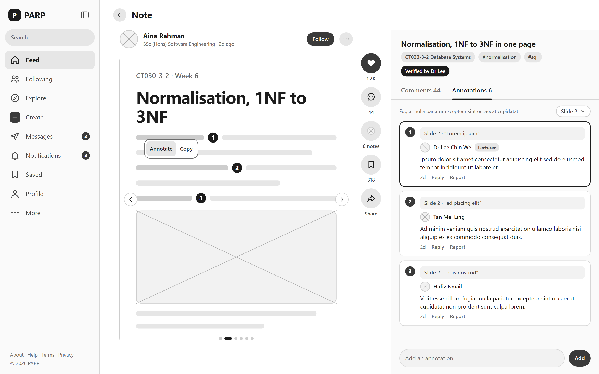

*Figure 4.x: Note detail with annotations*

	The note detail view is for reading a note closely with annotations (FR18, UC11). Selecting text on the slide shows an Annotate and Copy menu; each annotation is anchored to the selected text and numbered on the slide. The right panel lists the annotations for the current slide with the quoted text, author, body and Reply and Report links, and the slide dots show the position in the note.

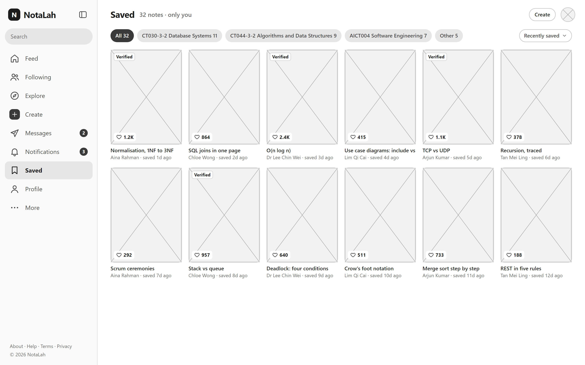

*Figure 4.x: Saved notes*

	Saved lists the notes the user has bookmarked, visible only to that user (UC13, FR14). Chips at the top group the saved notes by module with a count for each, and a sort menu orders them by when they were saved. Each tile shows the title, the author and how long ago it was saved, so a revision list can be built per module.

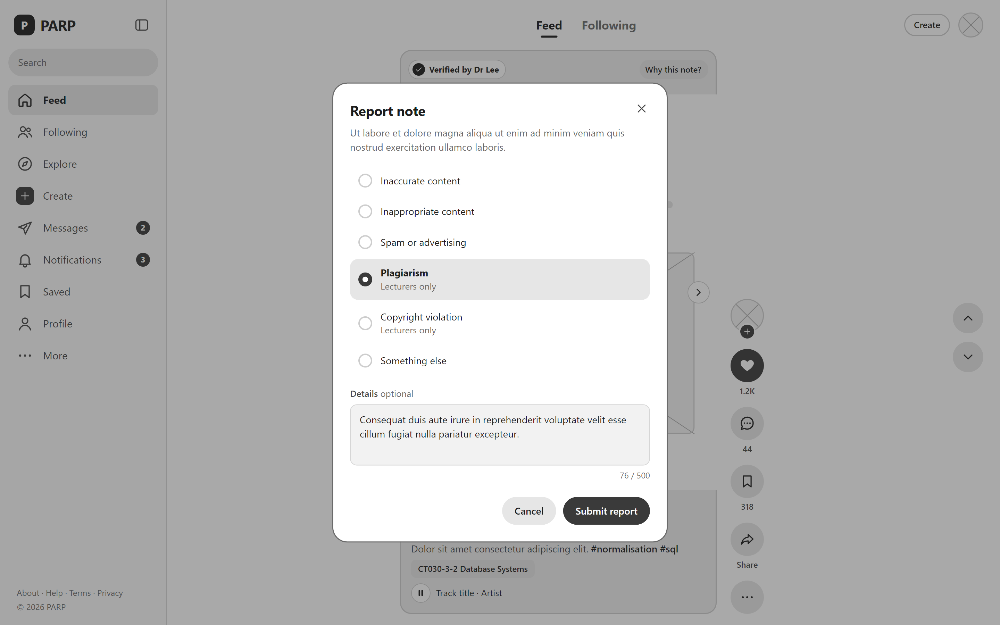

*Figure 4.x: Report note dialog*

	Reporting a note opens a dialog with a list of reasons and an optional details field with a character limit (UC12). Two reasons, plagiarism and copyright violation, are marked Lecturers only because they need subject knowledge to judge. The reporter stays anonymous to the author, and the report goes to the administrator queue shown in Figure [[52_admin-reports]].

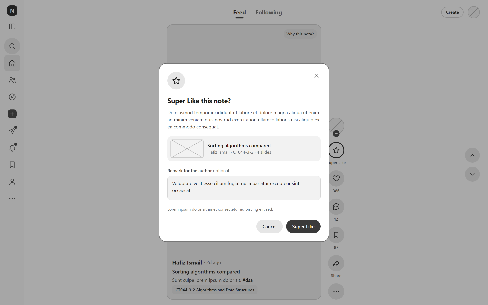

*Figure 4.x: Super Like (verify) dialog*

	A lecturer's Super Like is the validation signal used by the ranking (UC19, FR1, FR2, FR3). The confirmation dialog explains the effect, shows the note being verified and accepts an optional remark for the author that appears with the badge. A short help line notes how verification affects the note, and Super Like confirms the action.

## 4.4.3 Collaboration screens

	These screens cover co-authored notes, collaboration requests, sharing, the editing soft lock and re-verification after an edit (R30).

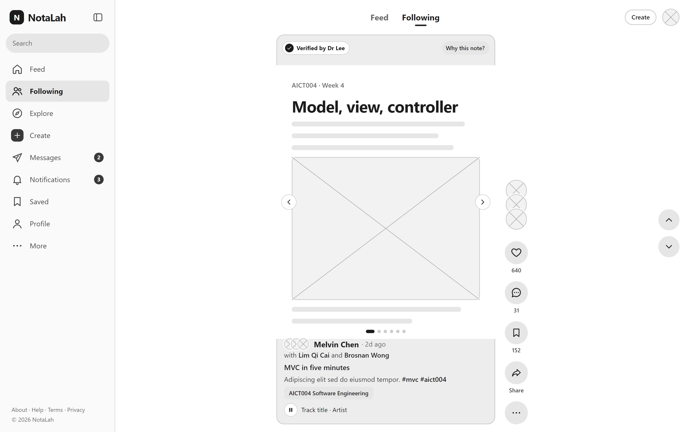

*Figure 4.x: Co-authored note card*

	A co-authored note credits its owner and co-authors on the card (R30, UC09). The caption names the owner, Melvin Chen, and adds "with Lim Qi Cai and Brosnan Wong", and the rail stacks the three avatars in place of the single follow avatar. The note appears in the Following feed of each co-author's followers, which is the tab shown here.

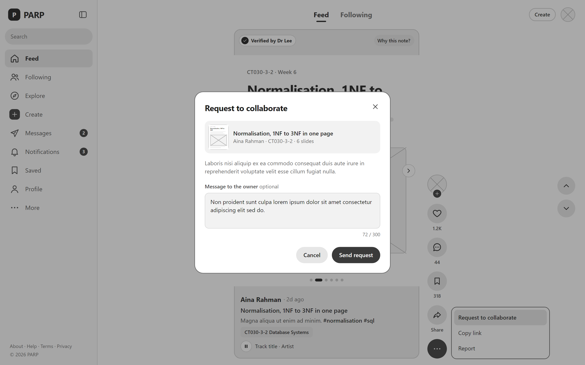

*Figure 4.x: Request to collaborate*

	Any viewer can ask to become a co-author from a note's More menu (R30). The menu offers Request to collaborate, Copy link and Report, and the request dialog shows the note being requested, a short explanation and an optional message to the owner with a character count. Sending the request creates a notification for the owner, who decides on it as shown in Figure [[44_collab-request-notification]].

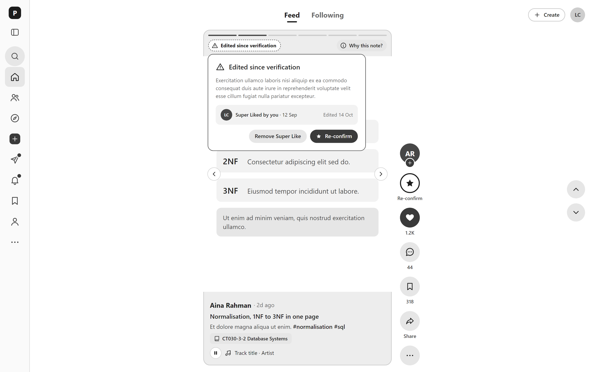

*Figure 4.x: "Edited since verification" state*

	When a verified note's content is edited, the badge changes to "Edited since verification" (R30, FR1, FR2, UC19). The lecturer who verified it sees a panel with the original Super Like date and the edit date, and can either Remove Super Like or Re-confirm. The rail's Super Like control reads Re-confirm until a decision is made, so an edit cannot silently keep a verification.

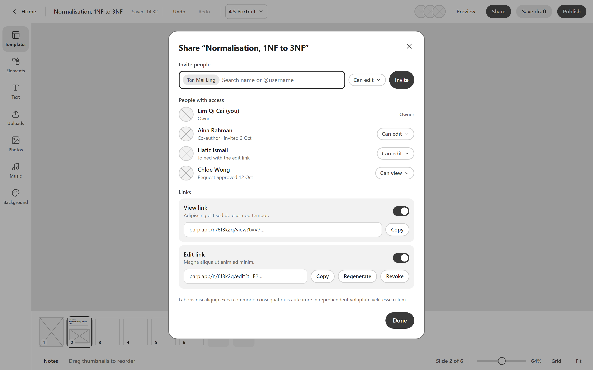

*Figure 4.x: Share dialog (owner)*

	The owner shares a note from the editor's Share button (R30, UC08). People are invited by name or username as viewers or editors, and the list of people with access shows each person's role and how they joined. The view link and edit link can each be turned on or off, copied, and for the edit link regenerated or revoked, so access can be withdrawn later.

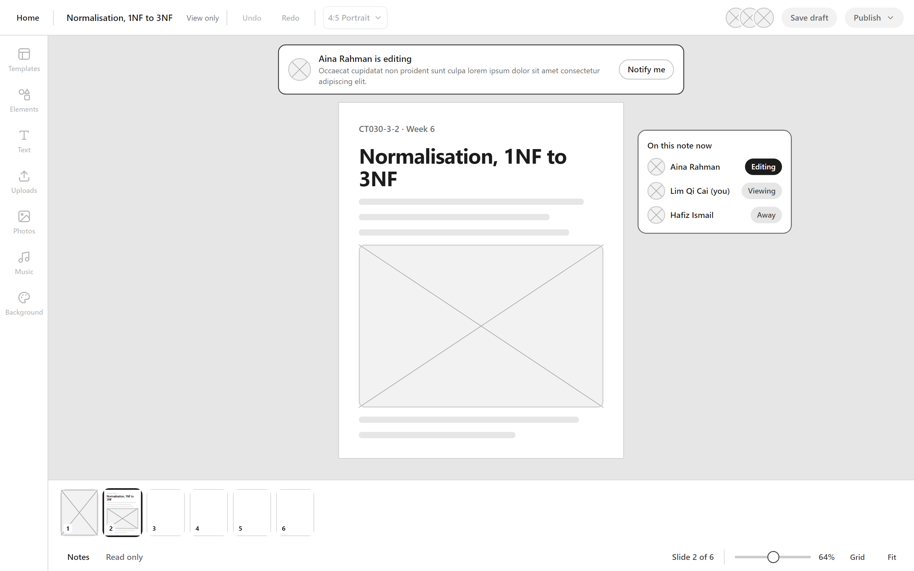

*Figure 4.x: Editor soft lock (co-author view)*

	When a co-author opens a note that someone else is editing, the editor is read-only (R30, UC08). A banner names the person editing and offers Notify me, the tools and slide size menu are dimmed, and a panel lists who is on the note now. Publish is dimmed with the tip "Only the owner can publish", because publishing and visibility stay with the owner.

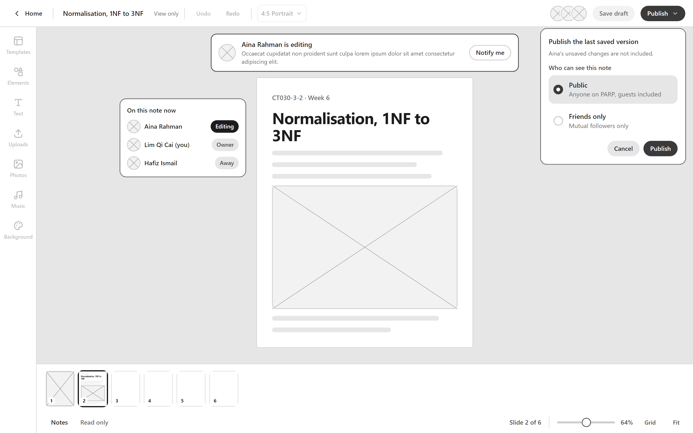

*Figure 4.x: Editor soft lock (owner publishes)*

	The owner sees the same soft lock when a co-author is editing, but Publish stays available (R30, UC07, FR10). Opening it shows a menu to publish the last saved version and choose who can see it, Public or Friends only, with a note that the co-author's unsaved changes are not included. This lets the owner publish without waiting for the editing session to end.

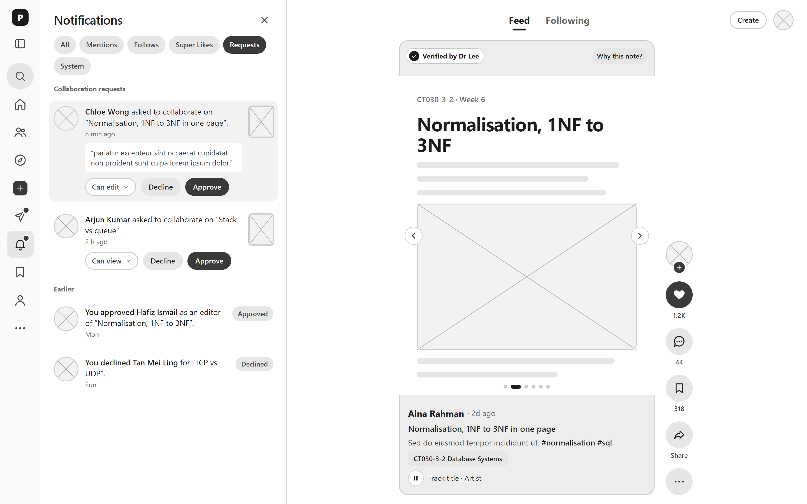

*Figure 4.x: Owner approves or declines a request*

	The Requests filter shows collaboration requests on the owner's notes (R30, R8). Each request names the requester and the note, quotes the optional message, and offers a role choice (Can edit or Can view) with Decline and Approve. Decisions already made stay below under Earlier with an Approved or Declined tag, so the owner keeps a record.

## 4.4.4 Slide editor screens

	These screens cover the Canva-style slide editor, publishing and drafts (UC05 to UC07, FR8, FR10, FR17).

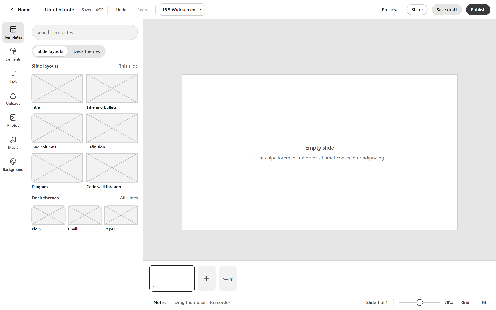

*Figure 4.x: Editor: templates on an empty note*

	The slide editor follows the Canva layout (UC05, FR8). The top bar holds Home, the note title, save status, undo and redo, the slide size menu, Preview, Share, Save draft and Publish. The left rail switches panels, and this screen shows Templates on an empty note: slide layouts for the current slide and deck themes for all slides, with the thumbnail strip and zoom below the workspace.

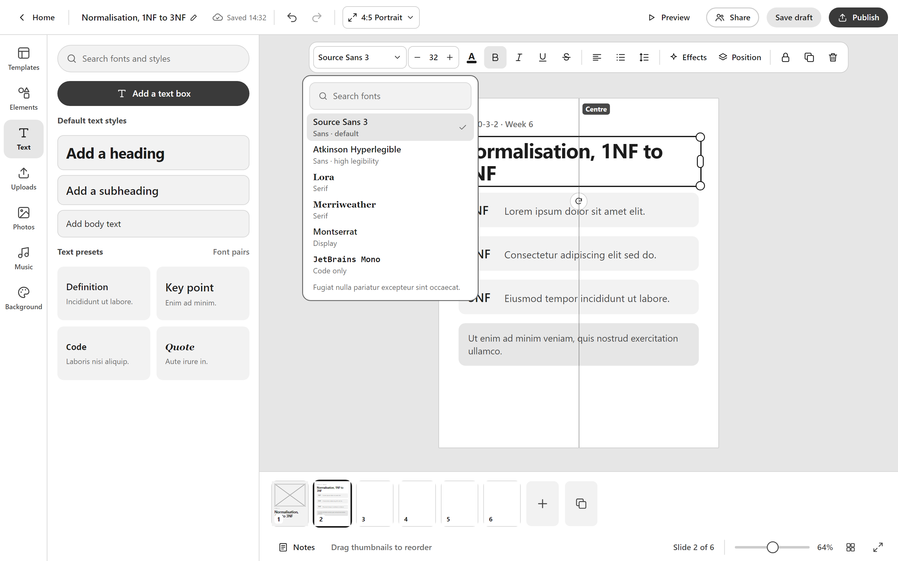

*Figure 4.x: Editor: text selected, curated fonts*

	This screen shows a text box selected on the slide, with resize handles, a rotate handle and a centre guide (UC05, FR8). A toolbar above the workspace holds font, size, colour, bold, italic, underline, strike, alignment, list, spacing, effects, position, lock, copy and delete. The font menu offers a short curated list, and the Text panel adds headings, body text and text presets.

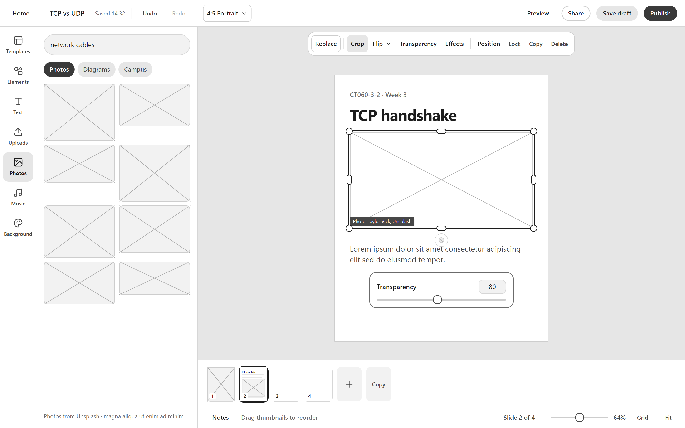

*Figure 4.x: Editor: photos and image tools*

	The Photos panel searches stock images and inserts them with an automatic credit line on the image (UC05, FR8). The selected image shows its handles and an image toolbar with Replace, Crop, Flip, Transparency, Effects, Position, Lock, Copy and Delete. The Transparency control is open as a slider with a value field, and the panel footer states where the photos come from.

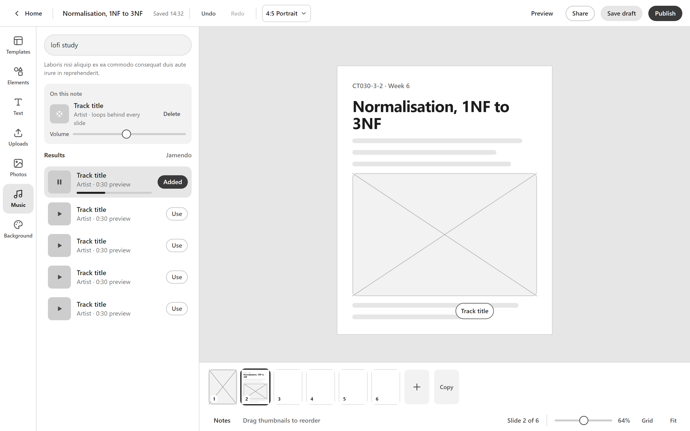

*Figure 4.x: Editor: background music*

	The Music panel lets the author attach one background track to the whole note (UC05, FR17). Search results list title, artist and a 30-second preview with Use or Added, and the track on the note has a volume slider and a delete control. A small player on the slide shows the current track; the catalogue source is shown next to the results heading.

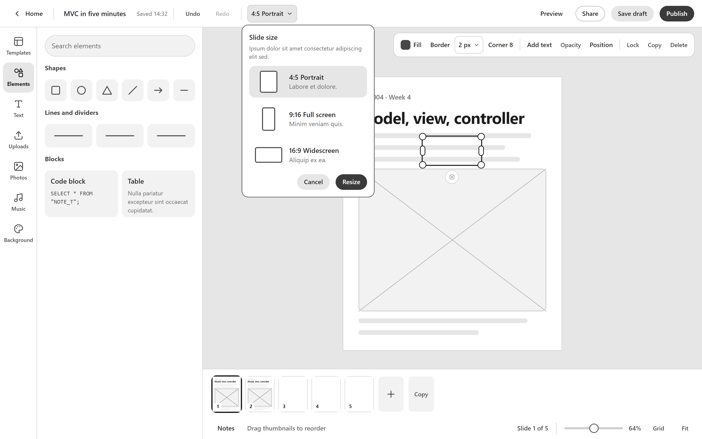

*Figure 4.x: Editor: elements, shapes and slide size*

	The Elements panel adds shapes, lines, a code block and a table to a slide (UC05, FR8). A selected shape gets a toolbar for fill, border, border width, corner radius, text, opacity, position, lock, copy and delete. The slide size menu is open from the top bar and offers 4:5 portrait, 9:16 full screen and 16:9 widescreen with Cancel and Resize.

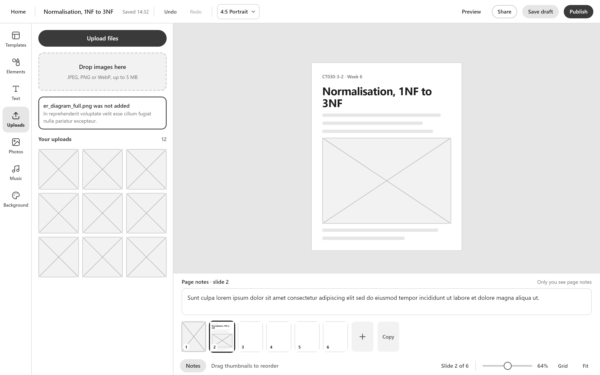

*Figure 4.x: Editor: uploads and page notes*

	The Uploads panel holds the author's own images, with an Upload button and a drop area that states the accepted types and the 5 MB limit (UC05, FR8). An oversized file is shown as an inline error naming the file, so the author knows why it was not added. Page notes are open under the slide; they are private to the author and do not appear when the note is published.

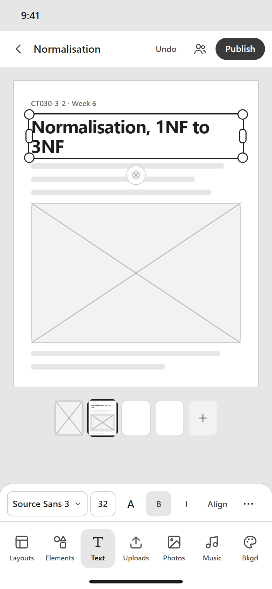

*Figure 4.x: Slide editor (mobile)*

	The phone editor puts the slide first and moves the tools into a bottom tray (UC05, FR8, NFR2). The top bar keeps back, title, undo, share and Publish; the slide thumbnails sit under the slide with an add button. With a text box selected, a compact formatting row appears above the tool rail of Layouts, Elements, Text, Uploads, Photos, Music and Background.

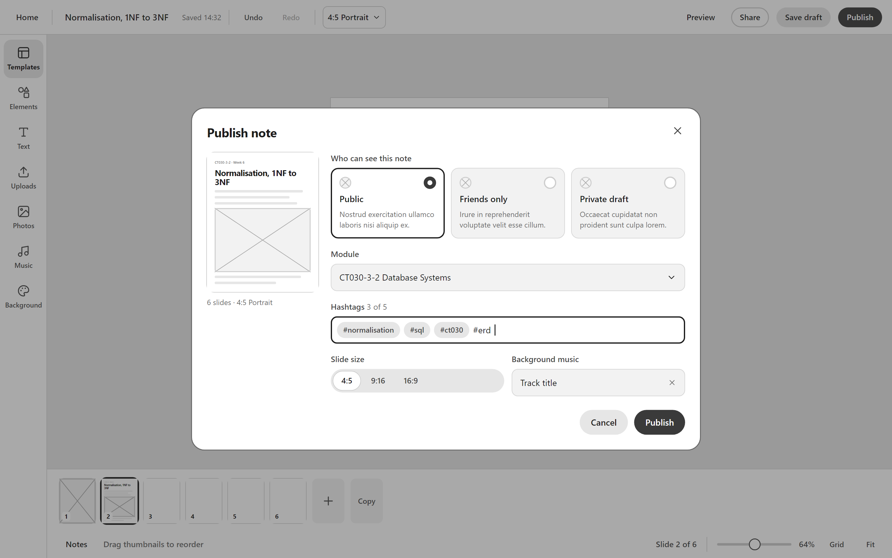

*Figure 4.x: Publish dialog*

	Publishing opens a dialog over the editor (UC07, FR10). Visibility is chosen first from three cards of equal weight (Public, Friends only and Private draft), followed by the module, up to five hashtags, the slide size and the background music. A thumbnail of the first slide with the slide count sits on the left, and Publish confirms the choice.

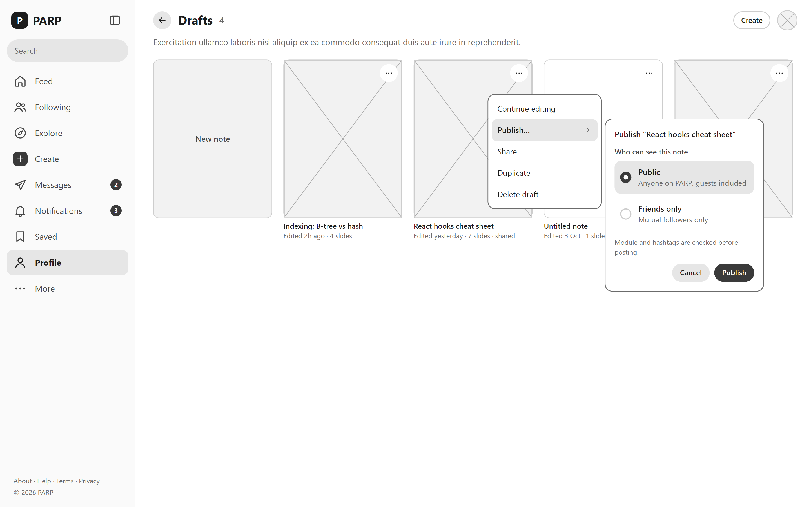

*Figure 4.x: Drafts*

	Drafts lists the user's unpublished notes as a grid with a New note tile first (UC06). Each draft shows its title, last edit and slide count, and its menu offers Continue editing, Publish, Share, Duplicate and Delete draft (UC07, UC08). Publish opens a small panel to choose Public or Friends only, so a finished draft can be posted without reopening the editor.

## 4.4.5 Profile and blocking screens

	These screens cover own and other users' profiles, profile editing and blocking (UC04, UC17).

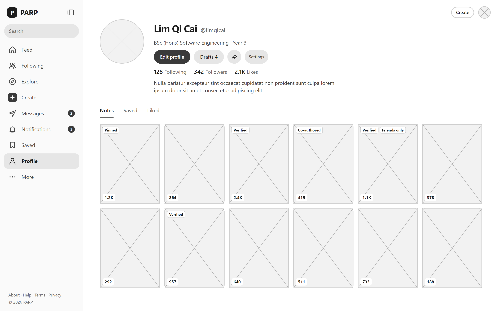

*Figure 4.x: My profile*

	The user's own profile shows the name, username, programme, counts and bio, with Edit profile, Drafts, Share and Settings (UC04). The tabs switch between the user's notes, saved notes and liked notes. Tiles carry small labels for Pinned, Verified, Friends only and Co-authored, so the visibility and status of each note can be read from the grid.

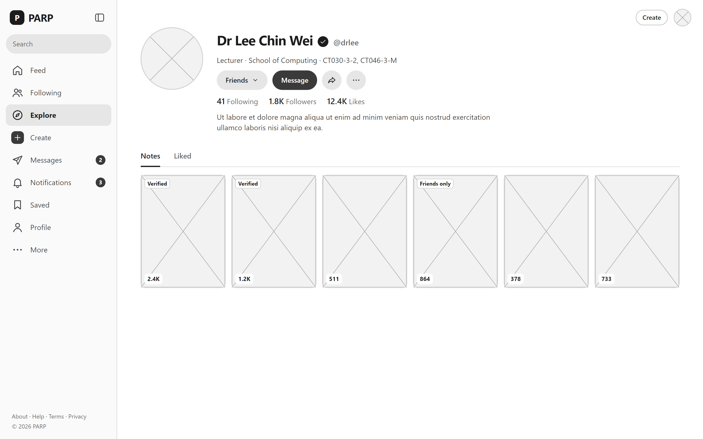

*Figure 4.x: Another user's profile (friends)*

	Another user's profile is shown in the Friends state, which applies when both users follow each other (UC04, UC17). The button reads Friends with a menu, next to Message, Share and More. Because the viewer is a friend, the grid includes a note labelled Friends only that other users cannot see, which shows the FR10 visibility rule on a profile.

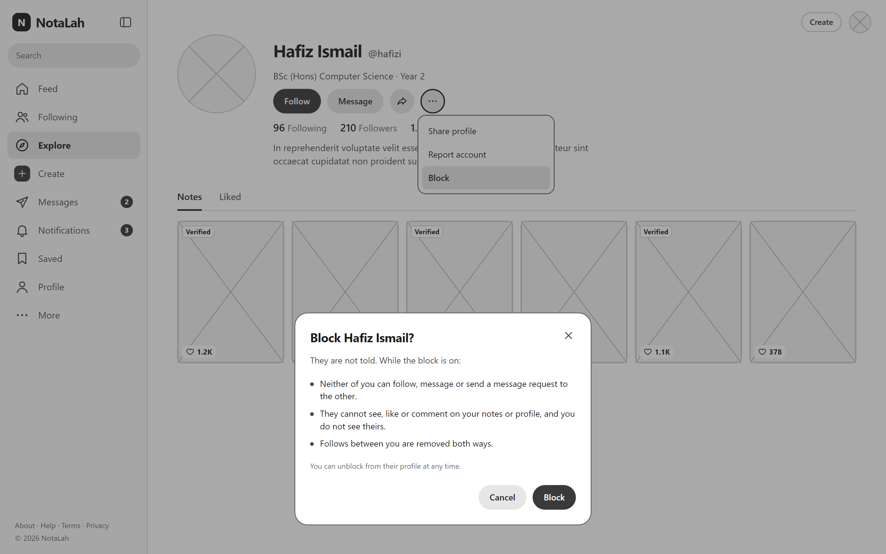

*Figure 4.x: Block a user (More menu and confirm)*

	Blocking starts from a profile's More menu, which also offers Share profile and Report account (Sprint 4 blocking, UC04). Choosing Block opens a confirmation that lists its effects: neither user can follow, message or send a message request to the other, the blocked user cannot see, like or comment on the blocker's notes, and follows are removed both ways.

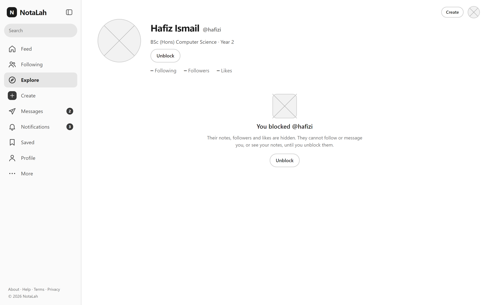

*Figure 4.x: Blocked profile state*

	After blocking, the profile shows the name and programme but hides the counts, bio and notes (Sprint 4 blocking, UC04). A short message explains what the block does and an Unblock button is shown at the top and in the message. Follow and Message are removed, matching the server rule that a blocked pair cannot interact.

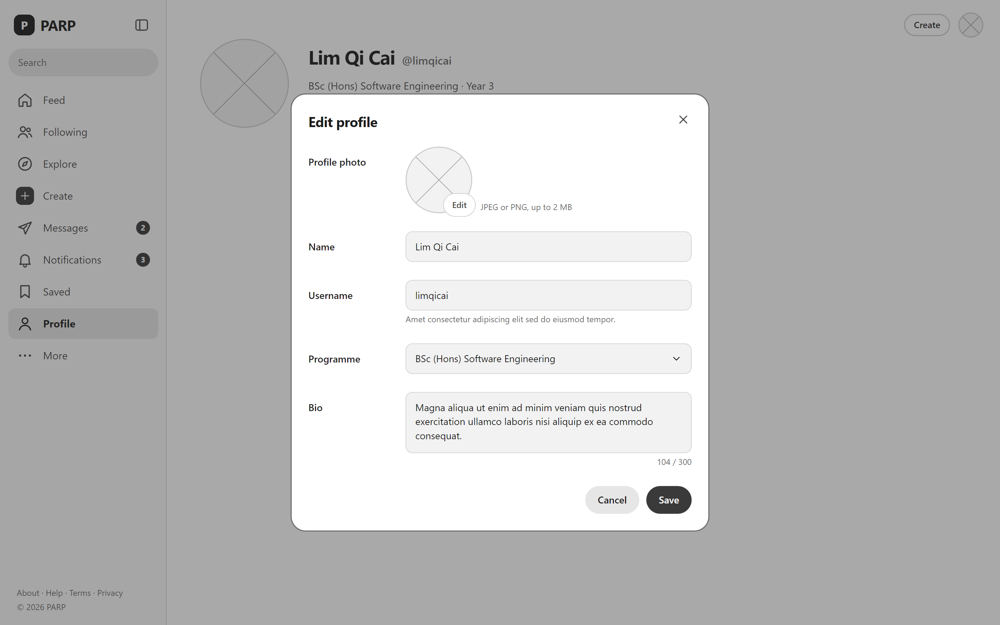

*Figure 4.x: Edit profile dialog*

	Edit profile is a single dialog over the user's profile (UC04). It holds the profile photo with an edit control and its size limit, the display name, the username with a rule about allowed characters, the programme picked from a list and a bio with a character count. Cancel and Save sit at the bottom, and the profile behind shows where the changes will appear.

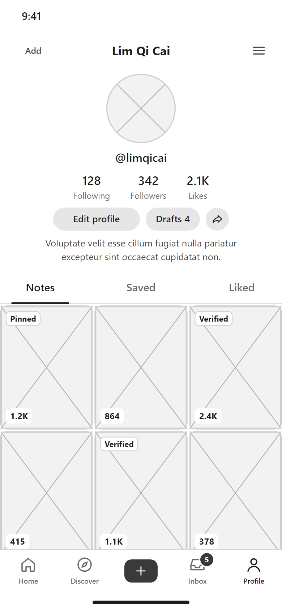

*Figure 4.x: Profile (mobile)*

	The phone profile stacks the photo, username and counts in the centre, with Edit profile, Drafts and Share below (UC04, NFR2). Notes, Saved and Liked tabs switch the grid, which shows three notes per row with the same Pinned and Verified labels as the desktop. The tab bar stays at the bottom with Profile selected.

## 4.4.6 Search screens

	These screens cover search results and filters on desktop and phone (UC14, FR4, FR5, FR12, FR15).

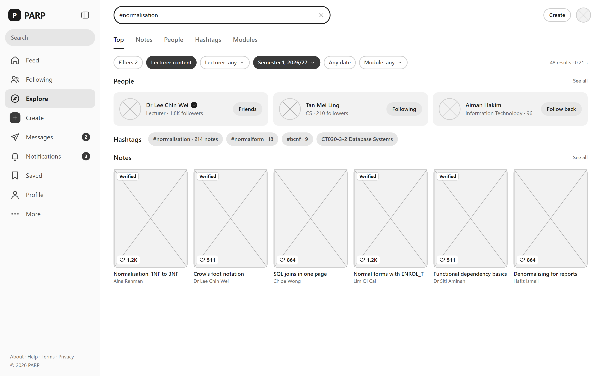

*Figure 4.x: Search results (Top)*

	Search results open on the Top tab, which mixes people, hashtags, modules and notes for the query (UC14, FR4, FR5, FR12). The filter row under the tabs shows the active filters as chips with the result count and the time taken, which supports the response time requirement. People show their relationship to the user, such as Friends, Following or Follow back.

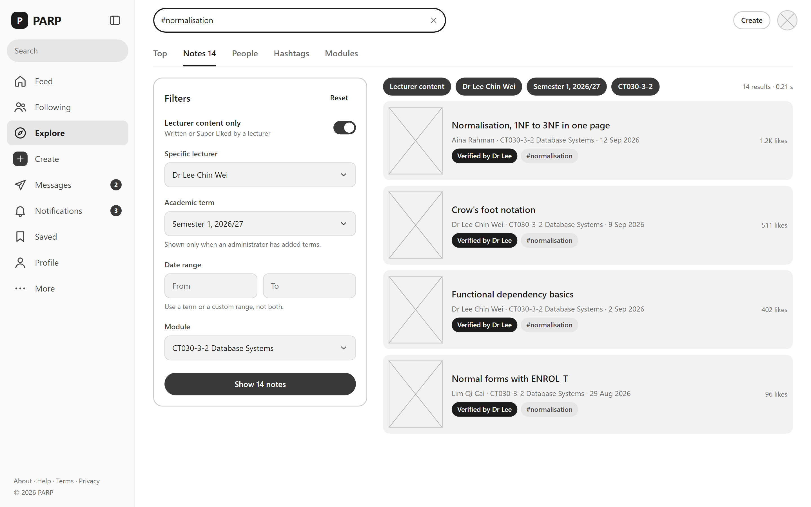

*Figure 4.x: Search filters*

	The filter panel sits beside the results on the Notes tab (UC14, FR15). It offers a Lecturer content only switch, a specific lecturer, an academic term, a custom date range and a module, with Reset and Show results. The academic term field is shown only when an administrator has added terms, and a help line says to use a term or a date range, not both.

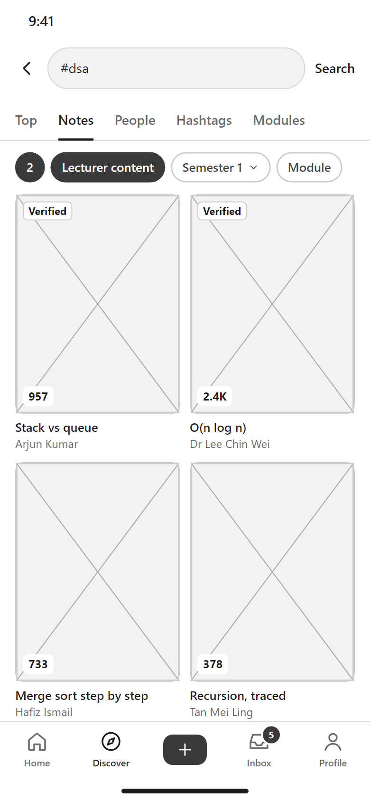

*Figure 4.x: Search (mobile)*

	Phone search keeps the query field and Search button at the top and the result tabs below it (UC14, NFR2). Active filters are shown as a row of chips, with the number of filters in the first chip, and the results are a two-column grid of note tiles with title, author and like count. The tab bar stays visible with Discover selected.

## 4.4.7 Notification and messaging screens

	These screens cover notifications, the phone inbox and post-anchored messaging, including requests and groups (UC15 to UC18, R8).

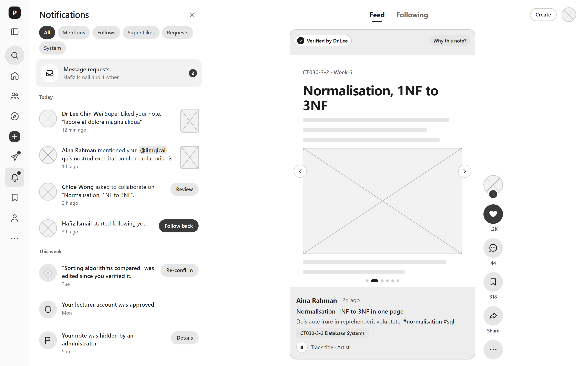

*Figure 4.x: Notifications drawer*

	Notifications open as a drawer beside the collapsed navigation, with filter chips for All, Mentions, Follows, Super Likes, Requests and System (UC16, UC19, UC20, UC22, R8). Items are grouped by Today and This week and include Super Likes, mentions, collaboration requests, follows, an "edited since verification" alert with Re-confirm, lecturer approval and a hidden note notice. Message requests have their own entry at the top.

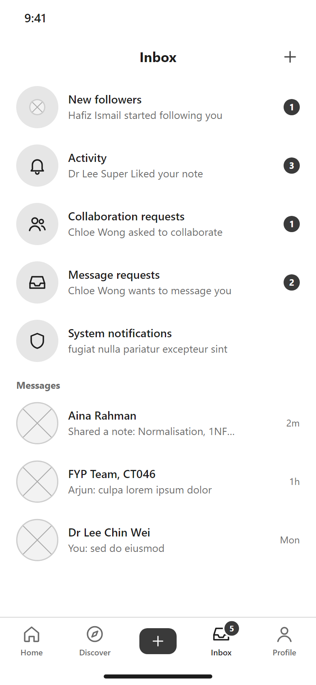

*Figure 4.x: Inbox (mobile)*

	The phone inbox combines notification groups and chats in one list (UC15, UC16, UC17, R30). The top rows are New followers, Activity, Collaboration requests, Message requests and System notifications, each with an unread count. Conversations follow under Messages with the last message and its time, and the Inbox tab shows the total unread badge.

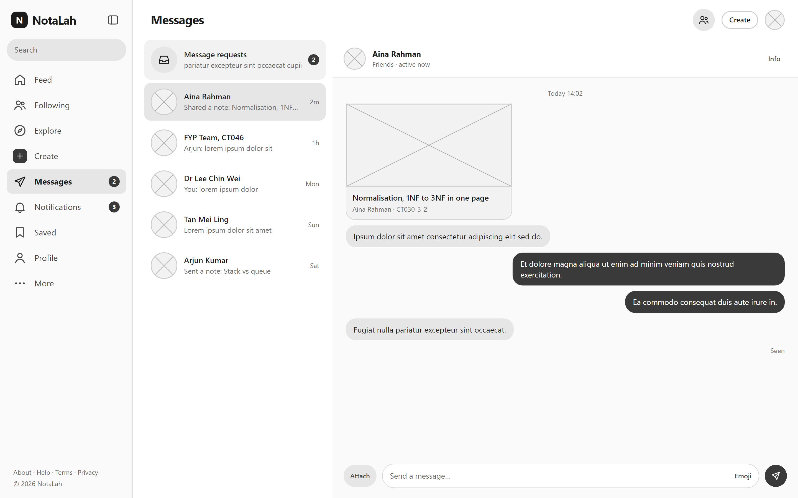

*Figure 4.x: Post-anchored chat*

	Messaging on the desktop uses a conversation list and a chat pane (UC15, UC17, FR7, FR9). The list starts with Message requests and then shows chats with their last message. This chat began from a shared note card, which carries the note title and author, and the header shows the friend status and activity. A Seen label marks the last message the other person has read.

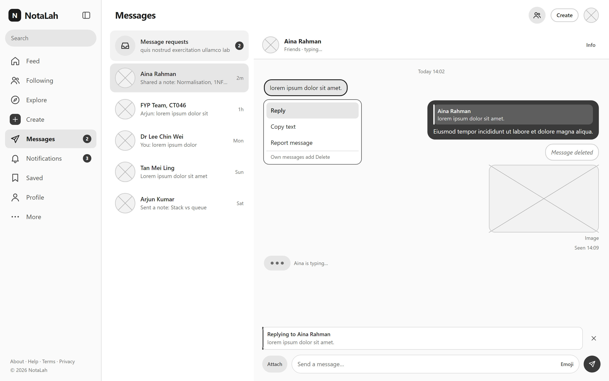

*Figure 4.x: Chat: reply, delete, Seen, typing, image*

	This screen shows the Sprint 4 chat details in one conversation (UC15, FR6, FR7). Selecting a message opens a menu with Reply, Copy text and Report, and Delete is added for one's own messages. The pane shows a quoted reply, a "Message deleted" placeholder, an image message, the Seen time, a typing indicator, and a reply bar above the input that can be cancelled.

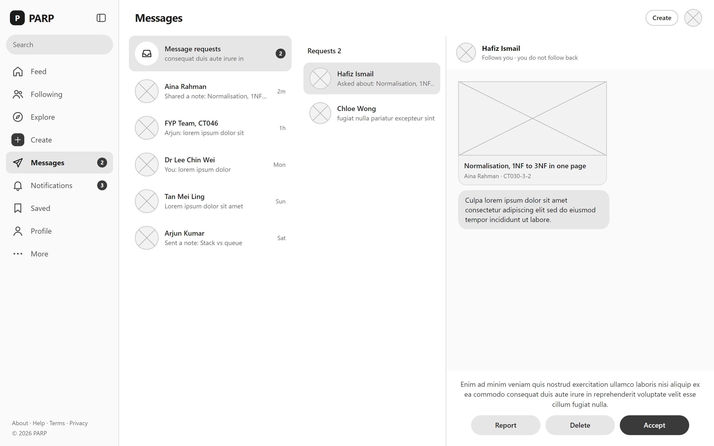

*Figure 4.x: Message request (recipient)*

	A first message from someone who is not a friend waits as a request (UC16, FR6). The requests column lists pending senders, and the open request shows the sender's relationship to the user, the shared note card and the message. The user can Report, Delete or Accept; accepting opens the chat without a follow.

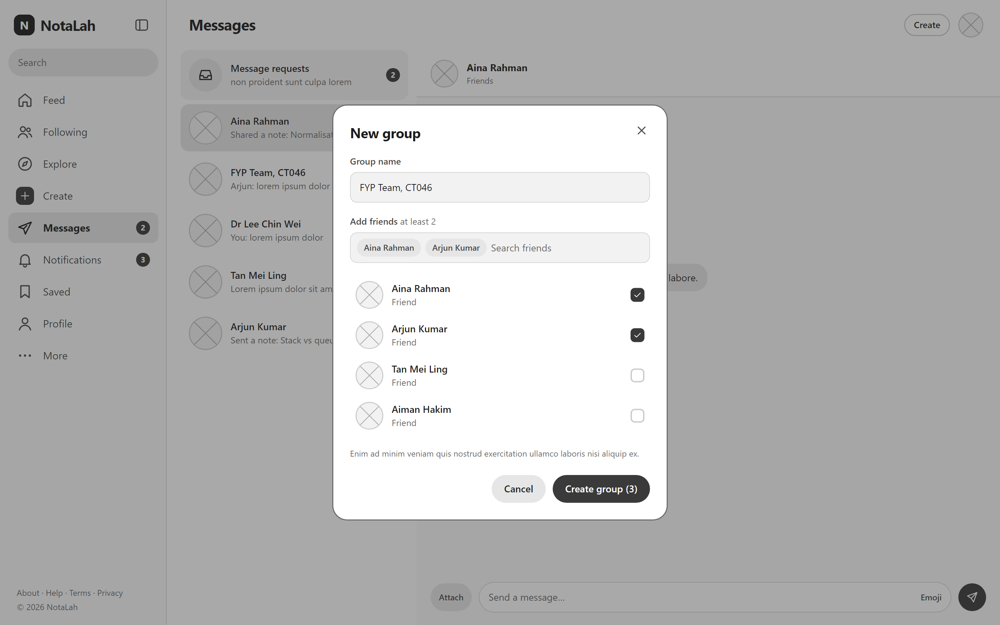

*Figure 4.x: New group dialog*

	A group is created from a dialog over the messages screen (UC18, FR13). The user enters a group name and picks at least two friends from a list with checkboxes; picked friends also appear as chips in the search field. The create button shows the member count, and a help line states the group size limit.

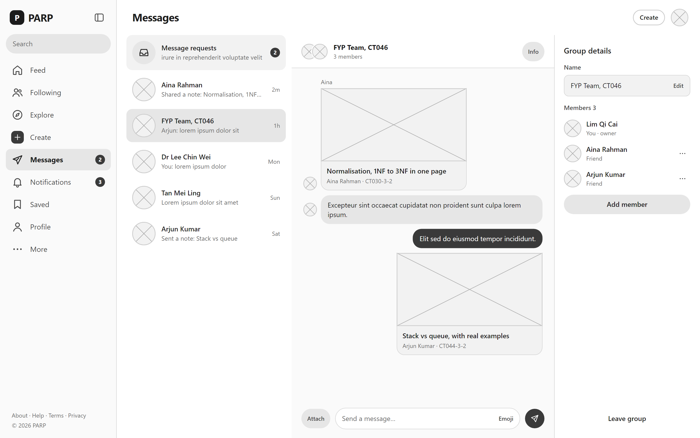

*Figure 4.x: Group chat with details*

	A group conversation shows each sender's name and avatar above their messages, and shared notes appear as cards in the thread (UC18, FR13). The details panel on the right lets members rename the group, see the member list with roles, add their own friends and leave the group. The creator can also remove members from each member's menu.

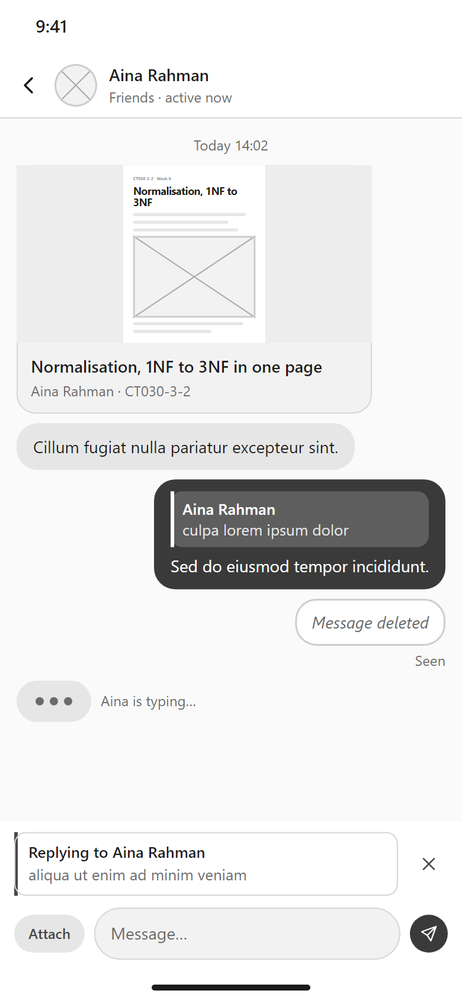

*Figure 4.x: Chat (mobile)*

	The phone chat shows the shared note card, messages, a quoted reply, a deleted message, the Seen label and the typing indicator (UC15, UC17, NFR2). The input bar is pinned to the bottom with Attach and Send, and when replying, a bar above it names the message being answered with a close control. The header shows the friend status and activity.

## 4.4.8 Administration screens

	These screens cover moderation, user management, lecturer approval, the module catalogue and academic terms (UC20 to UC22, FR15).

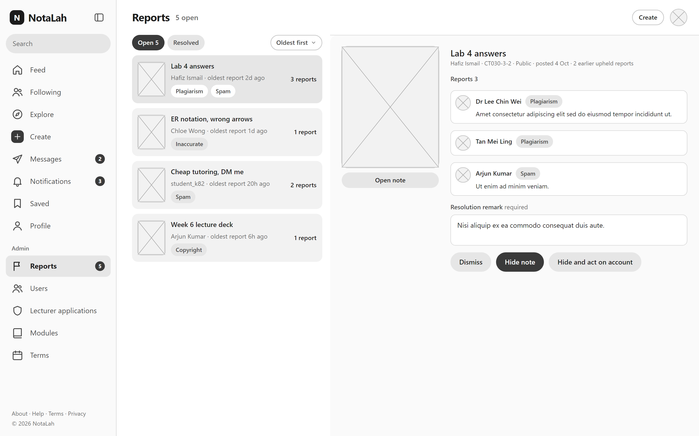

*Figure 4.x: Admin: report queue*

	The report queue lists reported notes with their report count, reasons and the age of the oldest report (UC20). The selected note opens in a detail pane with each report and its reporter, the author's earlier upheld reports and a required resolution remark. The administrator can Dismiss, Hide note, or Hide and act on the account, which leads to the user screen.

*Figure 4.x: Admin: users and suspension*

	The users table lists name, email, role, status, upheld reports and join date, with search and filters for students, lecturers and suspended accounts (UC21). The dialog shown suspends a user: the administrator picks Restrict posting, Suspend or Delete account and must give a reason before confirming. The upheld report count helps decide which action is proportionate.

*Figure 4.x: Admin: lecturer applications*

	Lecturer applications are reviewed one card at a time with the applicant's name, email, staff ID and school (UC22). Approve unlocks lecturer features such as Super Like. Reject opens a field for the reason, which is required and sent to the applicant, with Cancel and Reject application before the decision is saved.

*Figure 4.x: Admin: module catalogue*

	The module catalogue lets the administrator add a module by code and name and rename existing ones inline (UC21, R4, R5). The table shows each module's code, name and number of notes, with a Rename action per row. Renaming keeps every note linked to the module, so filing and module search are not broken by a title change.

*Figure 4.x: Admin: academic terms*

	The Terms page manages the academic terms used by the search term filter (FR15, Sprint 4). The form adds a term with a name, a start date and an end date, and the table lists existing terms with their dates, the number of notes in each term and Edit and Delete actions. A line at the top states that the end date must come after the start date.

*Figure 4.x: Admin: terms, empty state*

	This is the Terms page before any term exists (FR15, Sprint 4). The add form is shown at the top so the first term can be entered straight away, and the empty state explains that the Academic term filter appears in search only once a term exists. Until then users filter by a custom date range, which matches the conditional field in Figure [[38_search-filters]].
