# 4.4 Interface Design

	The wireframes below were produced before implementation to fix the layout and navigation of PARP. They are kept greyscale and at low to mid fidelity, with a single dark grey reserved for primary actions, so that review concentrates on content, hierarchy and flow rather than visual styling. The layout deliberately follows the conventions of TikTok on the web and on phones, because the target users already know where the feed, the action buttons, the comments and the inbox sit in that application; the slide editor follows the layout of Canva for the same reason. Thirty-three screens use a desktop frame of 1440 by 900 pixels with a left navigation column that can be collapsed to an icon rail, and seven screens show the mobile layout at 390 by 844 pixels for the screens most affected by NFR2. Every desktop screen shares the same shell, spacing scale, icon set and component shapes, and every screen is traceable to the use cases in Section 4.2.2. All wireframes are generated from a single source file (`docs/chapter4/wireframes/build.mjs`), so that a change agreed with the supervisor is applied consistently across every screen.

## 4.4.1 Account screens

### 4.4.1.1 Landing page

*Figure 4.x: Landing page*

	The landing page is the only screen a guest sees before authenticating. A short headline and one supporting sentence explain the product, and a phone frame on the right shows the real mobile feed so that the vertical, swipe-based format is understood before sign-up. Three lines below the buttons state the benefits that the survey supported most strongly: lecturer-verified notes, filing by module code and messaging about a specific note. The two calls to action lead to the registration and login dialogs.

### 4.4.1.2 Registration

*Figure 4.x: Registration dialog*

	Registration (UC01) opens as a dialog over the landing page, as sign-up does on TikTok, so the user never loses the context of the product. A segmented control at the top selects Student or Lecturer; the lecturer state is shown because it adds the staff ID field and a note that lecturer features unlock only after administrator approval (UC22). The programme is chosen from a list drawn from the module catalogue rather than typed, which keeps the values consistent for profile search.

### 4.4.1.3 Login

*Figure 4.x: Login dialog*

	The login dialog (UC02) is shown in its error state. A single message below the password field states that the email or password is incorrect without revealing which of the two was wrong, so the form does not disclose which accounts exist. The password field has a show control and accepts pasted input, which supports password managers. A link at the bottom switches to the registration dialog.

## 4.4.2 Feed and note screens

### 4.4.2.1 Ranked feed, desktop

*Figure 4.x: Ranked feed (desktop)*

	The For You feed (UC09) is the home screen after login. One note fills a centred vertical card, and the action rail to its right carries the author's avatar with a follow badge, Like, Comment, Save and Share with their counts, matching the TikTok desktop layout. A segmented bar at the top of the card shows the position within the note's slides, the "Verified by Dr Lee" badge marks a lecturer-validated note (FR2), and the caption at the bottom-left gives the author, title, hashtags, module and the background track with a pause control (FR17). The arrows at the far right move to the previous or next note, and the For You and Following tabs sit above the card.

### 4.4.2.2 Feed with collapsed navigation and widescreen slide

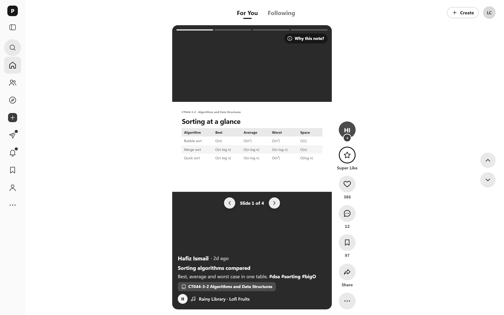

*Figure 4.x: Feed with collapsed navigation (lecturer view)*

	This screen shows the navigation collapsed to an icon rail with the toggle beside the logo, which gives the feed more width without losing any destination. It is drawn from a lecturer's account, so the rail includes the Super Like control above Like (UC19). The note uses the 16:9 slide size, which is letterboxed inside the card with the slide counter and arrows placed below it, demonstrating how one card shape holds all three slide sizes that authors can choose.

### 4.4.2.3 Feed with comments panel

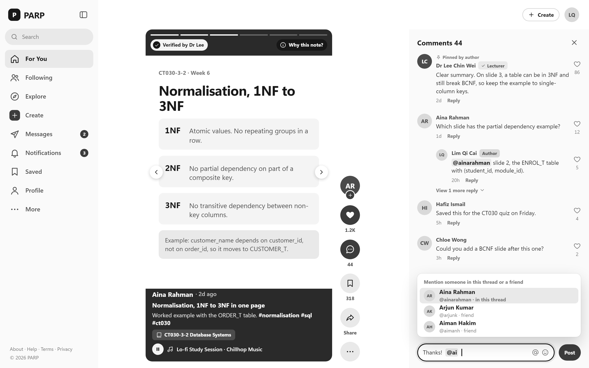

*Figure 4.x: Feed with comments panel*

	Selecting Comment opens a panel on the right while the note stays visible, as on TikTok desktop (UC11). The lecturer's comment is pinned at the top with its badge, and replies are indented one level beneath their parent comment (FR16). The input is fixed to the bottom of the panel; typing "@" opens a list of people who can be mentioned, limited to participants in the thread and the user's friends, and the mentioned user receives a notification.

### 4.4.2.4 Ranking explanation

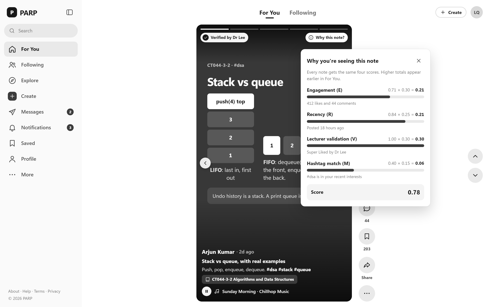

*Figure 4.x: "Why this note?" panel*

	The "Why this note?" control on every card opens a breakdown of the ranking score, so the heuristic is explained through its effect on the note in front of the user. Each of the four components, engagement (E), recency (R), lecturer validation (V) and hashtag match (M), is shown as a bar with its value, weight and a plain reason such as "Super Liked by Dr Lee". The weights are read from the ranking configuration, so the panel stays correct when they are re-tuned under NFR5. The note behind the panel uses the 9:16 slide size, which fills the card.

### 4.4.2.5 Ranked feed, mobile

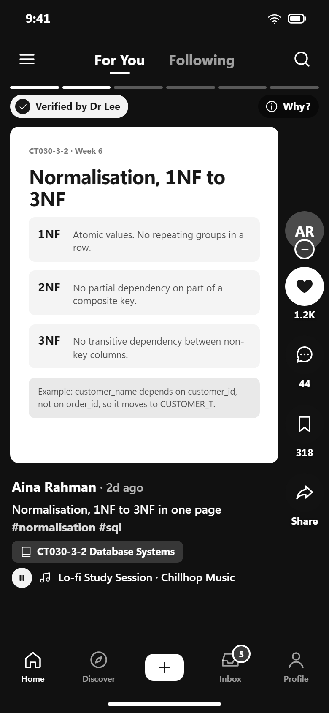

*Figure 4.x: Ranked feed (mobile)*

	The mobile feed follows TikTok's phone layout for a 390-pixel screen (NFR2). The top bar holds the menu, the For You and Following tabs and search; the action rail floats on the right; the caption sits below the slide; and a bottom tab bar gives Home, Discover, Create, Inbox and Profile. A vertical swipe moves to the next note and a horizontal swipe moves to the next slide, with the segmented bar showing the current slide.

### 4.4.2.6 Comments sheet, mobile

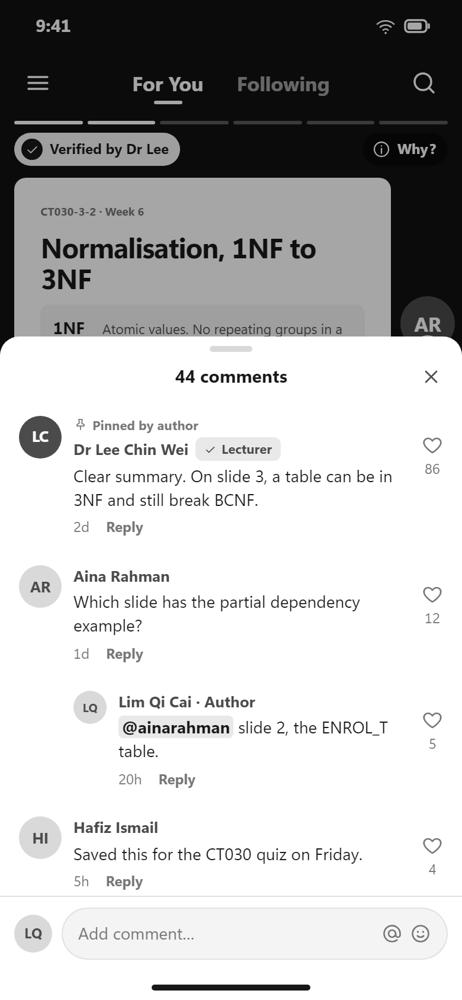

*Figure 4.x: Comments sheet (mobile)*

	On a phone, comments open as a bottom sheet over the dimmed note instead of a side panel, which keeps the thumb close to the list and the input. The sheet carries the same content as the desktop panel: the pinned lecturer comment, one level of replies and the @mention control in the input bar. Dragging the handle down or tapping the close button returns to the feed at the same note.

### 4.4.2.7 Note detail with annotations

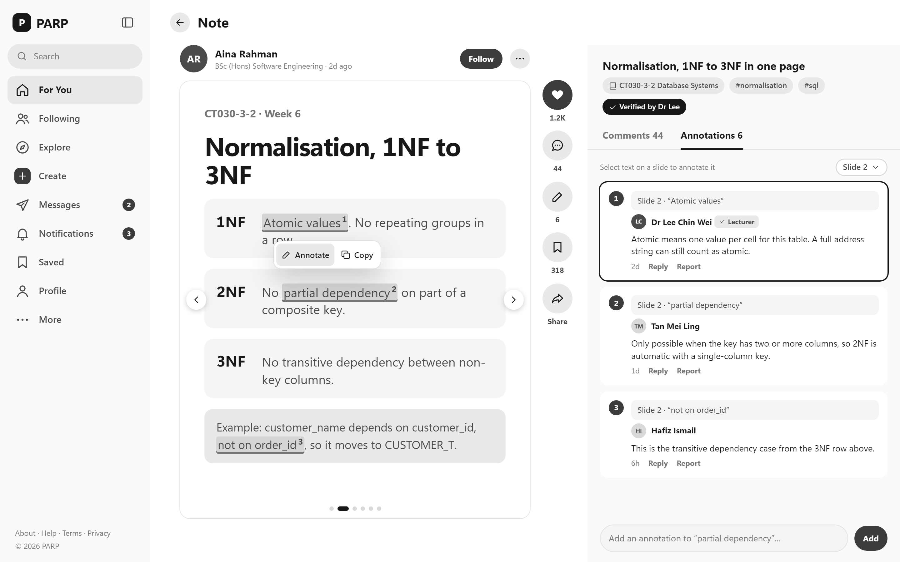

*Figure 4.x: Note detail with annotations*

	Opening a note directly shows the slide at reading size on the left and a panel on the right with Comments and Annotations tabs. Annotations (FR18) are anchored to text: selecting words on the slide shows an Annotate action, the annotated words are highlighted on the slide with a number, and the panel lists each annotation with its quoted text, author and replies. Lecturer annotations carry the lecturer badge, and each annotation can be reported in the same way as a comment.

## 4.4.3 Slide editor screens

### 4.4.3.1 Templates on an empty note

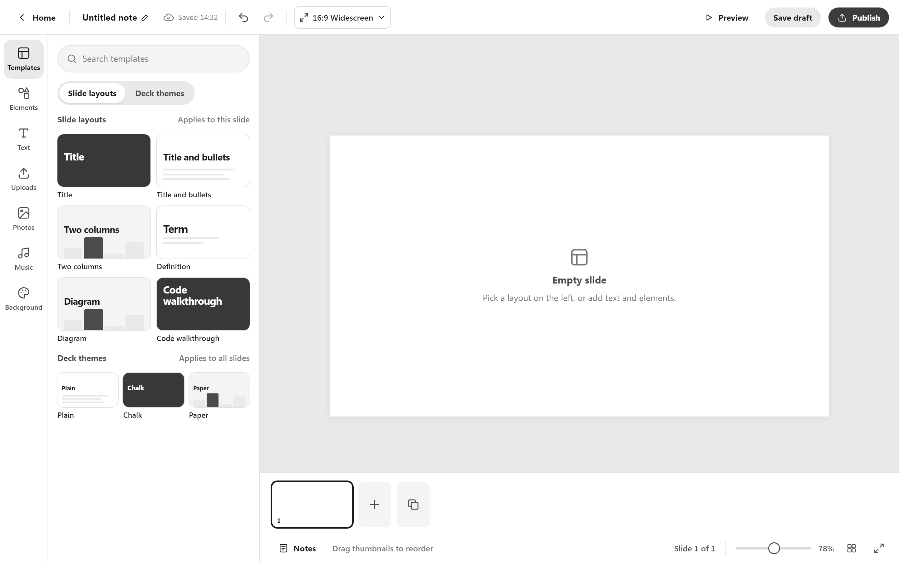

*Figure 4.x: Slide editor, templates panel*

	The slide editor (UC05, FR8) uses the layout of Canva: a top bar with the note title, undo and redo, the slide size control, Save draft and Publish; a labelled icon rail on the left; and the slide board in the centre. On a new, empty note the Templates panel is open and offers slide layouts that apply to the current slide and deck themes that apply to every slide. The thumbnail strip at the bottom shows the single blank slide with controls to add or duplicate slides.

### 4.4.3.2 Text editing

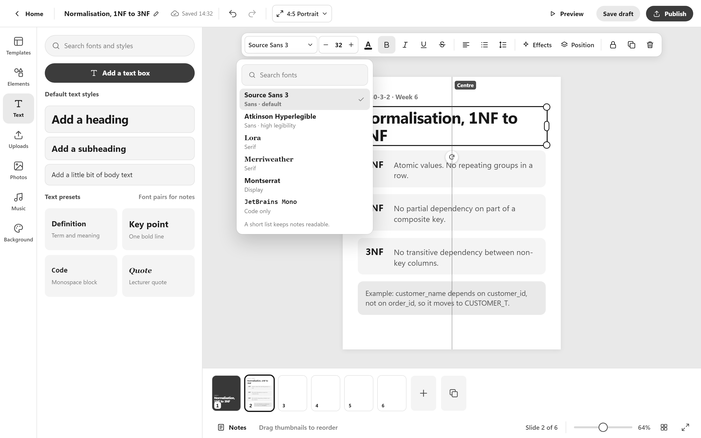

*Figure 4.x: Slide editor, text selected*

	Selecting a text box shows resize handles, a rotation handle and a centre guide on the board, and a contextual toolbar appears above it. The toolbar holds font family, size, colour, bold, italic, underline, strikethrough, alignment, lists, line spacing, effects, position, lock, duplicate and delete. The font menu is open to show that it offers a short, curated list rather than every available font, and the Text panel on the left provides heading, subheading and body styles with presets for definitions, key points, code and quotes.

### 4.4.3.3 Photos and image editing

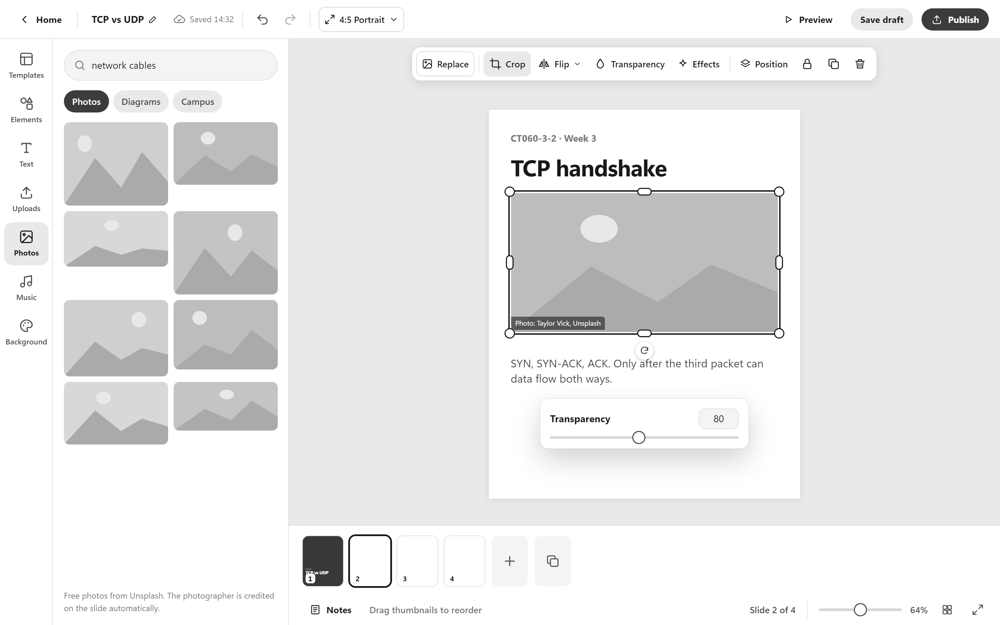

*Figure 4.x: Slide editor, photos panel and image selected*

	The Photos panel searches a stock library and places the chosen photo on the slide with the photographer credited automatically. When an image is selected the contextual toolbar changes to image tools: replace, crop, flip, transparency, effects and position. The transparency control is shown open as a slider with a numeric field, so the value can be set precisely as well as by dragging.

### 4.4.3.4 Background music

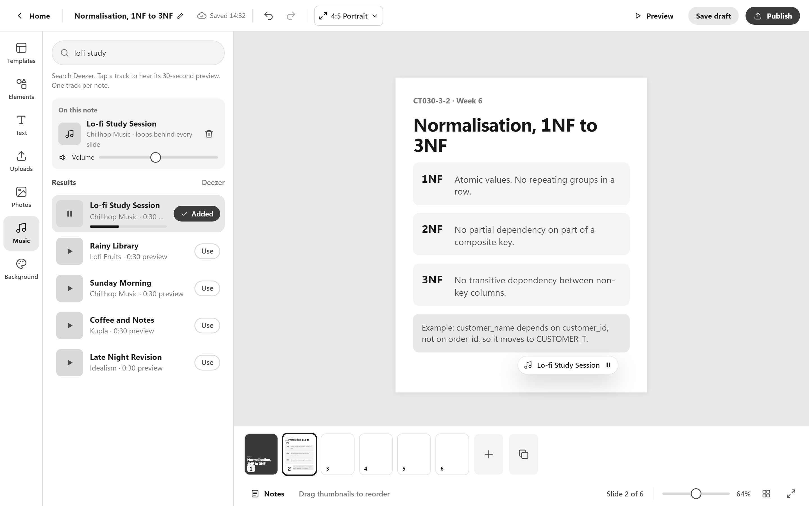

*Figure 4.x: Slide editor, music panel*

	The Music panel (FR17) searches a music catalogue and plays a 30-second preview of each result before the author adds it. Only one track can be attached to a note; the current track is shown at the top of the panel with a volume control and a remove button, and a small chip on the board confirms that it plays behind every slide. A note works without music if the music service is unavailable.

### 4.4.3.5 Elements, shapes and slide size

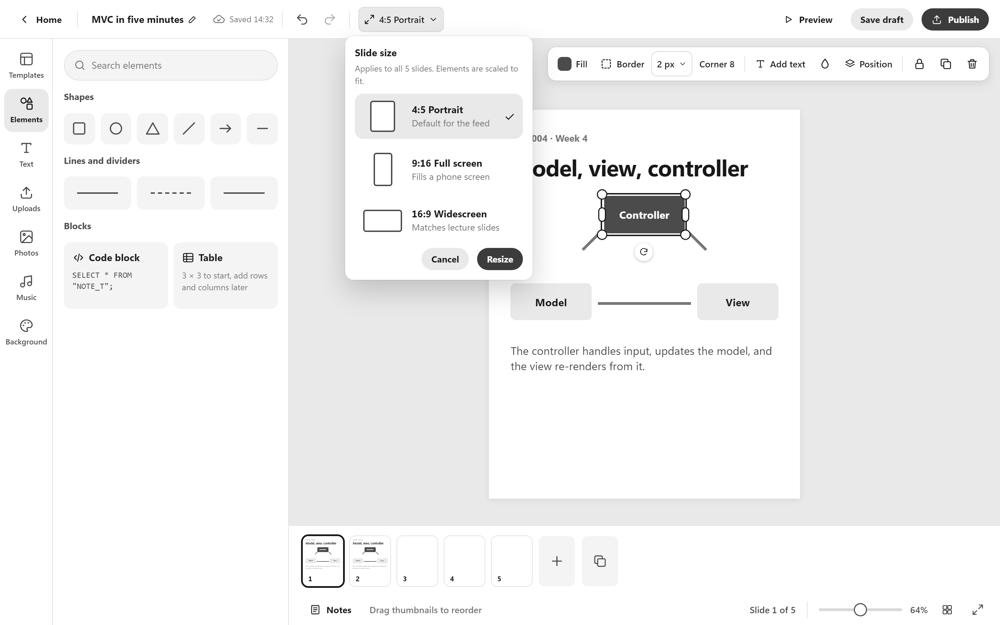

*Figure 4.x: Slide editor, elements panel and slide size menu*

	The Elements panel provides shapes, lines and dividers, a code block and a table. A selected shape changes the contextual toolbar to fill, border, border weight and corner radius. The slide size menu is open from the top bar and offers 4:5 portrait, the default for the feed, 9:16 full screen and 16:9 widescreen; the choice applies to the whole note and scales existing elements to fit.

### 4.4.3.6 Uploads and page notes

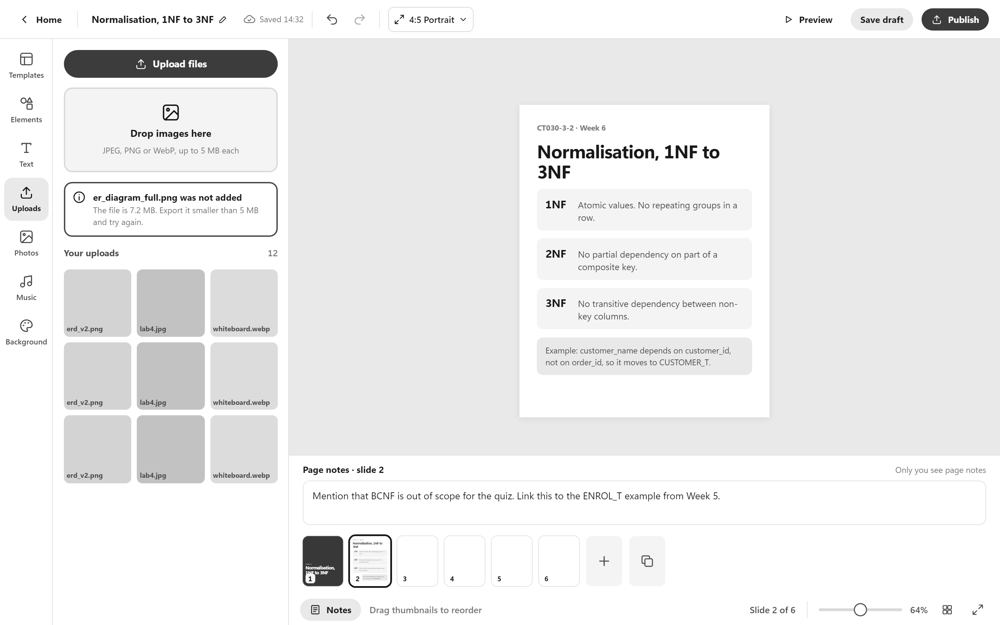

*Figure 4.x: Slide editor, uploads panel and page notes*

	The Uploads panel accepts the author's own images in JPEG, PNG or WebP format up to 5 MB each. It is shown with an error state for an oversized file, which names the file, gives its actual size and tells the author how to fix it. The Notes toggle at the bottom opens page notes for the current slide, which are private reminders for the author and are never published.

### 4.4.3.7 Mobile editor

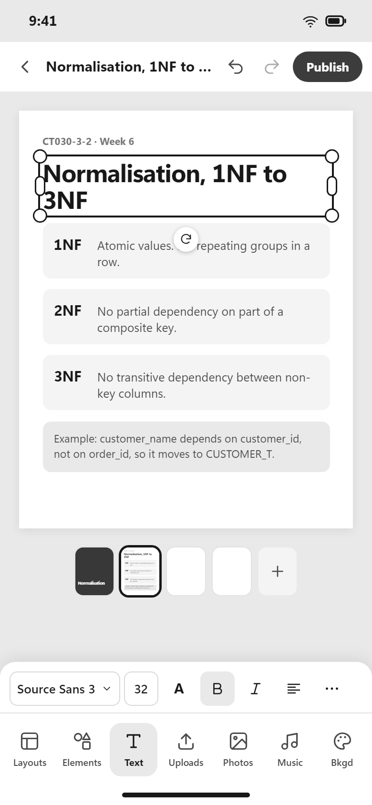

*Figure 4.x: Slide editor (mobile)*

	The mobile editor keeps the board as the focus and moves every tool to a tray at the bottom of the screen, within reach of the thumb. The tray lists the same tools as the desktop rail, and selecting a text box adds a compact formatting row above it with font, size, colour, bold, italic, alignment and an overflow menu for the rest. Slide thumbnails sit under the board, and Publish stays in the top bar.

### 4.4.3.8 Publish dialog

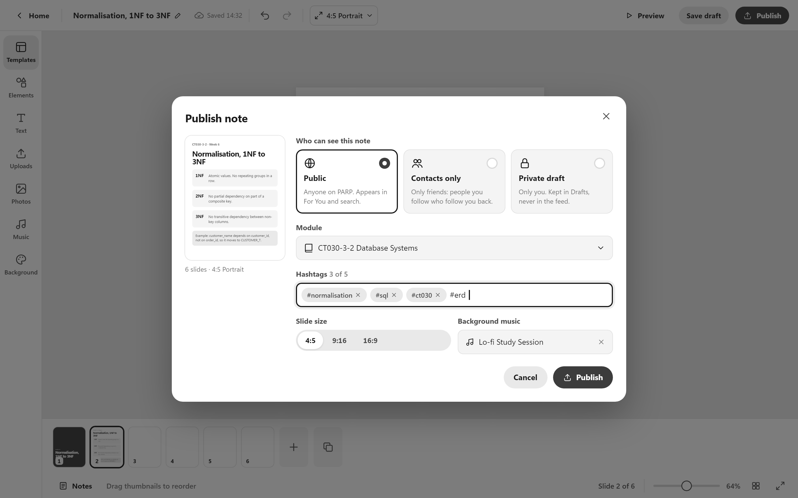

*Figure 4.x: Publish dialog*

	Publishing (UC07) opens a dialog with a preview of the first slide and the details needed for ranking and search. The three visibility options of FR10, Public, Contacts only (friends, meaning mutual follows) and Private draft, are presented as equal cards with one-line consequences, responding to the survey result in which no option exceeded 40.6 percent. The module is chosen from the catalogue, up to five hashtags are entered as removable chips, and the slide size and background music can be confirmed or changed before publishing.

### 4.4.3.9 Drafts

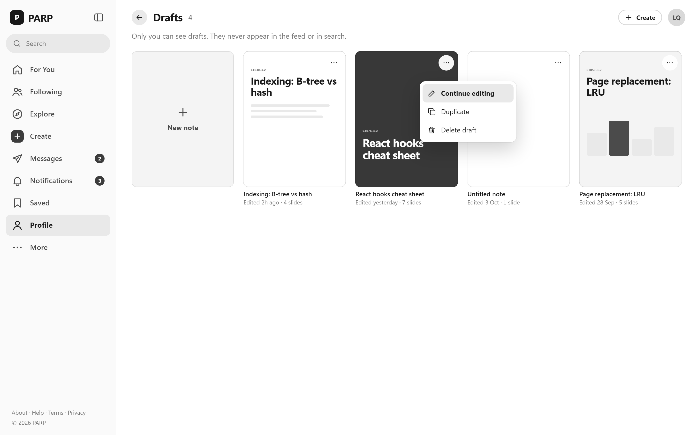

*Figure 4.x: Drafts*

	Drafts (UC06) are reached from the profile and are shown as a grid of cover thumbnails with the time of the last edit and the number of slides. The first tile starts a new note, and each draft has a menu to continue editing, duplicate or delete it. A line under the title reminds the author that drafts are visible only to them and never appear in the feed or search.

## 4.4.4 Profile, search and saved screens

### 4.4.4.1 Own profile

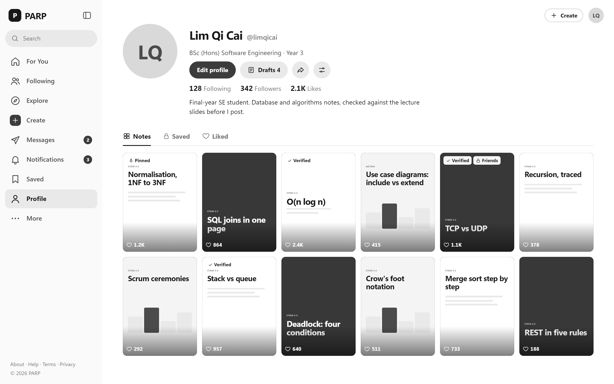

*Figure 4.x: Own profile*

	The profile (UC04) follows TikTok's layout: a large avatar, name and handle, programme, action buttons, the Following, Followers and Likes counts and a short biography. Below it, the Notes, Saved and Liked tabs switch between grids of note covers; the Saved tab carries a lock icon because only the owner can see it. Covers show their like count and labels for pinned, verified and friends-only notes.

### 4.4.4.2 Another user's profile

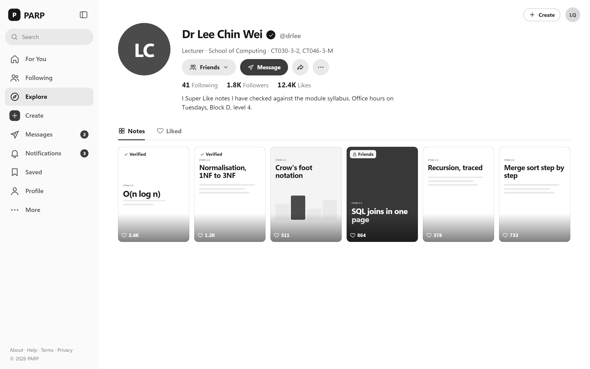

*Figure 4.x: Another user's profile*

	Viewing another user shows the same layout with the relationship button and a Message button in place of Edit profile. The relationship button has three states: Follow when the viewer does not follow the user, Following when the follow is one-way, and Friends when both follow each other, which is the state shown here. Only notes the viewer is allowed to see appear in the grid, so friends-only notes are visible here because the two users are friends.

### 4.4.4.3 Edit profile

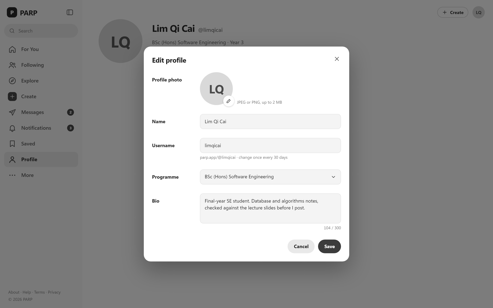

*Figure 4.x: Edit profile dialog*

	Editing the profile opens a dialog over the profile page with one labelled row per field: photo, name, username, programme and biography. The programme is a selection list because it is one of the search keys in FR4 and needs consistent values. The photo size limit and the biography character count are shown next to their fields, so the limits are visible before the user saves.

### 4.4.4.4 Profile, mobile

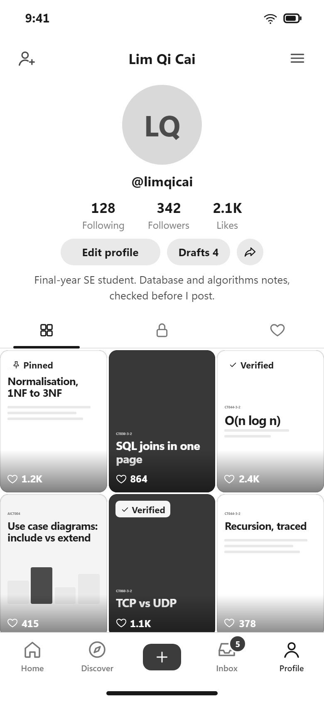

*Figure 4.x: Profile (mobile)*

	The mobile profile centres the avatar and counts in the TikTok arrangement and reduces the tab labels to icons for notes, saved and liked. Notes are shown in a three-column grid with no gaps between rows, which fits more covers on a small screen. The Edit profile and Drafts buttons stay directly under the counts.

### 4.4.4.5 Search results

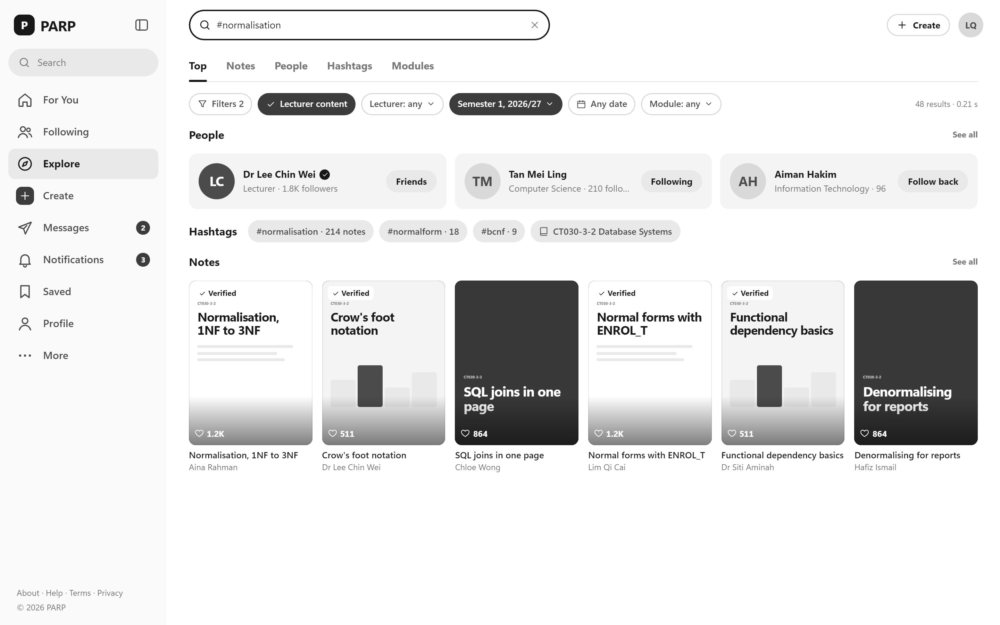

*Figure 4.x: Search results, Top tab*

	Search (UC14) uses an explore layout with Top, Notes, People, Hashtags and Modules tabs. The Top tab mixes the best matches of each kind: people with their relationship button, related hashtags and modules, and a grid of notes. A row of filter chips sits under the tabs, and the result count is shown with the response time, which keeps the three-second target of NFR1 visible during testing.

### 4.4.4.6 Search filters

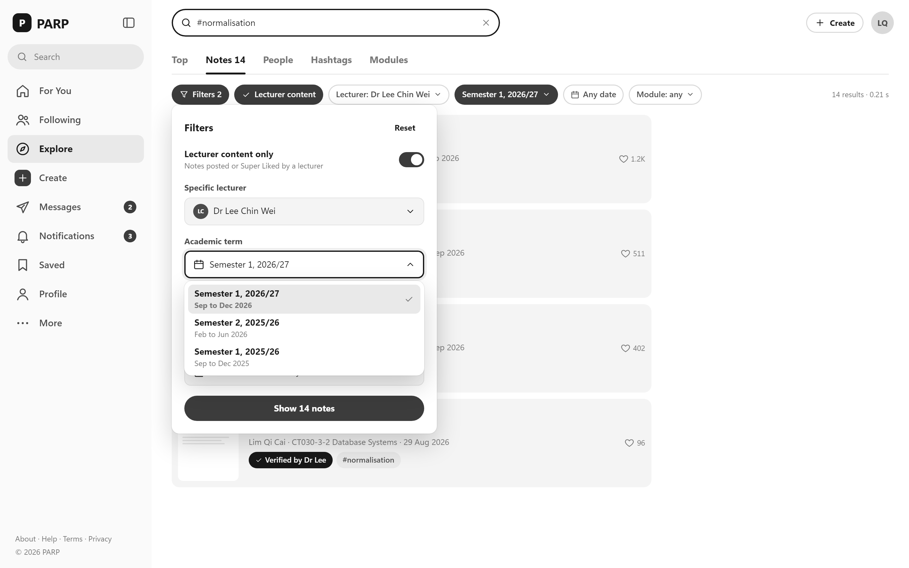

*Figure 4.x: Search filters*

	The Filters panel implements FR15. It offers a lecturer-content switch, a choice of a specific lecturer, an academic term drawn from the term catalogue with its dates shown, a custom date range and a module. The Notes tab behind it lists results with their author, module and date, and verified results carry the same badge as in the feed. The button at the bottom shows how many notes the filters will return before they are applied.

### 4.4.4.7 Search, mobile

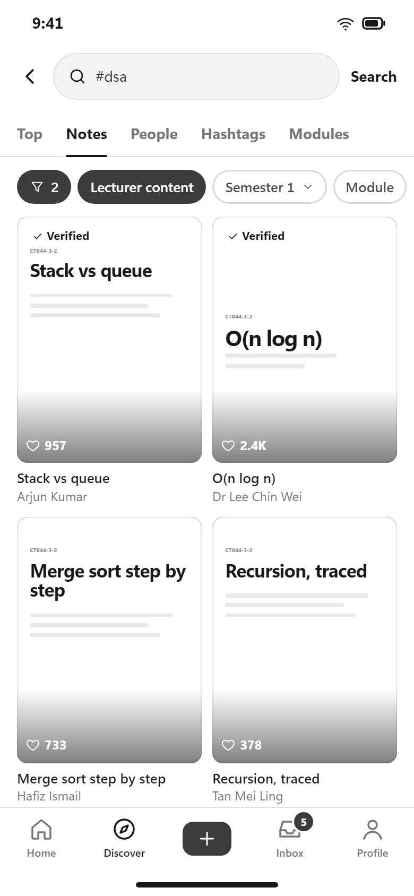

*Figure 4.x: Search (mobile)*

	On a phone, search opens from the Discover tab with the query field at the top and the same five tabs underneath. Active filters are shown as a scrolling row of chips, and the first chip opens the full filter sheet. Results are shown as a two-column grid of covers with titles and authors.

### 4.4.4.8 Saved notes

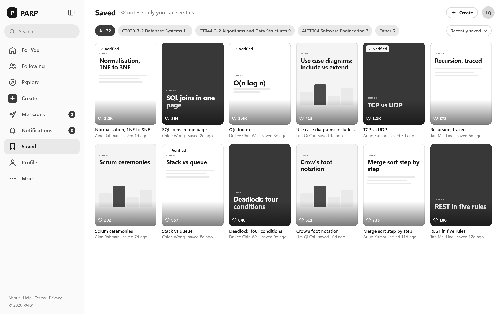

*Figure 4.x: Saved notes*

	The Saved screen (UC13, FR14) shows bookmarked notes as a grid, newest first, with chips that filter by module and show how many notes each module holds. Each cover shows the author and how long ago it was saved. Notes that have since been deleted or made private are left out, as specified in the exception flow of UC13.

### 4.4.4.9 Report dialog

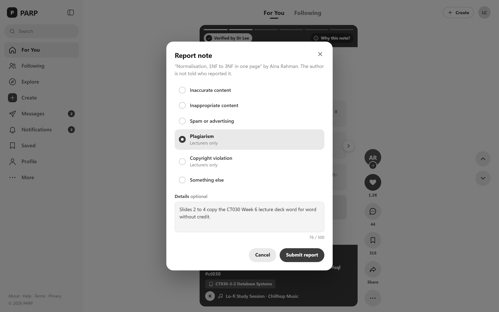

*Figure 4.x: Report note dialog*

	The report dialog (UC12) lists the available reasons as a single-choice list with an optional details field limited to 500 characters. It is drawn from a lecturer's account, so the Plagiarism and Copyright violation reasons, which are available to lecturers only, are visible and labelled as such. The dialog states that the author is not told who made the report, and submission adds the report to the administrator queue in Figure [[37_admin_reports]].

### 4.4.4.10 Super Like confirmation

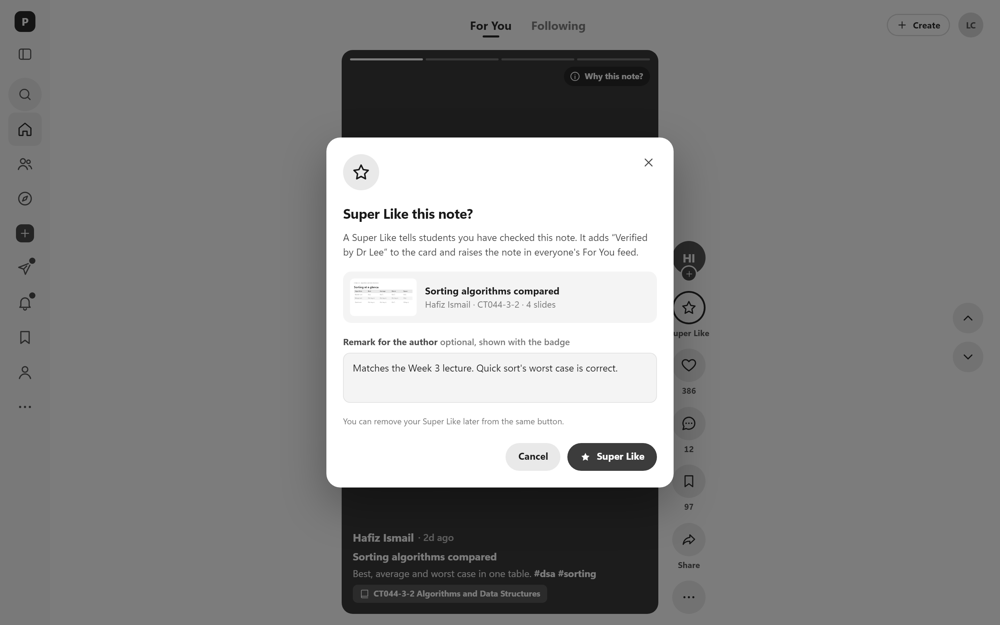

*Figure 4.x: Super Like confirmation (lecturer)*

	Super Like (UC19) asks for confirmation because it has the largest effect on ranking of any user action. The dialog explains in one sentence what it does, adding "Verified by Dr Lee" to the card and raising the note in every feed, and shows which note is being verified. An optional remark for the author is shown with the badge, and the dialog notes that the Super Like can be removed later from the same button.

## 4.4.5 Notification and messaging screens

### 4.4.5.1 Notifications

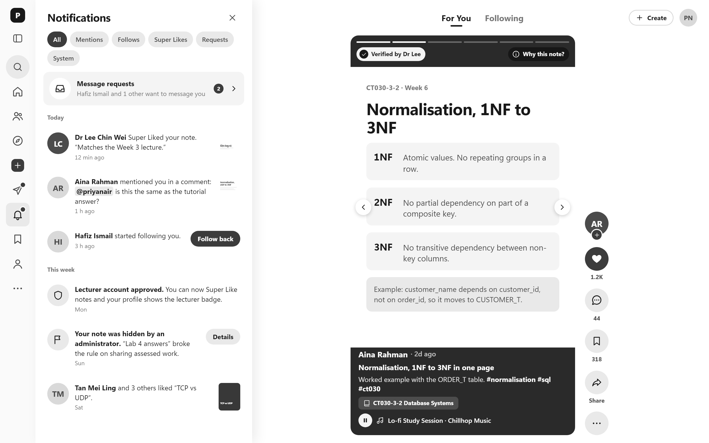

*Figure 4.x: Notifications drawer*

	Notifications open as a drawer beside the collapsed navigation while the feed stays visible, as the activity drawer does on TikTok desktop. Filter chips separate mentions, follows, Super Likes, requests and system messages, and message requests are pinned at the top. The example is drawn for a newly approved lecturer so that every type appears: a Super Like on her note, a mention, a new follower with Follow back, the lecturer approval, a note hidden by an administrator with its reason, and grouped likes.

### 4.4.5.2 Inbox, mobile

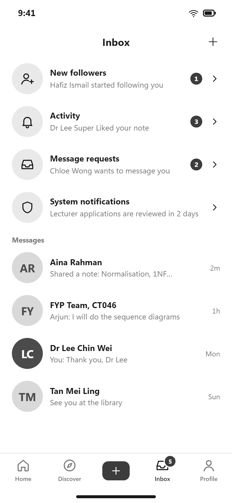

*Figure 4.x: Inbox (mobile)*

	On a phone, notifications and messages share the Inbox tab, as on TikTok. Four rows at the top open new followers, activity, message requests and system notifications, each with an unread count, and the conversations are listed below them. This keeps every incoming item behind one tab, and the tab bar badge shows the total waiting.

### 4.4.5.3 Messages

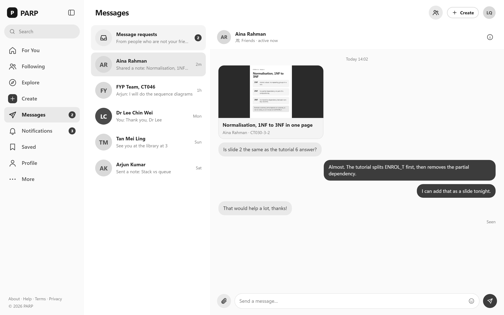

*Figure 4.x: Messages*

	The Messages screen (UC17) lists conversations on the left and the selected conversation on the right, with Message requests pinned at the top of the list. A note shared into a chat appears as a card with its first slide, title, author and module, which is the visible form of post-anchored messaging (FR7). The input bar has an attach control for sharing further notes, and the button at the top right starts a new group.

### 4.4.5.4 Message request

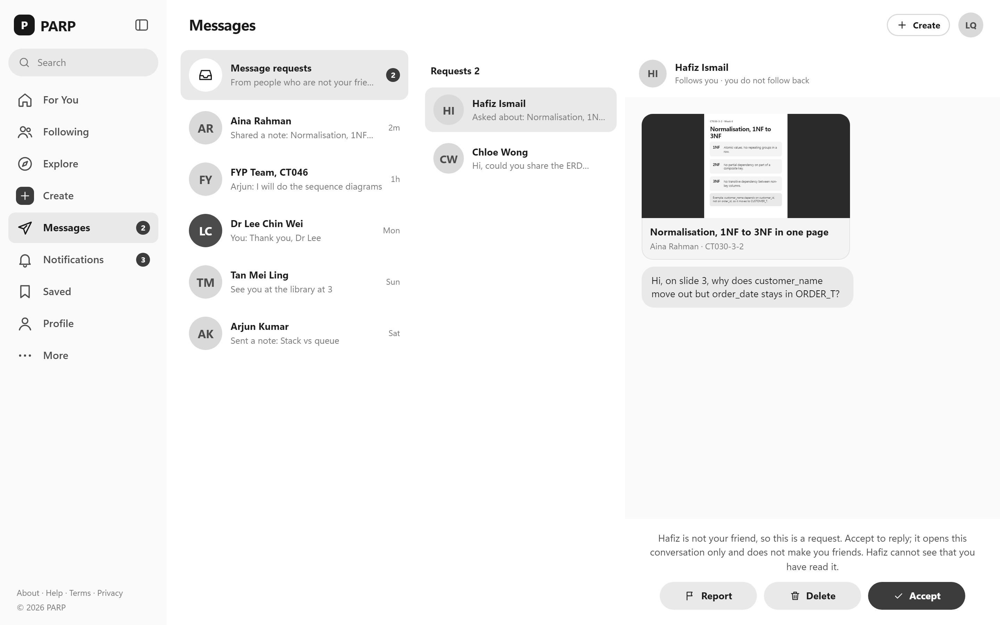

*Figure 4.x: Message request*

	A message from someone who is not a friend arrives as a request (UC16, FR6). The request shows the sender, their relationship to the recipient, the attached note and the first message, so the recipient can judge it from its academic context. A sentence above the buttons explains that accepting opens this conversation only and does not make them friends, and Report, Delete and Accept are given equal size.

### 4.4.5.5 New group

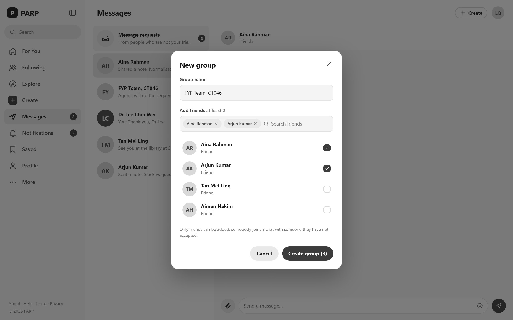

*Figure 4.x: New group dialog*

	The group dialog (UC18, FR13) asks for a group name and at least two members chosen from a searchable list of friends, with the selected members shown as removable chips. Membership is limited to friends so that nobody is placed in a conversation with someone they have not accepted, which keeps the approval rule of FR6 intact. The create button shows the resulting group size.

### 4.4.5.6 Group chat

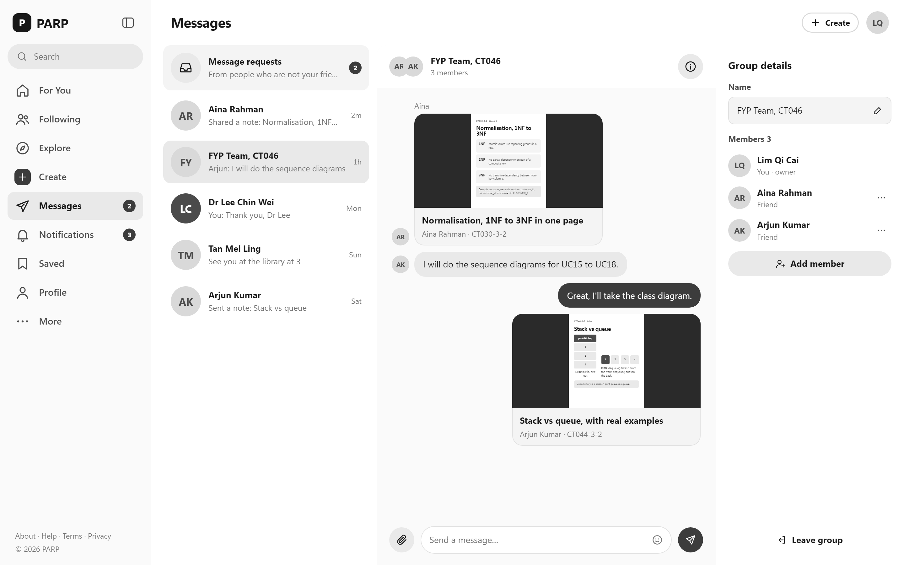

*Figure 4.x: Group chat with details panel*

	A group conversation shows each sender's avatar beside their messages and supports shared note cards in the same way as a direct chat. The details panel on the right lets the owner rename the group and add or remove members, and lets any member leave, matching the alternative flows of UC18.

### 4.4.5.7 Chat, mobile

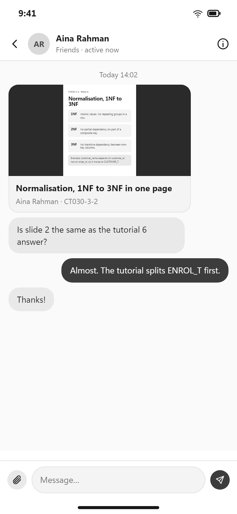

*Figure 4.x: Chat (mobile)*

	The mobile conversation hides the tab bar so the message list and input have the full height of the screen. A shared note keeps its card form, scaled to the narrower screen, and tapping it opens the note. The header shows the friend status, and the back arrow returns to the Inbox.

## 4.4.6 Administration screens

### 4.4.6.1 Reported content

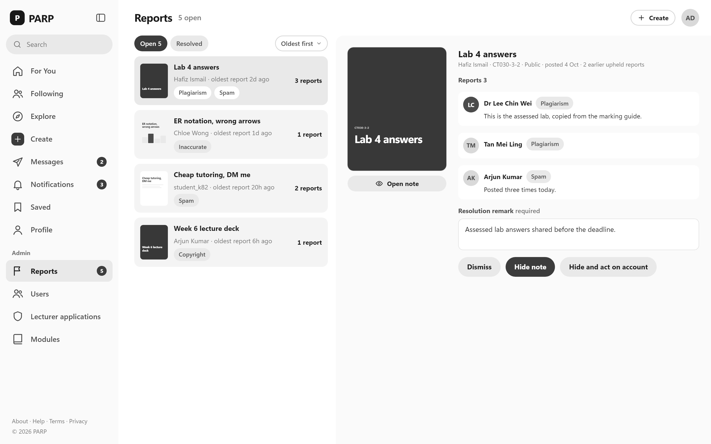

*Figure 4.x: Administrator, reported content*

	Administrators see an Admin group at the end of the same navigation column, so moderation does not need a separate application. The reports queue (UC20) groups open reports by note, oldest first, with their reasons and count; selecting one shows the note, every report with its reason and details, and the author's earlier upheld reports. A resolution remark is required, and the three outcomes, Dismiss, Hide note and Hide and act on account, match the standard and alternative flows of UC20.

### 4.4.6.2 User management

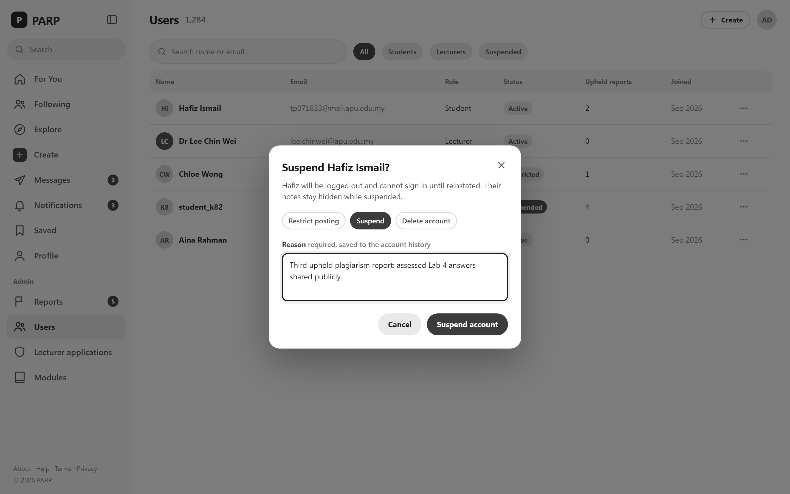

*Figure 4.x: Administrator, user management*

	The users screen (UC21) lists accounts with role, status and number of upheld reports, so the evidence for a decision sits on the same row. Each row's menu opens a confirmation dialog, shown here for a suspension, that states the consequence, lets the administrator switch between restrict, suspend and delete, and requires a reason that is saved to the account history.

### 4.4.6.3 Lecturer applications

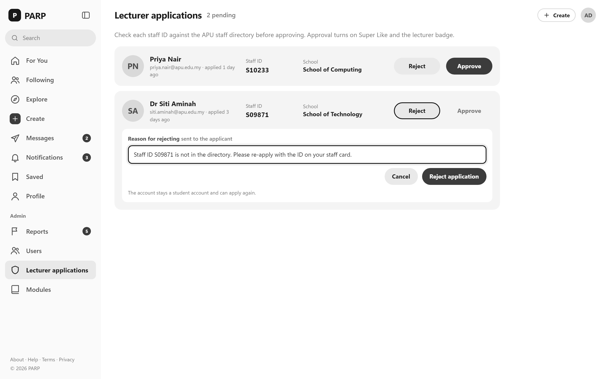

*Figure 4.x: Administrator, lecturer applications*

	Lecturer applications (UC22) are listed with the applicant's email, staff ID and school so they can be checked against the staff directory. Approving changes the role to lecturer and enables the Super Like action and badge. The second application is shown in its rejecting state, where a reason is required and sent to the applicant, and the account stays a student account that can apply again.

### 4.4.6.4 Modules

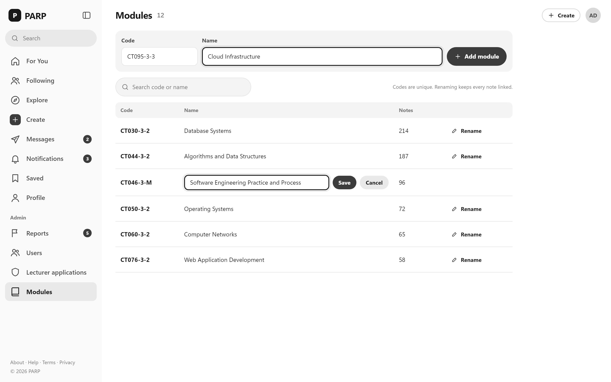

*Figure 4.x: Administrator, modules*

	The module catalogue is maintained by the administrator from this screen, which lists each module code with its name and number of notes. A form at the top adds a module, and Rename edits a name in place, shown here on one row. Module codes are unique and renaming keeps every existing note linked, so the module filter in search and the module field in the publish dialog always draw on the same list.
