<!-- Generated by build_chapter.py from the 4.*.md sections; edit those, not this file. -->

# Chapter 4: Design

## 4.1 Introduction

	This chapter translates the requirements established in Chapter 3 into the design of the Peer-to-Peer Academic Resource Platform (PARP). It was produced in a dedicated design sprint, Sprint 0, before any production code was written, so that each implementation sprint begins from an agreed specification and a fixed set of test cases. The chapter follows the use case, class, activity and sequence modelling path, which suits the incremental delivery of the Scrum framework selected in Section 3.1.3 because each use case can be scheduled into a sprint and traced to its tests.

	Section 4.2 presents the system design. The use case diagram and twenty-two use case specifications define the functional scope for the student, lecturer and administrator actors, and record where low-priority requirements were cut or reworked. The class diagram defines the static structure, including the ranking service and its configuration, and five activity diagrams and five sequence diagrams describe the workflows that deliver the four project objectives: publishing a note, generating the ranked feed, lecturer verification, search, and post-anchored messaging. Section 4.3 presents the database design as an entity relationship diagram and a schema table of nineteen tables, implemented as a versioned migration. Section 4.4 presents twenty-five low-fidelity wireframes of the interface, and Section 4.5 prepares the unit test cases for eight modules and the user acceptance testing instruments that are completed in Chapter 5. Every diagram and screen is followed by an explanatory paragraph that relates it to the requirements and to the design decisions it embodies.

# 4.2 Design

## 4.2.1 Use Case Diagram

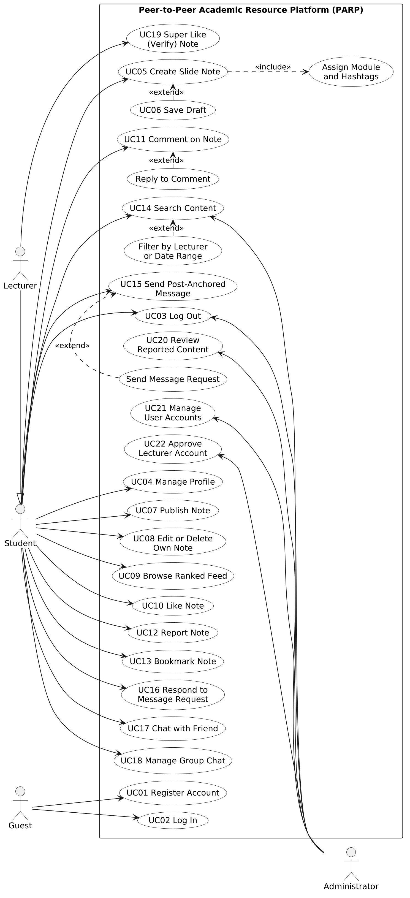

*Figure 4.1: PARP use case diagram*

	Figure 4.1 presents the functional scope of the Peer-to-Peer Academic Resource Platform (PARP) as twenty-two use cases distributed across four actors. The Guest actor represents an unauthenticated visitor and is limited to registering an account (UC01) and logging in (UC02), since every other function depends on an identified user. The Student actor holds the core peer-to-peer functions: creating, drafting and publishing slide notes (UC05 to UC08), browsing the ranked feed (UC09), engaging with notes through likes, comments, reports and bookmarks (UC10 to UC13), searching (UC14), and the messaging functions (UC15 to UC18). The Lecturer actor is drawn as a specialisation of the Student actor, which reflects the deliverables in Section 1.6.4, where lecturers perform every student function and additionally hold the Super Like action (UC19) that marks a note as verified. Representing this through generalisation, rather than duplicating sixteen associations, keeps the diagram readable and states the design rule directly: lecturer rights are a superset of student rights.

	The Administrator actor is placed on the opposite side of the system boundary because its use cases concern moderation rather than content. Administrators review reported content (UC20), suspend, restrict or delete accounts (UC21), and approve lecturer registrations (UC22). The last of these was added during design and is not listed in the Investigation Report; without it, any user could select the lecturer role at registration and verify their own notes, which would undermine the lecturer validation component that carries the joint-highest weight in the ranking formula (Section 2.3.4.4). Administrators also share the Search Content (UC14) and Log Out (UC03) use cases, the former supporting moderation searches by username or hashtag as specified in Section 1.6.4.

	Four relationships refine the base use cases. Assign Module and Hashtags is an included use case of Create Slide Note because hashtags are mandatory at creation; the relevance component of the ranking formula divides by the number of hashtags on a post, so a note without hashtags cannot be scored. Save Draft, Reply to Comment, Filter by Lecturer or Date Range, and Send Message Request are modelled as extensions because each occurs only under a condition: the author chooses not to publish yet, the user responds to an existing comment, the user narrows a result set, or the recipient of a post-anchored message is not yet a friend (a user who follows the sender and is followed back). The last extension implements FR6, which requires approval before a non-friend can deliver a message.

	Three low-priority requirements from Table 14 are not represented as use cases. Background audio on slide notes (FR17) and peer annotation (FR18) were removed from the Part II scope, and filtering by academic term (FR15) was reworked into a published-date filter. The justification for each change is recorded in the Sprint 0 review, consistent with the agreement with the supervisor that low-priority requirements are cut or reworked only with written justification.

## 4.2.2 Use Case Specifications

	Tables 4.1 to 4.22 specify each use case in the order shown in Figure 4.1. Each table states the actors, the conditions that must hold before and after execution, the standard process, alternative processes that still reach the postcondition, and exception flows that terminate or redirect the use case. The functional requirement implemented by each use case is listed so that the specifications can be traced back to Table 14 of the Investigation Report.

*Table 4.1: UC01 Register Account use case specification*

| **Component** | **Description** |
| --- | --- |
| Use case | UC01_Register Account |
| Description | Allows a new user to create a PARP account as a student or as a lecturer. Lecturer accounts begin with student-level rights until an administrator approves them (UC22). |
| Actors | Guest |
| Requirements | Role separation required by FR1 |
| Preconditions | The guest is not logged in and does not already hold an account under the same email address. |
| Postconditions | A user account is created with the student role, or with the lecturer role in pending status, and the user is redirected to the login page. |
| Standard Process | 1. Guest selects "Register" on the landing page.   2. System displays the registration form.   3. Guest enters display name, email, password, password confirmation and programme, and selects the Student or Lecturer role.   4. Guest submits the form.   5. System validates every field.   6. System checks that the email is not already registered.   7. System hashes the password and creates the account.   8. System displays a success message and redirects to the login page. |
| Alternative Process | **Step 3a: Guest registers as a lecturer**   3a.1 Guest selects the Lecturer role and enters a staff ID.   3a.2 System creates the account with status "pending lecturer".   3a.3 System informs the guest that lecturer features become available after administrator approval. |
| Exception Flow | **Step 5a: Invalid or missing field**   5a.1 System highlights each invalid field with a message (e.g. password shorter than 8 characters, confirmation mismatch).   5a.2 System returns to step 3 with valid entries retained.   **Step 6a: Email already registered**   6a.1 System displays "This email is already registered" and offers a link to UC02_Log In. |

*Table 4.2: UC02 Log In use case specification*

| **Component** | **Description** |
| --- | --- |
| Use case | UC02_Log In |
| Description | Allows a registered student, lecturer or administrator to authenticate and obtain a session token. |
| Actors | Guest (becoming Student, Lecturer or Administrator) |
| Requirements | Security of all FRs; IR deliverable "sign in securely" |
| Preconditions | The user holds an active account. |
| Postconditions | The user is authenticated with a JSON Web Token and redirected to the feed, or to the administration console for administrators. |
| Standard Process | 1. Guest selects "Log In".   2. System displays the login form.   3. Guest enters email and password and submits.   4. System validates that both fields are present.   5. System retrieves the account and compares the password against the stored hash.   6. System issues a signed token containing the user ID and role.   7. System redirects the user to the ranked feed (UC09). |
| Alternative Process | **Step 7a: User is an administrator**   7a.1 System redirects to the administration console instead of the feed. |
| Exception Flow | **Step 4a: Empty field**   4a.1 System displays "Email and password are required" and returns to step 3.   **Step 5a: Incorrect email or password**   5a.1 System displays a single generic message that does not reveal which field was wrong, and returns to step 3.   **Step 5b: Account suspended**   5b.1 System displays "This account is suspended" and does not issue a token. |

*Table 4.3: UC03 Log Out use case specification*

| **Component** | **Description** |
| --- | --- |
| Use case | UC03_Log Out |
| Description | Allows any logged-in user to end the session on the current device. |
| Actors | Student, Lecturer, Administrator |
| Requirements | IR deliverable "sign out to protect session integrity" |
| Preconditions | The user is logged in. |
| Postconditions | The session token is removed from the client, the real-time connection is closed, and the login page is displayed. |
| Standard Process | 1. User opens the account menu and selects "Log Out".   2. System discards the stored token.   3. System disconnects the user's real-time messaging socket.   4. System redirects to the login page. |
| Alternative Process | **Step 1a: Token expires**   1a.1 The next API request is rejected as unauthorised.   1a.2 System performs steps 2 to 4 automatically and displays "Session expired". |
| Exception Flow | None. |

*Table 4.4: UC04 Manage Profile use case specification*

| **Component** | **Description** |
| --- | --- |
| Use case | UC04_Manage Profile |
| Description | Allows a user to view and update their display name, programme, short biography and profile picture. The profile page also lists the user's published notes. |
| Actors | Student, Lecturer |
| Requirements | FR4 (programme name is a search key) |
| Preconditions | The user is logged in. |
| Postconditions | Updated profile details are stored and shown on the user's notes and profile page. |
| Standard Process | 1. User opens their profile page.   2. System displays profile details and the user's notes.   3. User selects "Edit Profile".   4. User edits the fields and saves.   5. System validates and stores the changes.   6. System displays the updated profile. |
| Alternative Process | **Step 1a: User views another user's profile**   1a.1 System displays that user's public details and only the notes the viewer is allowed to see (public, or contacts-only if the two users are friends, meaning they follow each other).   1a.2 Use case ends without editing. |
| Exception Flow | **Step 5a: Invalid input**   5a.1 System rejects an empty display name or an image larger than 2 MB and returns to step 4. |

*Table 4.5: UC05 Create Slide Note use case specification*

| **Component** | **Description** |
| --- | --- |
| Use case | UC05_Create Slide Note |
| Description | Allows a user to compose a note as an ordered set of formatted slides in the built-in editor, assign it to a module and attach hashtags. |
| Actors | Student, Lecturer |
| Requirements | FR8, FR9; includes Assign Module and Hashtags |
| Preconditions | The user is logged in. |
| Postconditions | A note with at least one slide, one module and at least one hashtag exists, either as a draft (UC06) or published (UC07). |
| Standard Process | 1. User selects "Create Note".   2. System opens the slide editor with one blank slide and a template picker.   3. User enters a title, chooses a template, and writes slide content using the formatting toolbar (heading, bold, italic, list, code block).   4. User adds, reorders or removes slides as needed.   5. User selects the module the note belongs to.   6. User enters one to five hashtags.   7. User proceeds to UC07_Publish Note. |
| Alternative Process | **Step 7a: User saves instead of publishing**   7a.1 User proceeds to UC06_Save Draft. |
| Exception Flow | **Step 7b: Required content missing**   7b.1 System lists what is missing (title, slide content, module or hashtag) and returns to the editor.   **Step 6a: Hashtag invalid**   6a.1 System rejects hashtags with spaces or symbols other than letters, digits and underscore, or more than five hashtags, and returns to step 6. |

*Table 4.6: UC06 Save Draft use case specification*

| **Component** | **Description** |
| --- | --- |
| Use case | UC06_Save Draft |
| Description | Allows an author to keep an unfinished note privately and resume editing later. A draft is visible only to its author and is excluded from the feed and search. |
| Actors | Student, Lecturer |
| Requirements | FR10 (private draft option) |
| Preconditions | The user is editing a note in UC05 or UC08. |
| Postconditions | The note is stored with status "draft" and appears in the author's Drafts list. |
| Standard Process | 1. User selects "Save Draft" in the editor.   2. System stores the title, slides, module and hashtags entered so far.   3. System confirms the save and shows the time saved.   4. User later opens the Drafts list and selects the draft.   5. System reopens the draft in the editor. |
| Alternative Process | **Step 2a: Draft is incomplete**   2a.1 System saves the draft even when module or hashtags are missing; completeness is checked only at publishing. |
| Exception Flow | **Step 2b: Save fails (connection lost)**   2b.1 System displays "Draft not saved" and keeps the editor content so the user can retry. |

*Table 4.7: UC07 Publish Note use case specification*

| **Component** | **Description** |
| --- | --- |
| Use case | UC07_Publish Note |
| Description | Allows an author to publish a completed note with a chosen visibility. Public notes enter every viewer's ranked feed; contacts-only notes are visible to the author's friends (users who follow each other). |
| Actors | Student, Lecturer |
| Requirements | FR10, FR9; FR2 (lecturer badge on lecturer-authored notes) |
| Preconditions | The note has a title, at least one non-empty slide, a module and at least one hashtag. |
| Postconditions | The note is stored with status "published", a visibility value and a publication time, and becomes eligible for the feed and search. |
| Standard Process | 1. User selects "Publish".   2. System displays three visibility options of equal size: Public, Contacts only, Keep as private draft.   3. User selects Public.   4. System validates completeness.   5. System stores the note as published and records the publication time.   6. System opens the published note. |
| Alternative Process | **Step 3a: User selects Contacts only**   3a.1 System publishes the note visible only to the author's friends.   **Step 3b: User selects Keep as private draft**   3b.1 System performs UC06_Save Draft instead.   **Step 6a: Author is an approved lecturer**   6a.1 System shows the lecturer checkmark badge on the author's picture in the note. |
| Exception Flow | **Step 4a: Note incomplete**   4a.1 System lists the missing elements and returns to the editor. |

*Table 4.8: UC08 Edit or Delete Own Note use case specification*

| **Component** | **Description** |
| --- | --- |
| Use case | UC08_Edit or Delete Own Note |
| Description | Allows an author to revise or remove a note they created. |
| Actors | Student, Lecturer |
| Requirements | FR8 |
| Preconditions | The user is logged in and is the author of the note. |
| Postconditions | The note is updated, or it is soft-deleted and no longer shown anywhere except moderation records. |
| Standard Process | 1. Author opens the note and selects "Edit".   2. System opens the note in the editor with existing slides, module and hashtags.   3. Author makes changes and selects "Save".   4. System validates and stores the changes and records the edit time.   5. System displays the updated note. |
| Alternative Process | **Step 1a: Author deletes the note**   1a.1 Author selects "Delete".   1a.2 System asks for confirmation.   1a.3 Author confirms.   1a.4 System marks the note as deleted and removes it from feed, search and bookmarks. |
| Exception Flow | **Step 1b: User is not the author**   1b.1 The Edit and Delete actions are not shown; a direct request is rejected by the server as forbidden.   **Step 4a: Edited note incomplete**   4a.1 System lists the missing elements and returns to step 3. |

*Table 4.9: UC09 Browse Ranked Feed use case specification*

| **Component** | **Description** |
| --- | --- |
| Use case | UC09_Browse Ranked Feed |
| Description | Presents notes the viewer is allowed to see in a vertical scrolling feed ordered by the heuristic score S = w₁E + w₂R + w₃V + w₄M (Section 2.3.4). Each note is shown in a slide viewer that the user swipes horizontally. |
| Actors | Student, Lecturer |
| Requirements | FR3, FR11, NFR3 |
| Preconditions | The user is logged in. |
| Postconditions | A page of ranked notes is displayed and each viewed note is recorded as a view interaction for the viewer's interest vector. |
| Standard Process | 1. User opens the Feed.   2. System retrieves candidate notes that are published and visible to the user.   3. System computes engagement, recency, lecturer validation and relevance for each candidate and the weighted score.   4. System returns the first page ordered by score.   5. User scrolls vertically between notes and swipes horizontally between slides.   6. System records a view interaction when a note stays on screen.   7. When the user nears the end of the page, System loads the next page. |
| Alternative Process | **Step 3a: New user with no interactions**   3a.1 The relevance component is zero for every note, so ordering is decided by engagement, recency and validation.   **Step 5a: User interacts with a note**   5a.1 User proceeds to UC10, UC11, UC12, UC13 or UC15 from the note's action bar. |
| Exception Flow | **Step 2a: No notes available**   2a.1 System displays an empty-feed message suggesting Search or Create Note.   **Step 4a: Feed request fails**   4a.1 System displays a retry option. |

*Table 4.10: UC10 Like Note use case specification*

| **Component** | **Description** |
| --- | --- |
| Use case | UC10_Like Note |
| Description | Allows a user to like or unlike a note. Likes contribute to the engagement component and to the liker's interest vector. |
| Actors | Student, Lecturer |
| Requirements | IR deliverable "like"; engagement component E |
| Preconditions | The user is logged in and can see the note. |
| Postconditions | A like is recorded once per user per note, or removed on unlike, and the like count is updated. |
| Standard Process | 1. User selects the Like icon on a note.   2. System records the like and a like interaction.   3. System updates the like count and fills the icon. |
| Alternative Process | **Step 1a: Note already liked**   1a.1 Selecting the icon again removes the like and decrements the count. |
| Exception Flow | **Step 2a: Note deleted meanwhile**   2a.1 System displays "This note is no longer available". |

*Table 4.11: UC11 Comment on Note use case specification*

| **Component** | **Description** |
| --- | --- |
| Use case | UC11_Comment on Note |
| Description | Allows a user to comment on a note, optionally referencing a slide number. Lecturer comments are pinned above student comments; student comments are ordered by likes, then by time. |
| Actors | Student, Lecturer |
| Requirements | FR16 (extension Reply to Comment); IR §2.3.4.6 comment ordering |
| Preconditions | The user is logged in and can see the note. |
| Postconditions | The comment is stored, the note's comment count increases, and a comment interaction is recorded. |
| Standard Process | 1. User opens the comment panel of a note.   2. System displays comments with lecturer comments pinned first.   3. User types a comment (1 to 1,000 characters) and optionally selects a slide number.   4. User submits.   5. System stores the comment and displays it in its ordered position. |
| Alternative Process | **Step 3a: Reply to Comment**   3a.1 User selects "Reply" under an existing top-level comment.   3a.2 System stores the reply one level beneath that comment.   **Step 5a: Commenter is an approved lecturer**   5a.1 System places the comment in the pinned lecturer section with the lecturer badge. |
| Exception Flow | **Step 4a: Empty or over-length comment**   4a.1 System disables submission and shows the character limit. |

*Table 4.12: UC12 Report Note use case specification*

| **Component** | **Description** |
| --- | --- |
| Use case | UC12_Report Note |
| Description | Allows a user to report a note for administrator review. Lecturers can additionally select plagiarism or copyright as the reason. |
| Actors | Student, Lecturer |
| Requirements | IR deliverables "submit reports" and lecturer "flag for plagiarism or copyright" |
| Preconditions | The user is logged in and can see the note, and is not its author. |
| Postconditions | A report with status "open" is stored and appears in the administrator queue (UC20). |
| Standard Process | 1. User selects "Report" from the note menu.   2. System displays reasons: inaccurate content, inappropriate content, spam, other.   3. User selects a reason and optionally adds details.   4. User submits.   5. System stores the report and confirms submission. |
| Alternative Process | **Step 2a: Reporter is a lecturer**   2a.1 System adds the reasons "plagiarism" and "copyright violation". |
| Exception Flow | **Step 5a: User already has an open report on this note**   5a.1 System displays "You have already reported this note". |

*Table 4.13: UC13 Bookmark Note use case specification*

| **Component** | **Description** |
| --- | --- |
| Use case | UC13_Bookmark Note |
| Description | Allows a user to save a note to a private Saved list for later retrieval. |
| Actors | Student, Lecturer |
| Requirements | FR14 |
| Preconditions | The user is logged in and can see the note. |
| Postconditions | The note appears in, or is removed from, the user's Saved list. |
| Standard Process | 1. User selects the Bookmark icon on a note.   2. System stores the bookmark and fills the icon.   3. User later opens "Saved" from the navigation bar.   4. System lists bookmarked notes, newest first. |
| Alternative Process | **Step 1a: Note already bookmarked**   1a.1 Selecting the icon again removes the bookmark. |
| Exception Flow | **Step 4a: A saved note has been deleted or made private**   4a.1 System omits it from the list. |

*Table 4.14: UC14 Search Content use case specification*

| **Component** | **Description** |
| --- | --- |
| Use case | UC14_Search Content |
| Description | Allows a user to find notes by module code or name, hashtag, keyword in title or slide text, or programme name, and to find users by name. Results are returned within 3 seconds. |
| Actors | Student, Lecturer, Administrator |
| Requirements | FR4, FR5, FR12, NFR1; FR15 (extension Filter by Lecturer or Date Range) |
| Preconditions | The user is logged in. |
| Postconditions | Matching notes and users visible to the searcher are displayed. |
| Standard Process | 1. User enters a query in the search bar.   2. System detects the query type: a leading "#" searches hashtags, a value matching a module code searches modules, and other text searches titles, slide text, module names, programme names and user names.   3. System runs an indexed query restricted to notes the user may see.   4. System returns results in two tabs, Notes and People, with notes ordered by relevance then score.   5. User selects a result to open it. |
| Alternative Process | **Step 4a: Filter by Lecturer or Date Range**   4a.1 User enables "Lecturer content only" and/or selects a published date range.   4a.2 System re-runs the query with the filters applied.   **Step 5a: Searcher is an administrator**   5a.1 Results include moderation actions (open reports, suspend user). |
| Exception Flow | **Step 1a: Empty query**   1a.1 Search is not submitted.   **Step 4b: No results**   4b.1 System displays "No results" with the active filters so the user can remove them. |

*Table 4.15: UC15 Send Post-Anchored Message use case specification*

| **Component** | **Description** |
| --- | --- |
| Use case | UC15_Send Post-Anchored Message |
| Description | Allows a user to start a private conversation about a specific note. The note is attached to the first message as a preview card, so the recipient sees the context of the question. |
| Actors | Student, Lecturer |
| Requirements | FR7, FR6 (extension Send Message Request), Objective 4 |
| Preconditions | The user is logged in, can see the note, and is not its author. |
| Postconditions | A message referencing the note is delivered to the author's conversation, or held as a pending message request if the two users are not friends. |
| Standard Process | 1. User selects "Message author" on a note.   2. System opens a chat window with the note preview card attached.   3. User types a message and sends it.   4. System confirms the two users are friends (each follows the other).   5. System stores the message with the note reference and delivers it in real time.   6. Recipient sees the message and note card in the conversation. |
| Alternative Process | **Step 4a: Users are not friends (Send Message Request)**   4a.1 System stores the message as a pending message request instead of delivering it to the conversation.   4a.2 System notifies the recipient of a new request.   4a.3 Sender sees "Request sent; you can message freely once accepted". |
| Exception Flow | **Step 4b: A pending request already exists**   4b.1 System informs the sender and does not create another request.   **Step 4c: Recipient previously declined the sender**   4c.1 System does not deliver the request and shows the same "Request sent" message, so the decline is not disclosed. |

*Table 4.16: UC16 Respond to Message Request use case specification*

| **Component** | **Description** |
| --- | --- |
| Use case | UC16_Respond to Message Request |
| Description | Allows a recipient to accept or decline a message request from a non-friend. Accepting opens a conversation and delivers the held message, without making the two users friends. |
| Actors | Student, Lecturer |
| Requirements | FR6 |
| Preconditions | The user has at least one pending message request. |
| Postconditions | The request is accepted (a conversation opens, but the users do not become friends) or declined (no conversation is created). |
| Standard Process | 1. User opens "Message Requests".   2. System lists pending requests with sender, attached note card and first message.   3. User selects "Accept".   4. System creates the direct conversation and moves the held message into it.   5. System notifies the sender in real time. |
| Alternative Process | **Step 3a: User declines**   3a.1 System marks the request declined and removes it from the list. The sender is not notified. |
| Exception Flow | **Step 4a: Sender account suspended meanwhile**   4a.1 System removes the request and displays "This user is unavailable". |

*Table 4.17: UC17 Chat with Friend use case specification*

| **Component** | **Description** |
| --- | --- |
| Use case | UC17_Chat with Friend |
| Description | Allows two friends to exchange private messages in real time, with optional note cards attached. |
| Actors | Student, Lecturer |
| Requirements | FR9, IR deliverable "direct private messaging with established friends" |
| Preconditions | Both users are friends (they follow each other). |
| Postconditions | Messages are stored and delivered to the other participant. |
| Standard Process | 1. User opens Messages.   2. System lists conversations ordered by latest message.   3. User opens a conversation.   4. System loads recent messages.   5. User types and sends a message.   6. System stores it and pushes it to the other participant over the socket connection. |
| Alternative Process | **Step 6a: Recipient offline**   6a.1 The message is stored and appears, with an unread count, when the recipient next opens Messages.   **Step 5a: User attaches a note**   5a.1 User selects "Attach note" and picks a note they can see; the message carries the note card. |
| Exception Flow | **Step 6b: Delivery fails**   6b.1 System marks the message "not sent" and offers resend. |

*Table 4.18: UC18 Manage Group Chat use case specification*

| **Component** | **Description** |
| --- | --- |
| Use case | UC18_Manage Group Chat |
| Description | Allows a user to create a named group chat with friends for coursework teams, add or remove members, and leave the group. |
| Actors | Student, Lecturer |
| Requirements | FR13 |
| Preconditions | The user is logged in and has at least two friends. |
| Postconditions | A named group conversation exists with the selected members, who can exchange messages as in UC17. |
| Standard Process | 1. User selects "New Group".   2. System displays a name field and the user's friends.   3. User enters a group name and selects two or more friends.   4. User selects "Create".   5. System creates the group with the user as owner and notifies members. |
| Alternative Process | **Step 1a: Owner manages an existing group**   1a.1 Owner renames the group, adds friends or removes members.   **Step 1b: Member leaves**   1b.1 Member selects "Leave group" and no longer receives its messages. |
| Exception Flow | **Step 4a: Name empty or fewer than two members**   4a.1 System disables "Create" and states the requirement. |

*Table 4.19: UC19 Super Like (Verify) Note use case specification*

| **Component** | **Description** |
| --- | --- |
| Use case | UC19_Super Like (Verify) Note |
| Description | Allows an approved lecturer to verify a note after reviewing it. The note receives a visible verified frame and its lecturer validation value V becomes 1.0, the highest-weighted trust signal in the ranking formula. |
| Actors | Lecturer |
| Requirements | FR1, FR2, FR3 |
| Preconditions | The user is an approved lecturer and can see the published note. |
| Postconditions | A verification record links the lecturer and the note, the verified frame and verifier name are displayed, and the note's ranking score is recomputed with V = 1.0. |
| Standard Process | 1. Lecturer opens a note and reviews its slides.   2. Lecturer selects "Super Like".   3. System asks for confirmation and an optional short review remark.   4. Lecturer confirms.   5. System verifies the lecturer's role and approval status on the server.   6. System stores the verification and shows the verified frame with "Verified by [lecturer]". |
| Alternative Process | **Step 2a: Lecturer withdraws a verification**   2a.1 Lecturer selects "Remove Super Like" on a note they verified.   2a.2 System deletes the verification; V returns to 0.0, or 0.5 if the author is a lecturer, unless another lecturer has also verified it. |
| Exception Flow | **Step 5a: User is not an approved lecturer**   5a.1 The action is hidden in the interface; a direct request is rejected by the server as forbidden.   **Step 5b: Lecturer is verifying their own note**   5b.1 System rejects the request, since authorship already carries V = 0.5. |

*Table 4.20: UC20 Review Reported Content use case specification*

| **Component** | **Description** |
| --- | --- |
| Use case | UC20_Review Reported Content |
| Description | Allows an administrator to review open reports and resolve each one by dismissing it, hiding the note, or escalating to account action. |
| Actors | Administrator |
| Requirements | IR administrator deliverable "review and resolve flagged content" |
| Preconditions | The administrator is logged in to the administration console. |
| Postconditions | The report is resolved with an outcome and the resolving administrator recorded; a hidden note no longer appears to users. |
| Standard Process | 1. Administrator opens "Reports".   2. System lists open reports, oldest first, grouped by note with report counts.   3. Administrator opens a report and views the note, reason and details.   4. Administrator selects "Hide note" and enters a resolution remark.   5. System hides the note, resolves every open report on it and notifies the author. |
| Alternative Process | **Step 4a: Report unfounded**   4a.1 Administrator selects "Dismiss"; the report is resolved and the note stays visible.   **Step 4b: Serious or repeated violation**   4b.1 Administrator hides the note and proceeds to UC21 to restrict or suspend the author. |
| Exception Flow | **Step 4c: Remark missing**   4c.1 System requires a remark before resolving. |

*Table 4.21: UC21 Manage User Accounts use case specification*

| **Component** | **Description** |
| --- | --- |
| Use case | UC21_Manage User Accounts |
| Description | Allows an administrator to search for an account and restrict, suspend, reinstate or delete it. A restricted user can browse but cannot publish, comment or message; a suspended user cannot log in. |
| Actors | Administrator |
| Requirements | IR administrator deliverable "suspend, restrict, or delete violating profiles" |
| Preconditions | The administrator is logged in to the administration console. |
| Postconditions | The account status is changed and the change is recorded with the administrator and reason. |
| Standard Process | 1. Administrator opens "Users" and searches by name or email.   2. System lists matching accounts with role, status and number of upheld reports.   3. Administrator selects an account and chooses "Suspend".   4. System asks for a reason and confirmation.   5. Administrator confirms.   6. System updates the status; existing tokens of that user are rejected from the next request. |
| Alternative Process | **Step 3a: Restrict**   3a.1 System sets status "restricted".   **Step 3b: Reinstate**   3b.1 System sets status back to "active".   **Step 3c: Delete**   3c.1 System anonymises the account, hides its notes and removes it from search. |
| Exception Flow | **Step 3d: Target is an administrator**   3d.1 System rejects the action; administrator accounts are managed outside the application. |

*Table 4.22: UC22 Approve Lecturer Account use case specification*

| **Component** | **Description** |
| --- | --- |
| Use case | UC22_Approve Lecturer Account |
| Description | Allows an administrator to confirm that a user who registered as a lecturer is genuine academic staff, which enables the Super Like action and lecturer badge. |
| Actors | Administrator |
| Requirements | FR1 (trust of lecturer verification) |
| Preconditions | At least one account has status "pending lecturer". |
| Postconditions | The account role becomes lecturer with status active, or the application is rejected and the account remains a student account. |
| Standard Process | 1. Administrator opens "Lecturer Applications".   2. System lists pending accounts with name, email and staff ID.   3. Administrator checks the details against the staff directory.   4. Administrator selects "Approve".   5. System sets the role to lecturer and notifies the user. |
| Alternative Process | **Step 4a: Reject**   4a.1 Administrator selects "Reject" with a reason.   4a.2 System keeps the account as a student account and notifies the user. |
| Exception Flow | None. |

# 4.2.3 Class Diagram

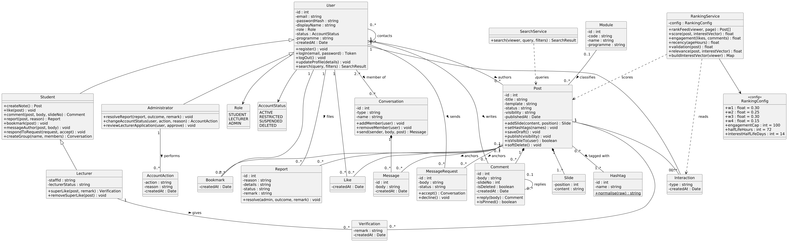

*Figure 4.2: PARP class diagram*

	Figure 4.2 shows the static structure of PARP as domain classes, their attributes and operations, and the two services that hold the system's core logic. The User hierarchy mirrors the use case diagram: User is abstract and holds identity, credentials, role and account status together with the operations every account shares, namely registration, login, logout, profile update and search. Student adds the content and communication operations, Lecturer specialises Student with the Super Like operations and its staff identifier, and Administrator carries the moderation operations. Modelling Lecturer as a subclass of Student, rather than as a sibling, expresses in the type structure the same rule the server enforces at run time: a lecturer can do everything a student can, plus verification.

	Post is the central content class and is composed of one or more Slide objects, drawn as composition because a slide has no existence outside its note and is deleted with it. Comment is likewise composed into Post and has a reflexive association that represents one level of replies. Post is associated with Hashtag in a many-to-many relationship, and with Like, Verification, Bookmark, Report and Interaction as association classes that record who acted on which note and when. The messaging classes are separated from content: MessageRequest holds a first message from a non-friend and creates a Conversation when accepted, Conversation is composed of Message objects, and both MessageRequest and Message carry an optional association to Post, which is the class-level expression of post-anchored messaging (FR7).

	RankingService and SearchService are drawn as service classes because they own behaviour that spans many entities. RankingService exposes one operation per component of the scoring formula in Section 2.3.4, namely engagement, recency, validation and relevance, together with buildInterestVector and the composite score operation. Separating the components into individual operations allows each to be unit tested against fixed inputs, which is the verification approach committed to in Section 2.3.4.10. Every weight and constant is read from RankingConfig, a single configuration object whose initial values are those of Section 2.3.4.7, so that the re-evaluation of the weights required by NFR5 after user acceptance testing changes one file and no scoring code.

# 4.2.4 Activity Diagrams

	Five activity diagrams describe the workflows that carry the project objectives: publishing a note, browsing the ranked feed, lecturer verification, searching, and post-anchored messaging. Each diagram separates the actor and the system into swimlanes, so that the boundary between user decisions and system processing is explicit.

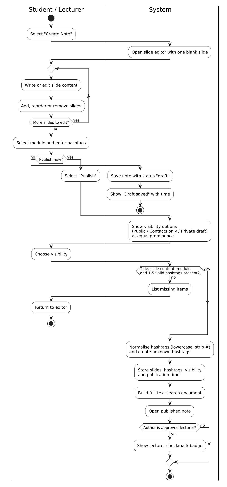

*Figure 4.3: Activity diagram for publishing a slide note*

	Figure 4.3 describes how a student or lecturer creates and publishes a slide note (UC05 to UC07). The author edits slides in a loop until the content is complete and then assigns a module and hashtags. The first decision separates saving a draft from publishing; a draft is stored without completeness checks so that unfinished work is never lost. When the author publishes, the system presents the three visibility options at equal prominence, which implements FR10's requirement that no option is visually favoured, since the survey found no option above 40.6 percent preference. Completeness is validated only at this point, and a failure returns the author to the editor with the missing items listed. On success the system normalises the hashtags, stores the note, and builds the full-text search document that later serves FR12. The final decision displays the lecturer badge when the author is an approved lecturer, which is the authorship component of lecturer validation.

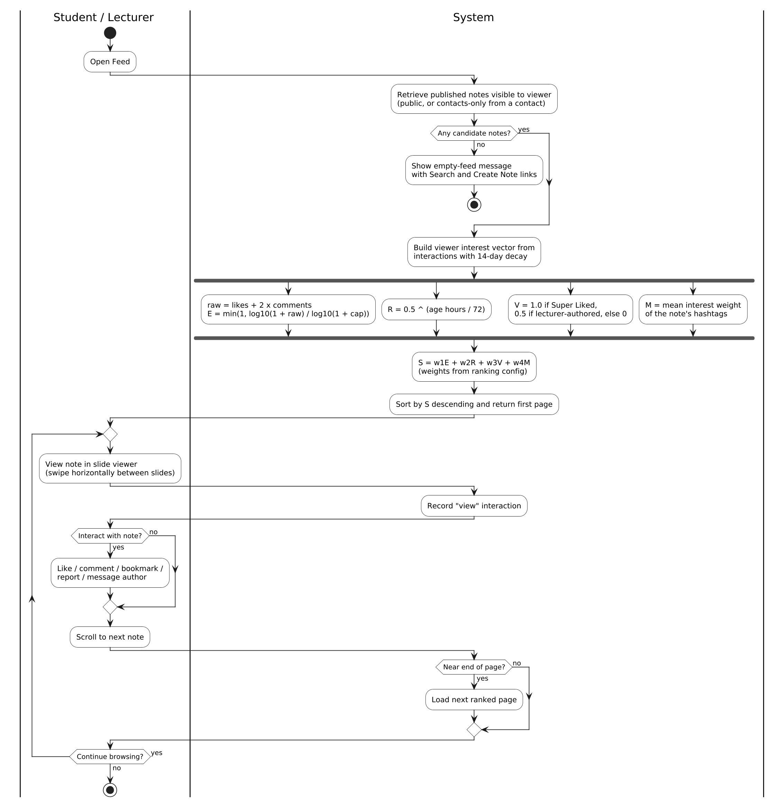

*Figure 4.4: Activity diagram for browsing the ranked feed*

	Figure 4.4 shows how the ranked feed is produced and consumed (UC09), and is the workflow that delivers Objective 1. After retrieving the notes the viewer is permitted to see, the system builds the viewer's interest vector and then calculates the four score components. These are drawn as parallel activities between a fork and a join because they are independent of one another; engagement depends only on like and comment counts, recency only on age, validation only on authorship and Super Likes, and relevance only on hashtags and the interest vector. The weighted sum then orders the page. The lower half of the diagram shows the browsing loop, in which every note that remains on screen is recorded as a view interaction. This feedback loop is what makes the ranking adaptive: each view, like and comment shifts the interest vector used for the next request.

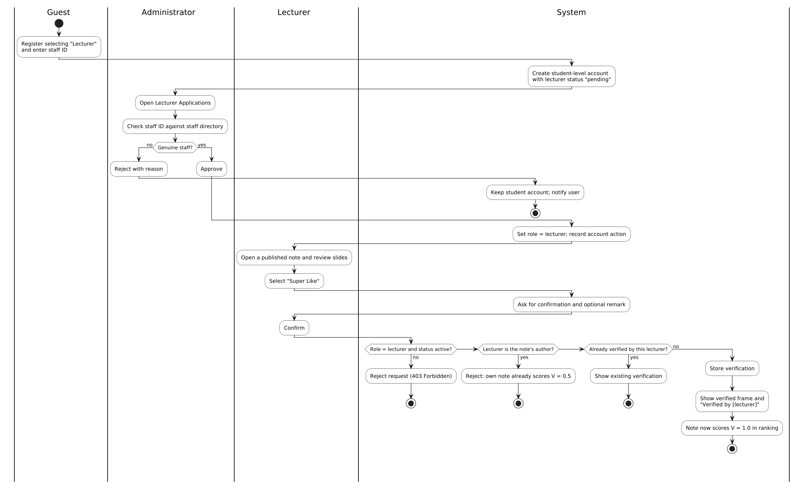

*Figure 4.5: Activity diagram for lecturer verification*

	Figure 4.5 covers both stages of lecturer verification: the approval of a lecturer account (UC22) and the Super Like of a note (UC19). The first stage was introduced during design to protect the trust signal; a user who registers as a lecturer receives student-level rights until an administrator confirms the staff identity. The second stage applies three guards in sequence before a verification is stored. The server checks the role and status regardless of what the interface displays, rejects a lecturer's attempt to verify their own note because authorship already contributes V = 0.5, and treats a repeated Super Like as idempotent. Only after all three checks does the note receive the verified frame and the maximum validation value, which addresses FR1 and FR2 and feeds FR3 through the ranking formula.

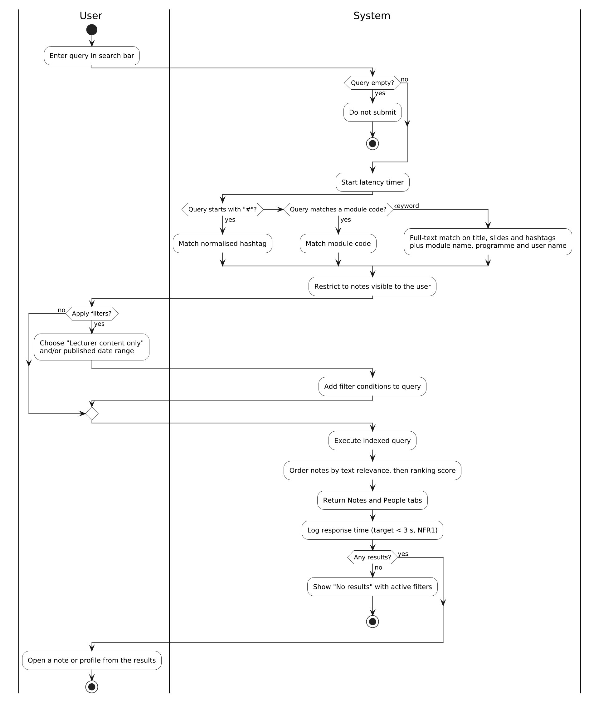

*Figure 4.6: Activity diagram for searching content*

	Figure 4.6 describes the search workflow (UC14) that serves Objective 2. The system first classifies the query so that each type uses its most selective access path: a hashtag query matches the normalised hashtag index, a module code matches the unique module code, and any other text uses the full-text index across titles, slide content and hashtags as well as module, programme and user names. This classification covers the three search keys of FR4 and the free-text requirement of FR12. Visibility restrictions are applied before the optional lecturer and date filters, which implement the reworked FR15. The latency timer that starts before the query and is logged after it is the measurement point for NFR1, so that the three-second target is evidenced from recorded timings rather than observation.

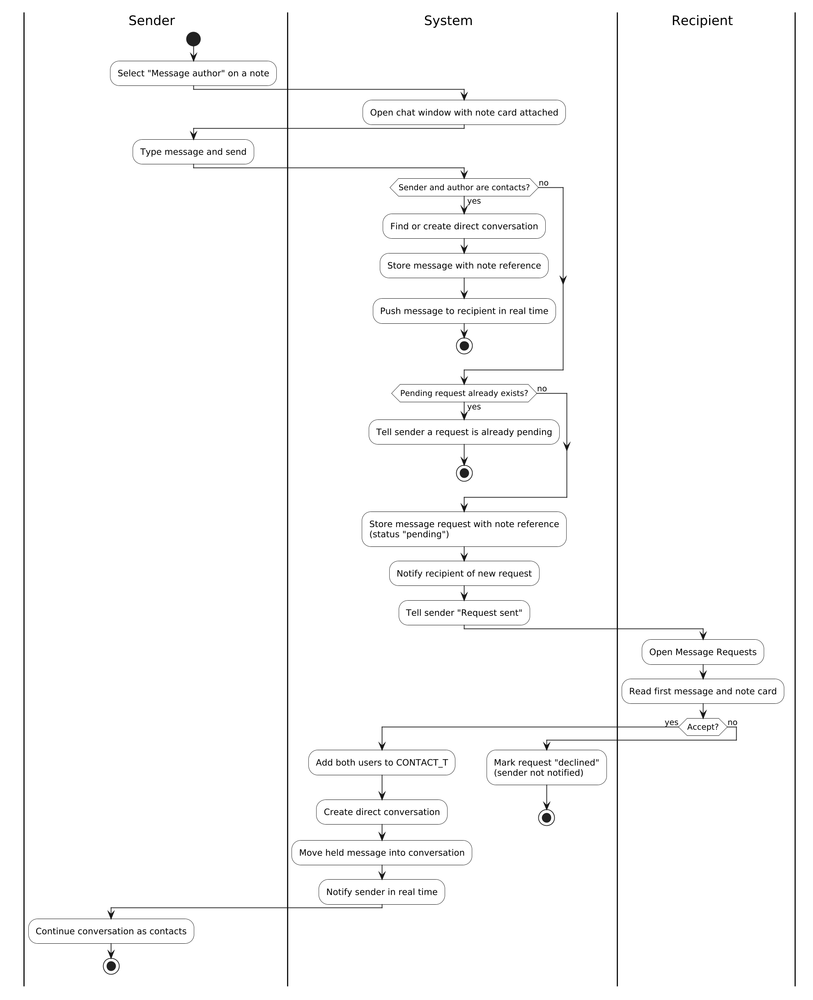

*Figure 4.7: Activity diagram for post-anchored messaging*

	Figure 4.7 shows how a user messages the author of a note (UC15 and UC16), which delivers Objective 4. The message always carries the note it was sent from, so the conversation opens with its academic context attached. The first decision applies FR6: messages between friends (two users who follow each other) are delivered immediately, while a message to a non-friend is held as a request. Duplicate requests are prevented, and the recipient's decision determines the outcome. Accepting creates the conversation and moves the held message into it, but does not make the two users friends; declining closes the request without notifying the sender. This design reflects the survey finding that 75 percent of respondents wanted approval before receiving messages from non-friends, while keeping the note-anchored first message that 78.1 percent rated useful.

# 4.2.5 Sequence Diagrams

	The sequence diagrams show the same five workflows at the level of the implemented architecture: the React client, the Express API with its Passport JWT middleware, the service classes, the Socket.io server for real-time messaging, and the PostgreSQL database. Messages are numbered so that each step can be referenced from the test cases in Section 4.5.

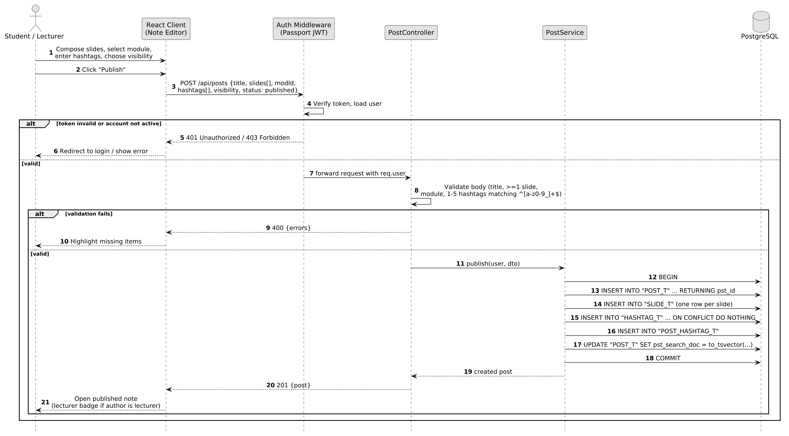

*Figure 4.8: Sequence diagram for publishing a slide note*

	Figure 4.8 shows the publish request passing through two layers of checks before any data is written. The authentication middleware rejects missing or invalid tokens and inactive accounts, and the controller rejects incomplete content with a 400 response listing each error, matching the exception flows of UC07. The service then writes the post, its slides, any new hashtags, the post-hashtag links and the search document inside a single transaction. A transaction is used because a note that is partially stored, for example with slides but without hashtags, would be visible in the feed with a relevance score of zero and would be absent from hashtag search; atomicity guarantees that a published note is either complete or absent.

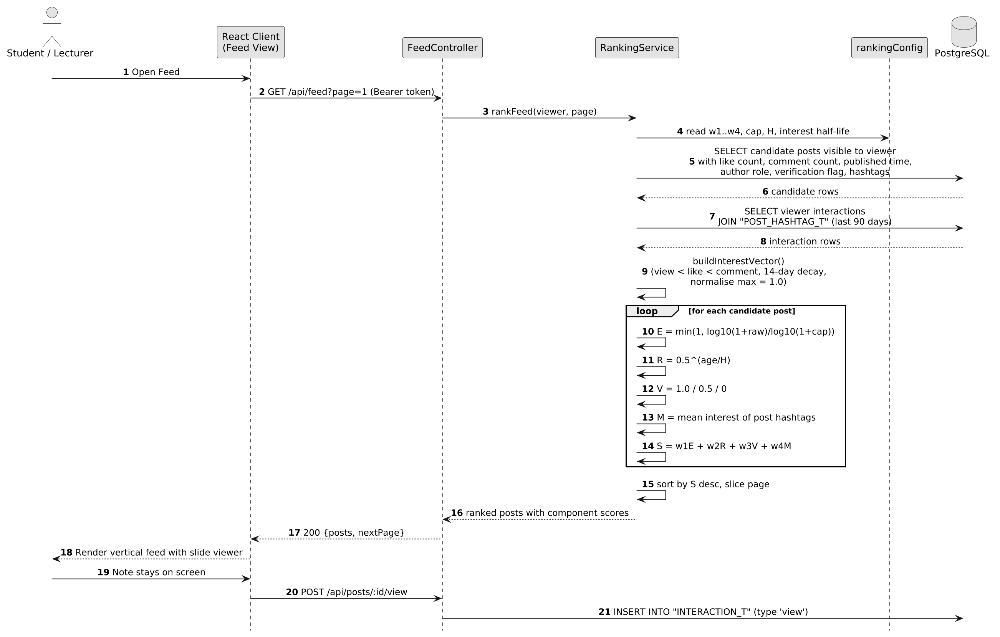

*Figure 4.9: Sequence diagram for generating the ranked feed*

	Figure 4.9 shows that RankingService reads all weights and constants from the configuration module at the start of every request, then retrieves candidate posts with their aggregated counts and the viewer's recent interactions in two queries. The scoring loop runs in the application rather than in SQL so that each component is a separately testable function and the arithmetic is identical to the formula in Section 2.3.4. Each component is constant-time per post, which satisfies the responsiveness argument used to justify the deterministic approach in Section 2.3.4.9. The final exchange shows the view interaction being recorded, closing the loop that updates the interest vector for later requests.

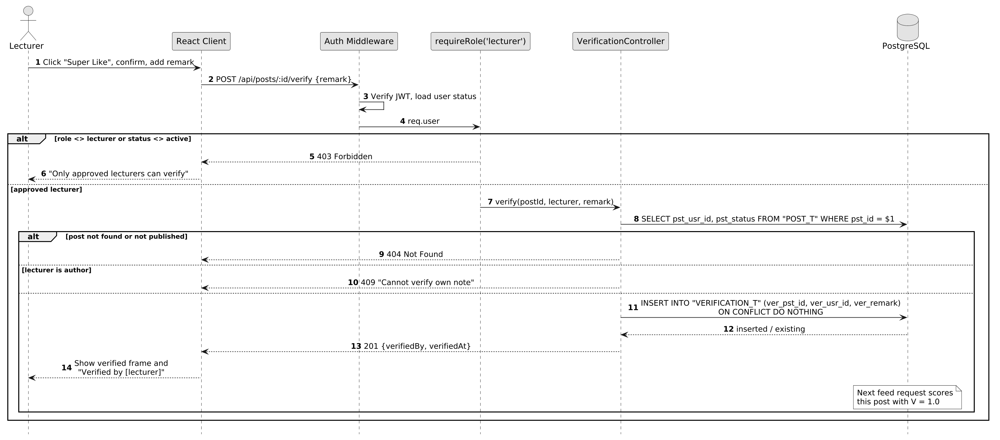

*Figure 4.10: Sequence diagram for lecturer verification*

	Figure 4.10 shows that verification is authorised on the server through a role-checking middleware placed after authentication, so a student who calls the endpoint directly receives a 403 response even though the interface never shows the button. The controller then distinguishes three outcomes with separate status codes: a missing or unpublished post, an attempt to verify one's own note, and a successful verification. The insert uses the unique constraint on the post and lecturer pair, so a repeated request cannot create a second verification. The note at the end records that no ranking data is updated at this point; the next feed request reads the new verification and scores the post with V = 1.0, which keeps the ranking free of stored scores that could become stale.

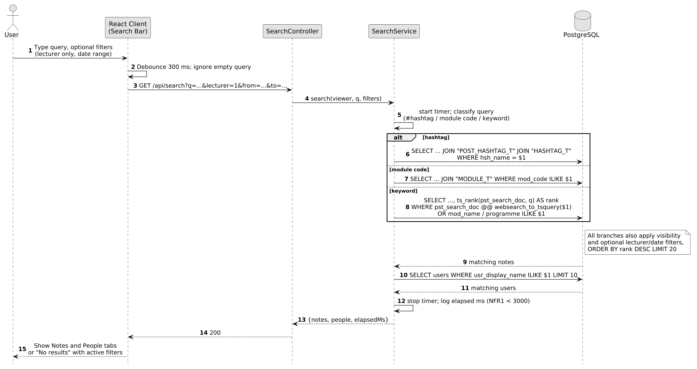

*Figure 4.11: Sequence diagram for searching content*

	Figure 4.11 shows search from the user's keystrokes to the rendered tabs. The client waits 300 milliseconds after the last keystroke before sending a request, which avoids a query per character without delaying a completed query noticeably. SearchService classifies the query and issues one of three parameterised queries; the full-text branch uses websearch_to_tsquery against the GIN-indexed search document and ranks results with ts_rank. All branches apply visibility and optional filters and limit the result size, and a second query returns matching people. The elapsed time is returned in the response and logged, giving the measured evidence required to evaluate FR5 and NFR1 in Chapter 6.

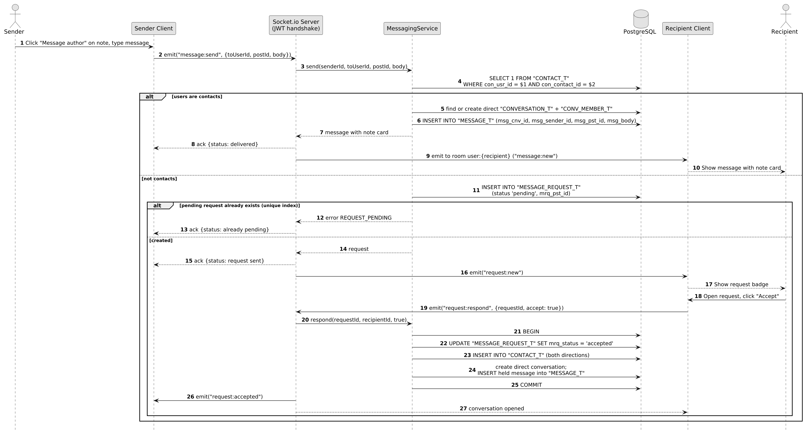

*Figure 4.12: Sequence diagram for post-anchored messaging*

	Figure 4.12 shows messaging over Socket.io, where the connection is authenticated with the same JSON Web Token during the handshake, so every event already carries a verified sender. MessagingService checks friendship first, which is a mutual follow: a row in FOLLOW_T in each direction. For friends, the message is stored with its post reference and pushed to a room named after the recipient, so delivery reaches every device on which the recipient is connected. For non-friends, the message is stored as a pending request, and a partial unique index in the database rejects a second pending request between the same pair, so the duplicate check cannot be bypassed by concurrent requests. Acceptance is processed in one transaction that updates the request, creates the conversation and moves the held message, so a request is never marked accepted without the conversation that should accompany it. Acceptance does not create follow rows, because friendship is decided only by the users' own follows.

# 4.3 Database Design

## 4.3.1 Entity Relationship Diagram

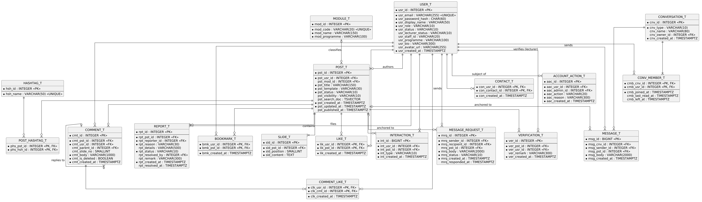

*Figure 4.13: PARP entity relationship diagram (crow's foot notation)*

	Figure 4.13 presents the relational data model of PARP as twenty-four entities in crow's foot notation. The model is organised around two central entities. USER_T holds every account, with a single role attribute distinguishing students, lecturers and administrators rather than three separate tables, because the three roles share all identity attributes and a lecturer differs from a student only in permissions. POST_T holds each slide note and references its author and its module; the slides themselves are stored in SLIDE_T as an ordered one-to-many child, since a note contains a variable number of slides that must keep their sequence. A post may exist without a module only while it is a draft, and a check constraint enforces that a published post always has a module, a visibility value and a publication time, which keeps the feed and search queries free of incomplete rows.

	The entities around POST_T map directly to the four components of the ranking formula in Section 2.3.4. LIKE_T and COMMENT_T provide the like and comment counts for the engagement component E. The publication time on POST_T provides the age for the recency component R. VERIFICATION_T records each lecturer Super Like and, together with the author's role, determines the lecturer validation component V. HASHTAG_T, linked to posts through the associative entity POST_HASHTAG_T, and INTERACTION_T together provide the relevance component M: INTERACTION_T is an append-only log of the views, likes and comments each user performs, from which the viewer's decayed interest weight for each hashtag is calculated. Storing raw interactions instead of a pre-computed interest vector keeps the 14-day decay exact and allows the weights to be re-tuned after user acceptance testing (NFR5) without migrating stored data.

	The remaining entities serve engagement, moderation and messaging. COMMENT_T references itself through cmt_parent_id to support one level of replies (FR16), and COMMENT_LIKE_T supplies the like counts that order student comments beneath pinned lecturer comments. BOOKMARK_T implements the saved-notes list (FR14), and REPORT_T together with ACCOUNT_ACTION_T record the moderation workflow, including which administrator resolved each report or changed each account status. FOLLOW_T records who follows whom, one row per direction; when two users follow each other they are friends, who may see each other's contacts-only notes (FR10) and message each other directly. Messaging is separated into MESSAGE_REQUEST_T, which holds a first message from a non-friend until the recipient approves it (FR6), and CONVERSATION_T, CONV_MEMBER_T and MESSAGE_T, which hold direct and group conversations (FR13); approving a request opens that conversation without making the two users friends. Both MESSAGE_REQUEST_T and MESSAGE_T carry an optional reference to POST_T, which is how a message is anchored to a specific note (FR7, Objective 4). For legibility, Figure 4.13 draws one relationship line per pair of entities, except FOLLOW_T, which is drawn twice because it references USER_T as both follower and followee; the second foreign keys to USER_T in MESSAGE_REQUEST_T, REPORT_T, CONVERSATION_T and ACCOUNT_ACTION_T are listed in Table 4.23.

	Two entities were added after the first design to meet the scale and reliability targets, and a third replaced an earlier one. FOLLOW_T replaced the original CONTACT_T, which stored a symmetric pair created by an accepted message request. A directed follow with a composite primary key and a check that a user cannot follow themselves is a single relationship from which friendship is derived at query time as a pair of follows in opposite directions, so there is no second table that could drift out of step; the migration that introduced it copied each existing contact into both directions. FEED_SNAPSHOT_T stores, for one viewer and one request time, the ranked list of post identifiers and their scores as arrays. The first page of the For You feed ranks the candidates once and writes this row, and later pages read a slice of it, so that a viewer paging through the feed sees a stable order and the ranking work is not repeated for every page; rows are short-lived and are deleted when they expire. RATE_LIMIT_T is an operational table with no foreign key to any other entity: it holds one counter per rate-limit key (a user identifier or an address) and time window, so that the request limits are enforced consistently across several server instances. It is therefore drawn in Figure 4.13 as a standalone entity.

	Three entities support shared notes (R30), which were added after the first design. COLLABORATOR_T grants a user view or edit access to one note, with a composite primary key so that a user holds one role per note; the owner is never a row, because ownership is already recorded in pst_usr_id. An invited editor is credited on the note, and the note reaches their followers, only once clb_edited_at records their first save, so an owner cannot attach someone's name to a note they never worked on. SHARE_LINK_T stores the view and edit links an owner hands out. Only the SHA-256 hash of each random token is kept, so a copy of the database cannot be used to open shared notes, and a partial unique index allows at most one active link per note and role, which makes regenerating a link revoke the old one. COLLAB_REQUEST_T records a reader's request to collaborate until the owner approves or declines it, with a partial unique index that permits one pending request per note and user. POST_T gained three columns for the same feature: pst_content_edited_at records the last change to the title or slides of a published note, and a lecturer Super Like older than it no longer counts towards V until the lecturer confirms it again, while pst_lock_usr_id and pst_lock_expires_at hold a short soft lock so that only one collaborator edits at a time.

## 4.3.2 Database Schema

	Table 4.23 lists every table, field, data type, size and constraint of the schema. Table names follow the uppercase singular form with a _T suffix, and field names are lowercase with a three-letter table prefix, so that a field's origin is visible in any query. Because PostgreSQL folds unquoted identifiers to lowercase, table names are written in double quotes in every SQL statement so that the live database matches this schema exactly. Six PostgreSQL-specific types are used where a generic type would be weaker: identity columns generate primary keys without separate sequences, TIMESTAMPTZ stores times with their offset so that recency decay is correct regardless of server time zone, TEXT holds slide content of unpredictable length, TSVECTOR stores the pre-processed search document for full-text search (FR12), array types (INTEGER[] and DOUBLE PRECISION[]) hold the ranked list in FEED_SNAPSHOT_T as one row, and BIGINT is used for the two tables expected to grow fastest, INTERACTION_T and MESSAGE_T. The password hash uses CHAR(60) because bcrypt output is always exactly sixty characters.

*Table 4.23: PARP database schema*

The schema table is also rendered as high-resolution images for the report: `diagrams/png/schema_table_1.png` to `schema_table_4.png`.

| Table name | Field name | Data type | Size | Constraint | Description |
| --- | --- | --- | --- | --- | --- |
| USER_T | usr_id | INTEGER (identity) | | PK, NOT NULL | Unique user identifier |
| | usr_email | VARCHAR | 255 | NOT NULL, UNIQUE | Login email address |
| | usr_password_hash | CHAR | 60 | NOT NULL | bcrypt hash of the password |
| | usr_display_name | VARCHAR | 50 | NOT NULL | Name shown on notes and messages |
| | usr_role | VARCHAR | 10 | NOT NULL, CHECK (student, lecturer, admin) | Permission level |
| | usr_status | VARCHAR | 10 | NOT NULL, CHECK (active, restricted, suspended, deleted) | Account standing set by administrators |
| | usr_lecturer_status | VARCHAR | 10 | CHECK (pending, approved, rejected) | Lecturer application state; null for non-applicants |
| | usr_staff_id | VARCHAR | 20 | | Staff ID supplied with a lecturer application |
| | usr_programme | VARCHAR | 100 | | Programme of study or teaching; searchable |
| | usr_bio | VARCHAR | 300 | | Short profile biography |
| | usr_avatar_url | VARCHAR | 255 | | Path of the profile picture |
| | usr_created_at | TIMESTAMPTZ | | NOT NULL | Registration time |
| MODULE_T | mod_id | INTEGER (identity) | | PK, NOT NULL | Unique module identifier |
| | mod_code | VARCHAR | 20 | NOT NULL, UNIQUE | Module code, e.g. CT046-3-M |
| | mod_name | VARCHAR | 150 | NOT NULL | Module name |
| | mod_programme | VARCHAR | 100 | NOT NULL | Programme the module belongs to |
| POST_T | pst_id | INTEGER (identity) | | PK, NOT NULL | Unique note identifier |
| | pst_usr_id | INTEGER | | FK → USER_T, NOT NULL | Author |
| | pst_mod_id | INTEGER | | FK → MODULE_T | Module; required once published |
| | pst_title | VARCHAR | 150 | NOT NULL | Note title |
| | pst_template | VARCHAR | 30 | NOT NULL | Slide template chosen in the editor |
| | pst_status | VARCHAR | 10 | NOT NULL, CHECK (draft, published, hidden, deleted) | Lifecycle state |
| | pst_visibility | VARCHAR | 10 | CHECK (public, contacts) | Audience; required once published |
| | pst_search_doc | TSVECTOR | | GIN index | Full-text document built from title, slides and hashtags |
| | pst_created_at | TIMESTAMPTZ | | NOT NULL | Creation time |
| | pst_updated_at | TIMESTAMPTZ | | NOT NULL | Last edit time |
| | pst_published_at | TIMESTAMPTZ | | | Publication time; age for recency R |
| | pst_content_edited_at | TIMESTAMPTZ | | | Last title or slide change after publication; older Super Likes stop counting for V |
| | pst_lock_usr_id | INTEGER | | FK → USER_T; set together with pst_lock_expires_at | Collaborator holding the soft edit lock |
| | pst_lock_expires_at | TIMESTAMPTZ | | | Time the soft edit lock lapses unless renewed |
| SLIDE_T | sld_id | INTEGER (identity) | | PK, NOT NULL | Unique slide identifier |
| | sld_pst_id | INTEGER | | FK → POST_T, NOT NULL | Owning note |
| | sld_position | SMALLINT | | NOT NULL, UNIQUE with sld_pst_id | Order of the slide within the note |
| | sld_content | TEXT | | NOT NULL | Sanitised formatted slide content |
| HASHTAG_T | hsh_id | INTEGER (identity) | | PK, NOT NULL | Unique hashtag identifier |
| | hsh_name | VARCHAR | 50 | NOT NULL, UNIQUE, CHECK lowercase letters, digits, underscore | Normalised hashtag text without "#" |
| POST_HASHTAG_T | phs_pst_id | INTEGER | | PK, FK → POST_T | Tagged note |
| | phs_hsh_id | INTEGER | | PK, FK → HASHTAG_T | Hashtag applied |
| LIKE_T | lik_usr_id | INTEGER | | PK, FK → USER_T | User who liked |
| | lik_pst_id | INTEGER | | PK, FK → POST_T | Liked note |
| | lik_created_at | TIMESTAMPTZ | | NOT NULL | Time of like |
| VERIFICATION_T | ver_id | INTEGER (identity) | | PK, NOT NULL | Unique verification identifier |
| | ver_pst_id | INTEGER | | FK → POST_T, NOT NULL, UNIQUE with ver_usr_id | Verified note |
| | ver_usr_id | INTEGER | | FK → USER_T, NOT NULL | Approved lecturer who gave the Super Like |
| | ver_remark | VARCHAR | 300 | | Optional review remark |
| | ver_created_at | TIMESTAMPTZ | | NOT NULL | Time of verification |
| COMMENT_T | cmt_id | INTEGER (identity) | | PK, NOT NULL | Unique comment identifier |
| | cmt_pst_id | INTEGER | | FK → POST_T, NOT NULL | Note commented on |
| | cmt_usr_id | INTEGER | | FK → USER_T, NOT NULL | Commenter |
| | cmt_parent_id | INTEGER | | FK → COMMENT_T | Parent comment for a reply; null for top level |
| | cmt_slide_no | SMALLINT | | CHECK ≥ 1 | Optional slide the comment refers to |
| | cmt_body | VARCHAR | 1000 | NOT NULL, CHECK not blank | Comment text |
| | cmt_is_deleted | BOOLEAN | | NOT NULL | Soft-delete flag preserving reply threads |
| | cmt_created_at | TIMESTAMPTZ | | NOT NULL | Time of comment |
| COMMENT_LIKE_T | clk_usr_id | INTEGER | | PK, FK → USER_T | User who liked the comment |
| | clk_cmt_id | INTEGER | | PK, FK → COMMENT_T | Liked comment |
| | clk_created_at | TIMESTAMPTZ | | NOT NULL | Time of like |
| REPORT_T | rpt_id | INTEGER (identity) | | PK, NOT NULL | Unique report identifier |
| | rpt_pst_id | INTEGER | | FK → POST_T, NOT NULL | Reported note |
| | rpt_reporter_id | INTEGER | | FK → USER_T, NOT NULL | Reporting user |
| | rpt_reason | VARCHAR | 30 | NOT NULL, CHECK (inaccurate, inappropriate, spam, plagiarism, copyright, other) | Report category |
| | rpt_details | VARCHAR | 500 | | Reporter's explanation |
| | rpt_status | VARCHAR | 10 | NOT NULL, CHECK (open, dismissed, upheld); one open report per user and note | Resolution state |
| | rpt_resolved_by | INTEGER | | FK → USER_T | Administrator who resolved the report |
| | rpt_remark | VARCHAR | 300 | | Administrator's resolution remark |
| | rpt_created_at | TIMESTAMPTZ | | NOT NULL | Time reported |
| | rpt_resolved_at | TIMESTAMPTZ | | | Time resolved |
| BOOKMARK_T | bmk_usr_id | INTEGER | | PK, FK → USER_T | User who saved the note |
| | bmk_pst_id | INTEGER | | PK, FK → POST_T | Saved note |
| | bmk_created_at | TIMESTAMPTZ | | NOT NULL | Time saved |
| INTERACTION_T | int_id | BIGINT (identity) | | PK, NOT NULL | Unique interaction identifier |
| | int_usr_id | INTEGER | | FK → USER_T, NOT NULL | Acting user |
| | int_pst_id | INTEGER | | FK → POST_T, NOT NULL | Note interacted with |
| | int_type | VARCHAR | 10 | NOT NULL, CHECK (view, like, comment) | Interaction kind; sets its weight in the interest vector |
| | int_created_at | TIMESTAMPTZ | | NOT NULL | Interaction time; age for the 14-day decay |
| FOLLOW_T | fol_follower_id | INTEGER | | PK, FK → USER_T | User who follows |
| | fol_followee_id | INTEGER | | PK, FK → USER_T, CHECK differs from fol_follower_id; indexed | User being followed; a row in each direction makes the two users friends |
| | fol_created_at | TIMESTAMPTZ | | NOT NULL | Time of the follow; orders follower lists |
| MESSAGE_REQUEST_T | mrq_id | INTEGER (identity) | | PK, NOT NULL | Unique request identifier |
| | mrq_sender_id | INTEGER | | FK → USER_T, NOT NULL | Requesting user |
| | mrq_recipient_id | INTEGER | | FK → USER_T, NOT NULL | Recipient who must approve |
| | mrq_pst_id | INTEGER | | FK → POST_T | Note the request is anchored to |
| | mrq_body | VARCHAR | 2000 | NOT NULL | First message, held until accepted |
| | mrq_status | VARCHAR | 10 | NOT NULL, CHECK (pending, accepted, declined); one pending per pair | Request state |
| | mrq_created_at | TIMESTAMPTZ | | NOT NULL | Time sent |
| | mrq_responded_at | TIMESTAMPTZ | | | Time accepted or declined |
| CONVERSATION_T | cnv_id | INTEGER (identity) | | PK, NOT NULL | Unique conversation identifier |
| | cnv_type | VARCHAR | 10 | NOT NULL, CHECK (direct, group) | Conversation kind |
| | cnv_name | VARCHAR | 80 | Required for groups | Group chat name |
| | cnv_owner_id | INTEGER | | FK → USER_T; required for groups | Group creator who manages members |
| | cnv_created_at | TIMESTAMPTZ | | NOT NULL | Creation time |
| CONV_MEMBER_T | cmb_cnv_id | INTEGER | | PK, FK → CONVERSATION_T | Conversation |
| | cmb_usr_id | INTEGER | | PK, FK → USER_T | Member |
| | cmb_joined_at | TIMESTAMPTZ | | NOT NULL | Time joined |
| | cmb_last_read_at | TIMESTAMPTZ | | | Last read time, for unread counts |
| | cmb_left_at | TIMESTAMPTZ | | | Time the member left a group |
| MESSAGE_T | msg_id | BIGINT (identity) | | PK, NOT NULL | Unique message identifier |
| | msg_cnv_id | INTEGER | | FK → CONVERSATION_T, NOT NULL | Conversation |
| | msg_sender_id | INTEGER | | FK → USER_T, NOT NULL | Sender |
| | msg_pst_id | INTEGER | | FK → POST_T | Note attached to the message (post anchor) |
| | msg_body | VARCHAR | 2000 | NOT NULL | Message text |
| | msg_created_at | TIMESTAMPTZ | | NOT NULL | Time sent |
| ACCOUNT_ACTION_T | aac_id | INTEGER (identity) | | PK, NOT NULL | Unique action identifier |
| | aac_usr_id | INTEGER | | FK → USER_T, NOT NULL | Account acted on |
| | aac_admin_id | INTEGER | | FK → USER_T, NOT NULL | Administrator who acted |
| | aac_action | VARCHAR | 20 | NOT NULL, CHECK (restrict, suspend, reinstate, delete, approve_lecturer, reject_lecturer) | Action taken |
| | aac_reason | VARCHAR | 300 | NOT NULL | Recorded justification |
| | aac_created_at | TIMESTAMPTZ | | NOT NULL | Time of action |
| FEED_SNAPSHOT_T | fsn_usr_id | INTEGER | | PK, FK → USER_T, NOT NULL, ON DELETE CASCADE | Viewer the snapshot was ranked for |
| | fsn_as_of | TIMESTAMPTZ | | PK, NOT NULL | Request time the ranking is pinned to |
| | fsn_pst_ids | INTEGER[] | | NOT NULL | Post identifiers in ranked order; later pages read a slice |
| | fsn_scores | DOUBLE PRECISION[] | | NOT NULL | Score and components for each post, in the same order |
| | fsn_created_at | TIMESTAMPTZ | | NOT NULL, default now; indexed | Time stored; used to purge expired snapshots |
| RATE_LIMIT_T | rlt_key | VARCHAR | 200 | PK, NOT NULL | Rate-limit key built from the user identifier or client address |
| | rlt_window_start | TIMESTAMPTZ | | NOT NULL | Start of the current fixed window |
| | rlt_hits | INTEGER | | NOT NULL | Requests counted in the window |
| COLLABORATOR_T | clb_pst_id | INTEGER | | PK, FK → POST_T, ON DELETE CASCADE | Shared note |
| | clb_usr_id | INTEGER | | PK, FK → USER_T; indexed | Collaborator; never the owner |
| | clb_role | VARCHAR | 4 | NOT NULL, CHECK (view, edit) | Read-only access or co-author |
| | clb_added_by | INTEGER | | FK → USER_T, NOT NULL | Owner who granted the access |
| | clb_created_at | TIMESTAMPTZ | | NOT NULL | Time access was granted |
| | clb_edited_at | TIMESTAMPTZ | | | First save by this co-author; credit and Following-feed reach start here |
| SHARE_LINK_T | shl_id | INTEGER (identity) | | PK, NOT NULL | Unique link identifier |
| | shl_pst_id | INTEGER | | FK → POST_T, NOT NULL, ON DELETE CASCADE | Shared note |
| | shl_role | VARCHAR | 4 | NOT NULL, CHECK (view, edit); one active per note and role | Access the link grants |
| | shl_token_hash | CHAR | 64 | NOT NULL, UNIQUE | SHA-256 of the random token; the token itself is never stored |
| | shl_created_at | TIMESTAMPTZ | | NOT NULL | Time created |
| | shl_revoked_at | TIMESTAMPTZ | | | Time revoked or replaced; null while active |
| COLLAB_REQUEST_T | crq_id | INTEGER (identity) | | PK, NOT NULL | Unique request identifier |
| | crq_pst_id | INTEGER | | FK → POST_T, NOT NULL, ON DELETE CASCADE | Note the reader wants to work on |
| | crq_usr_id | INTEGER | | FK → USER_T, NOT NULL; one pending per note and user | Requesting user |
| | crq_message | VARCHAR | 300 | | Optional note to the owner |
| | crq_status | VARCHAR | 8 | NOT NULL, CHECK (pending, approved, declined) | Request state |
| | crq_created_at | TIMESTAMPTZ | | NOT NULL | Time sent |
| | crq_decided_at | TIMESTAMPTZ | | Set exactly when not pending | Time approved or declined |

	The schema is created by the versioned migration file `server/db/migrations/20261013000001_initial_schema.sql`, so that every later change is recorded as a new migration rather than an edit to the live database. Indexes are defined for the access paths that determine performance: published posts ordered by publication time for the feed, the GIN index on pst_search_doc and the hashtag index on POST_HASHTAG_T for the sub-three-second search target (FR5, NFR1), and the user and time index on INTERACTION_T for building interest vectors. Migrations added after the initial schema create further indexes, each for one access path:

- `comment_like_comment_idx` on COMMENT_LIKE_T (clk_cmt_id): counts the likes of each comment when comments are listed.
- `interaction_user_post_time_idx` on INTERACTION_T (int_usr_id, int_pst_id, int_created_at DESC): finds a viewer's latest interaction with a note for the view-logging window and the interest vector.
- `report_post_idx` on REPORT_T (rpt_pst_id): groups reports by note in the moderation queue.
- `message_request_recipient_pending_idx` on MESSAGE_REQUEST_T (mrq_recipient_id), partial on pending requests: lists a recipient's open requests without scanning resolved ones.
- `follow_followee_idx` on FOLLOW_T (fol_followee_id): lists a user's followers and checks the reverse direction of a follow.
- `feed_snapshot_created_idx` on FEED_SNAPSHOT_T (fsn_created_at): deletes expired snapshots.
- `comment_parent_idx` on COMMENT_T (cmt_parent_id), partial on replies: checks whether a deleted top-level comment still has live replies.
- `collaborator_user_idx` on COLLABORATOR_T (clb_usr_id): lists the notes shared with a user.
- `share_link_active_idx` on SHARE_LINK_T (shl_pst_id, shl_role), unique and partial on active links: keeps one active link per note and role.
- `collab_request_pending_idx` on COLLAB_REQUEST_T (crq_pst_id, crq_usr_id), unique and partial on pending requests: one open request per reader and note.

# 4.4 Interface Design

	The wireframes below were produced before implementation to fix the layout and navigation of PARP. They are deliberately low fidelity and greyscale, so that review concentrates on content, hierarchy and flow rather than visual styling. Twenty-four screens use a desktop layout of 1280 by 800 pixels with a persistent top bar for search and a left navigation column; one screen shows the mobile layout of the feed, which is the screen most affected by NFR2. Every screen is traceable to the use cases in Section 4.2.2. Wireframes are generated from a single source file (`docs/chapter4/wireframes/build.mjs`) so that changes agreed with the supervisor can be applied consistently across all screens.

## 4.4.1 Account screens

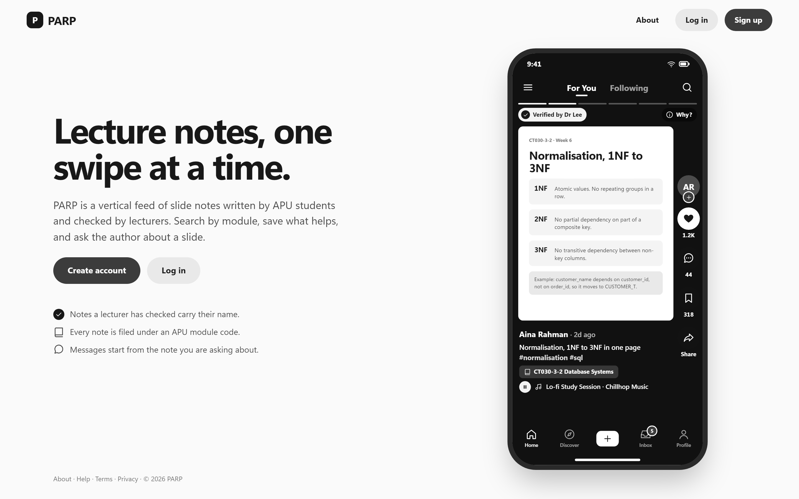

*Figure 4.14: Landing page*

	The landing page is the only screen a guest sees before authenticating. It states the three benefits that the survey supported most strongly, namely lecturer-verified notes, search by module code and messaging about a specific note, rather than describing the ranking algorithm, following the recommendation in Section 3.3.3.3 that the feed be presented through its visible effects. The two calls to action lead to registration and login.

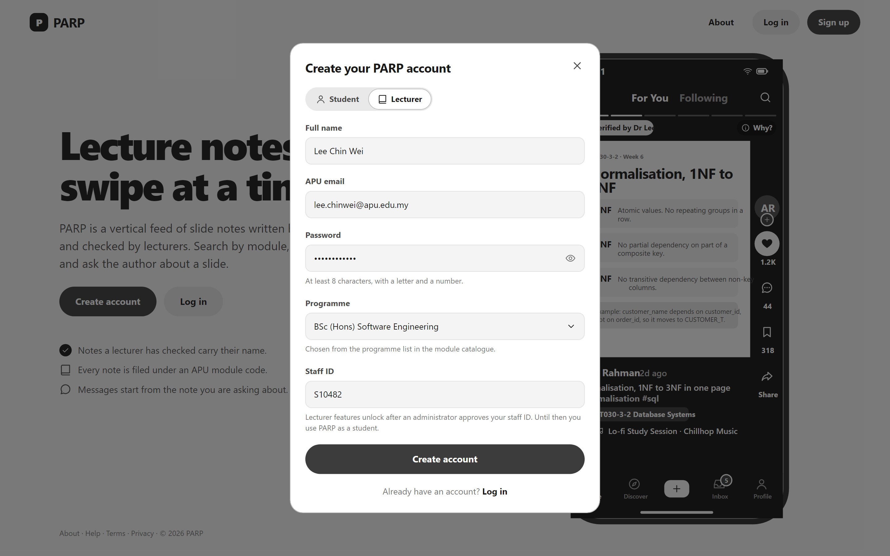

*Figure 4.15: Registration page*

	The registration form implements UC01. Display name, email, password with confirmation and programme are mandatory, and the role choice is presented as two buttons with Student selected by default. Selecting Lecturer reveals a staff ID field and an explanation that lecturer features become available only after administrator approval, which sets the user's expectation for the approval step introduced in UC22.

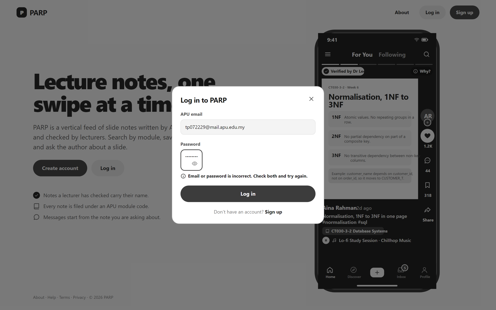

*Figure 4.16: Login page*

	The login page implements UC02 and is shown in its error state. A single generic message is displayed for an incorrect email or password so that the form does not reveal which accounts exist. Suspended accounts receive a distinct message, as specified in the exception flow of UC02.

## 4.4.2 Feed and note screens

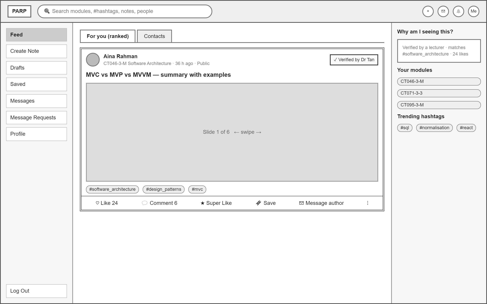

*Figure 4.17: Ranked feed (desktop)*

	The feed is the home screen after login (UC09). Each note occupies the centre column with its author, module, age and visibility, the slide viewer, its hashtags and an action bar for like, comment, Super Like, save and message author. A verified note carries a double frame and a "Verified by" label (FR2). The right column explains why the note is shown in plain terms, presenting the ranking through its effects as recommended in Section 3.3.3.3.

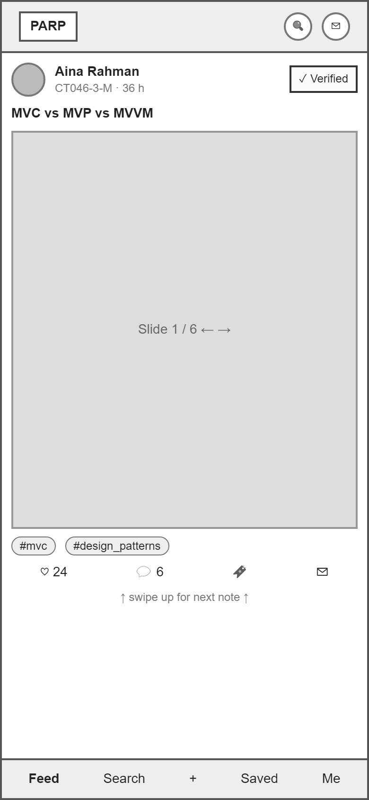

*Figure 4.18: Ranked feed (mobile)*

	The mobile feed shows the same content in a single column for a 390-pixel screen (NFR2). One note fills the viewport, the user swipes horizontally between slides and vertically to the next note, and the left navigation is replaced by a bottom tab bar. The Super Like action is omitted from this student view because it appears only for approved lecturers.

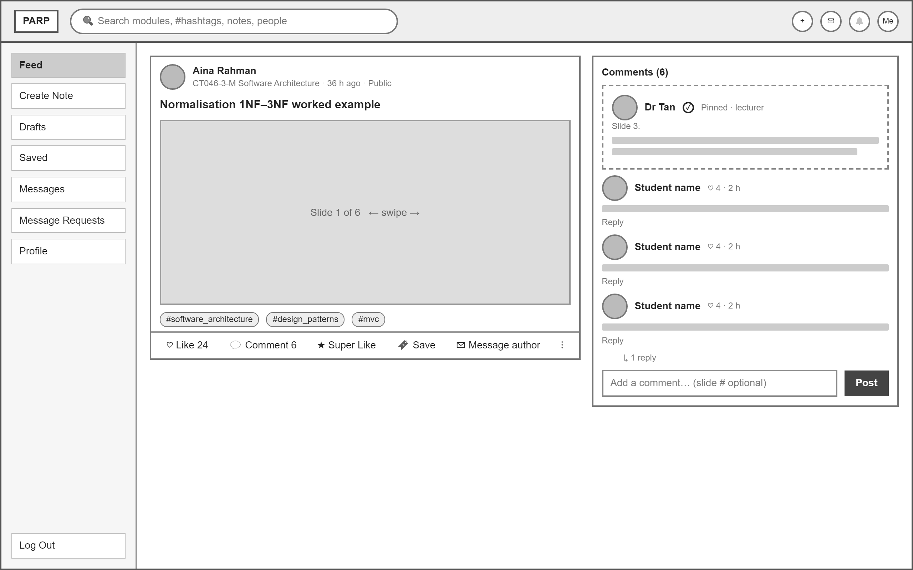

*Figure 4.19: Note detail with comments*

	Opening a note shows its slides beside the comment panel (UC11). The lecturer's comment is pinned at the top with the lecturer badge and refers to a specific slide, which is how lecturer feedback is attached to part of a note after annotation (FR18) was removed from scope. Student comments follow in order of likes, each with a Reply action that creates one level of replies (FR16).

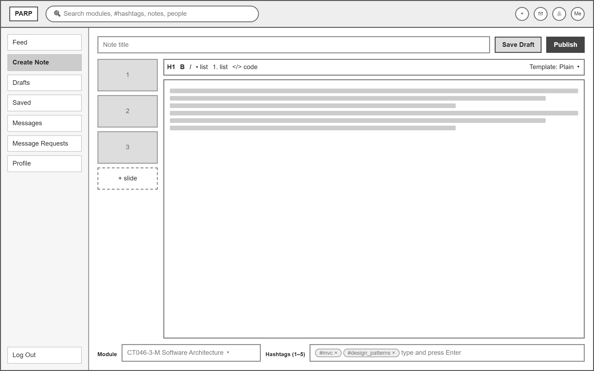

*Figure 4.20: Slide note editor*

	The editor implements UC05 and FR8. The left strip lists slides as thumbnails that can be reordered or extended, the formatting toolbar offers headings, emphasis, lists and code blocks, and a template selector sets the slide layout. Module selection and hashtag entry sit below the canvas, so that the two pieces of information required for ranking and search are visible before the author reaches the Publish button.

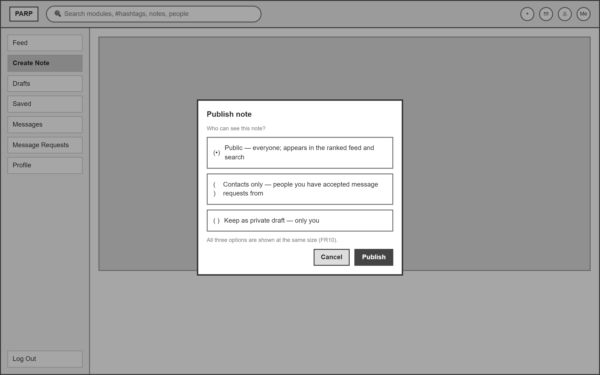

*Figure 4.21: Publish visibility dialog*

	Publishing opens a dialog with the three visibility options of FR10 presented as equally sized choices with one-line consequences. Equal prominence responds to the survey result in which no option exceeded 40.6 percent, so the interface does not steer authors toward public sharing. Choosing the private option performs a draft save instead of publishing.

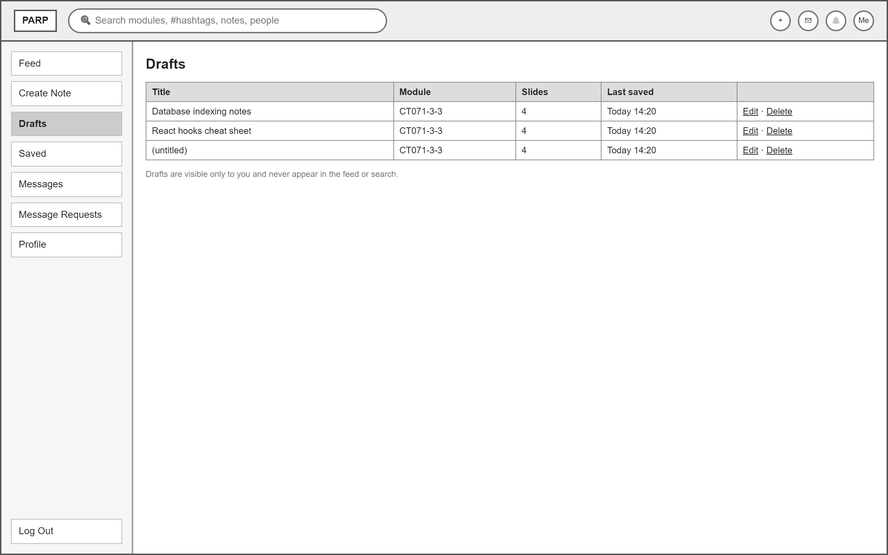

*Figure 4.22: Drafts list*

	The Drafts screen implements the retrieval part of UC06. It lists each unfinished note with its module, slide count and last saved time, with actions to resume editing or delete. A short notice reminds the author that drafts never appear in the feed or in search.

## 4.4.3 Profile, search and saved screens

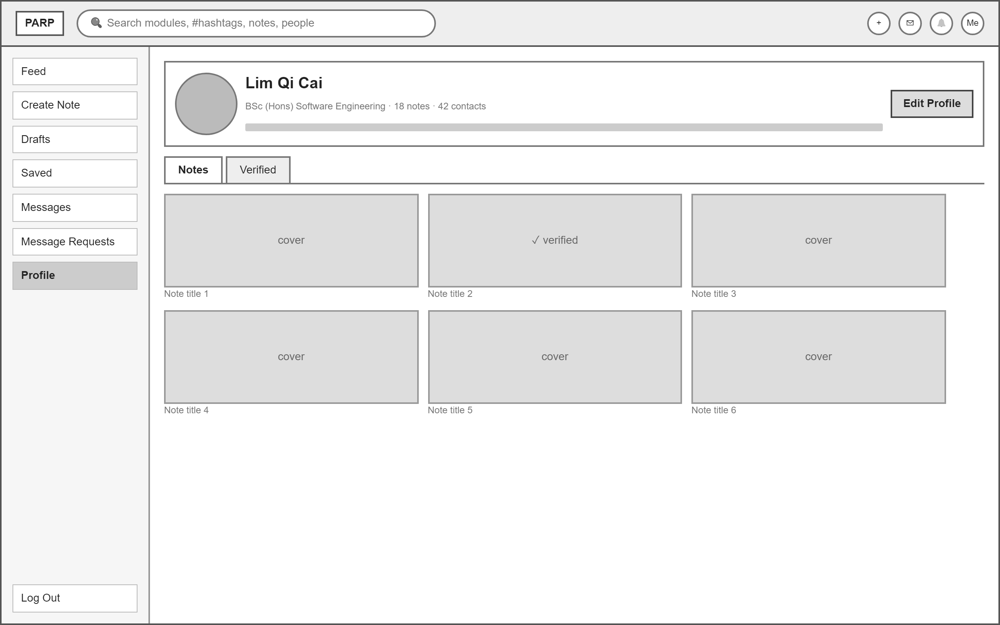

*Figure 4.23: Own profile*

	The profile page (UC04) shows the user's name, programme and counts of notes and contacts above a grid of their notes. A Verified tab collects the notes a lecturer has Super Liked, which gives students visible recognition for validated work. The Edit Profile button leads to Figure 4.25.

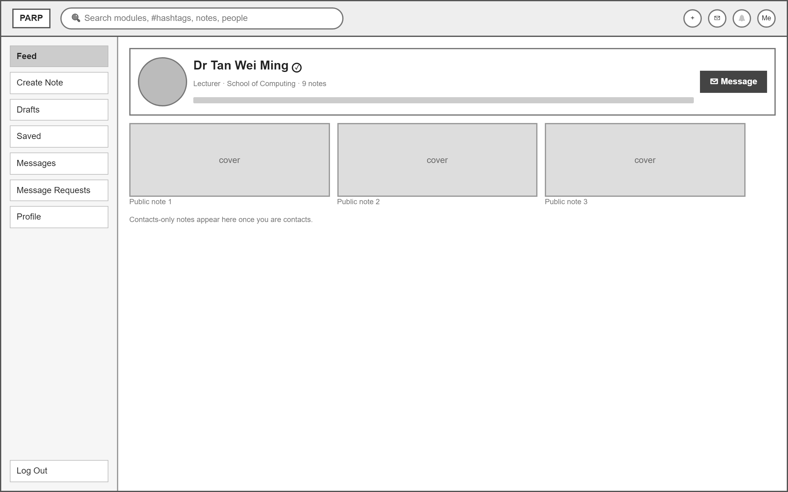

*Figure 4.24: Another user's profile*

	Viewing another user's profile shows only the notes the viewer is permitted to see, as specified in the alternative process of UC04. A lecturer profile carries the checkmark badge. The Message button starts a conversation, which becomes a message request if the two users are not yet contacts.

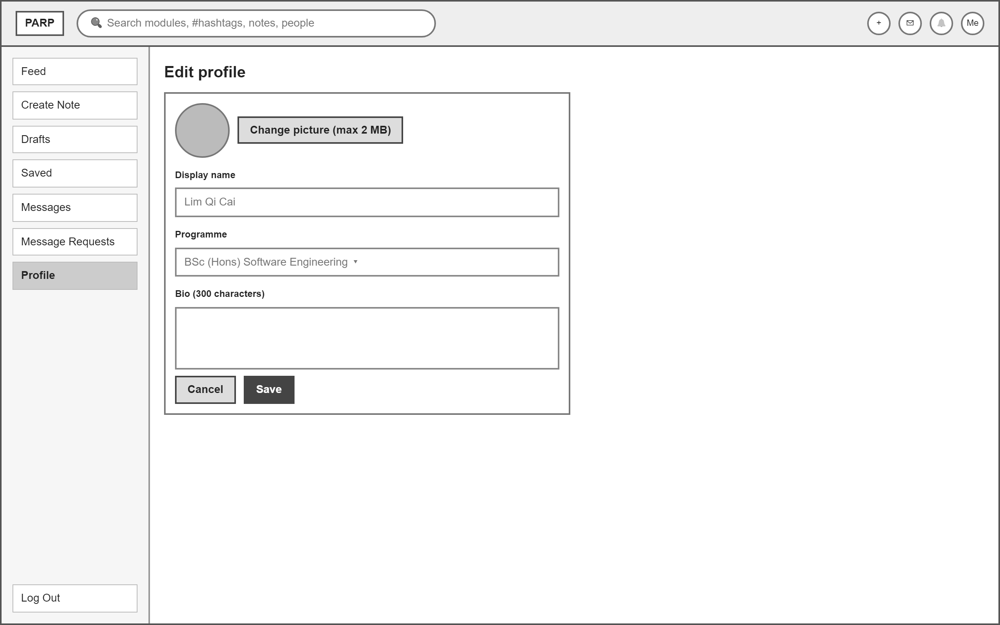

*Figure 4.25: Edit profile*

	The edit form allows the user to change their picture, display name, programme and biography. The programme field is a selection list rather than free text because programme name is one of the search keys in FR4, and consistent values are required for that search to work. The picture size limit is stated next to the control.

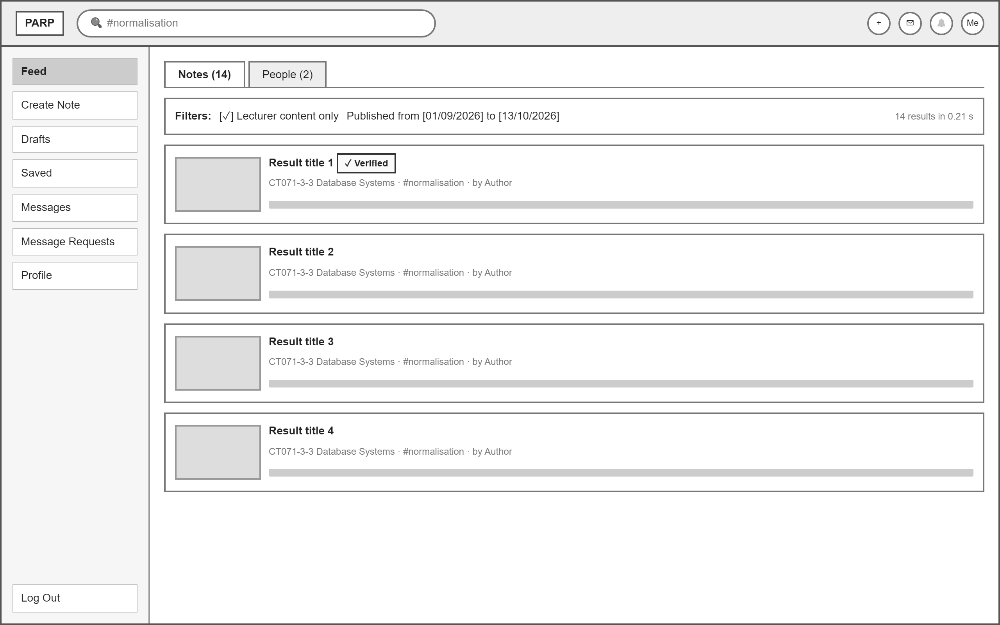

*Figure 4.26: Search results (notes, with filters)*

	Search results (UC14) appear in two tabs. The Notes tab shows a filter bar with the reworked FR15 filters, lecturer content only and a published date range, and displays the result count with the measured response time, which keeps the three-second target of NFR1 visible during testing. Verified results carry the same verified label as in the feed.

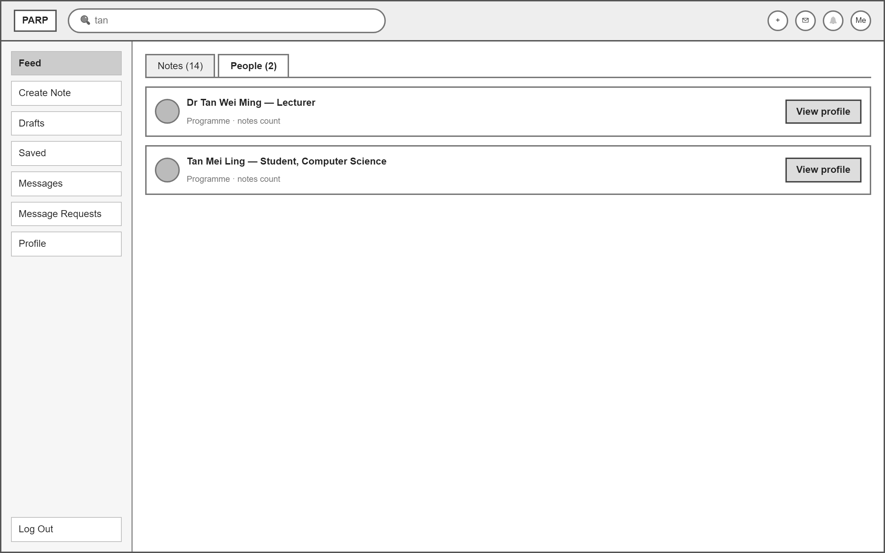

*Figure 4.27: Search results (people)*

	The People tab lists matching users with their role and programme so that a student can find a lecturer or classmate by name, as required by the IR deliverable to search for user profiles. Each row links to the profile screen in Figure 4.24.

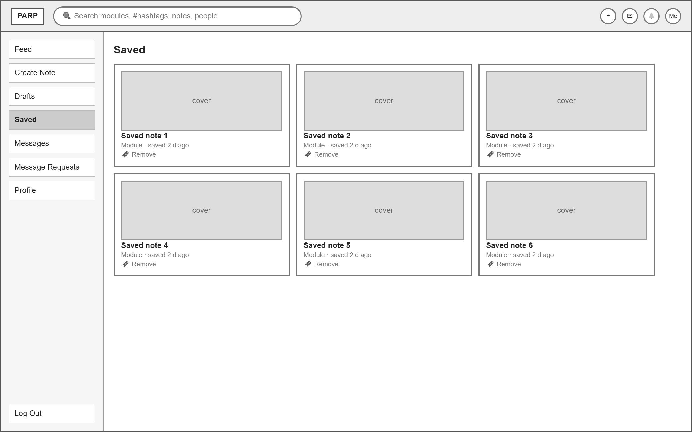

*Figure 4.28: Saved notes*

	The Saved screen implements UC13 and FR14. Bookmarked notes are shown as cards in the order they were saved, each with a control to remove it. Notes that have since been deleted or made private are omitted, as specified in the exception flow of UC13.

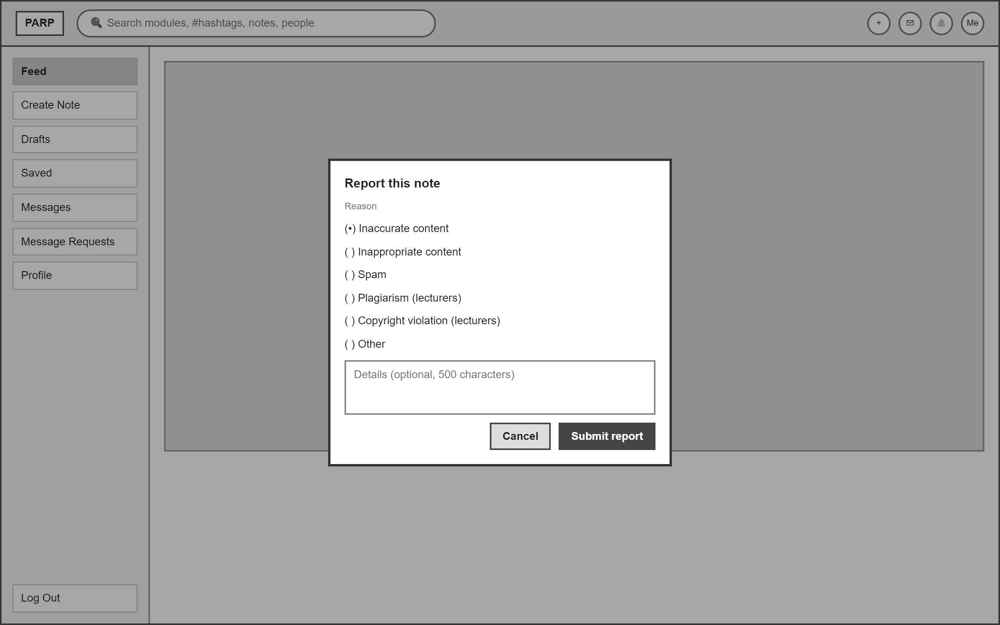

*Figure 4.29: Report note dialog*

	The report dialog (UC12) lists the reasons available to the reporter and an optional details field. Plagiarism and copyright violation appear only for lecturers, reflecting the lecturer deliverable in Section 1.6.4; the wireframe shows them labelled for review purposes. Submission places the report in the administrator queue in Figure 4.36.

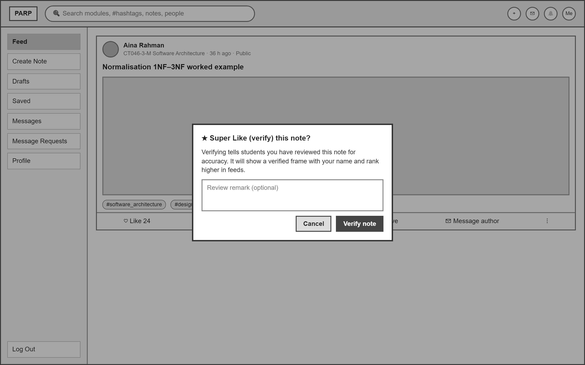

*Figure 4.30: Super Like confirmation (lecturer)*

	Super Like requires confirmation because it is the most influential action in the ranking formula (UC19). The dialog explains its consequences in one sentence, namely the verified frame, the lecturer's name and a higher position in feeds, and accepts an optional review remark that is shown with the verification.

## 4.4.4 Messaging screens

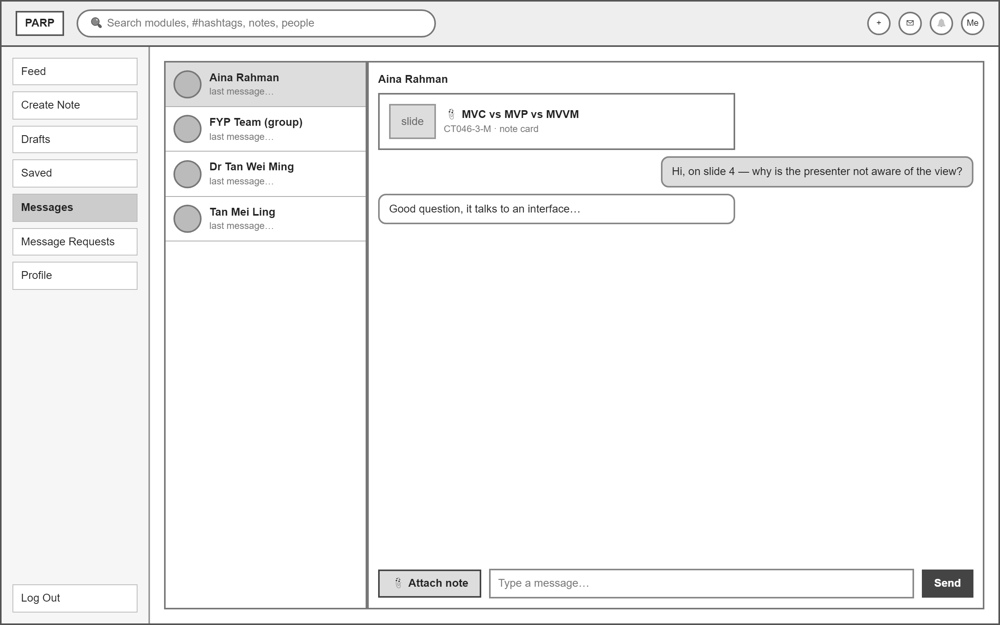

*Figure 4.31: Messages (conversation)*

	The Messages screen (UC17) lists conversations on the left and the selected conversation on the right. The first item in this conversation is the note card attached when the conversation started from a note, which is the visible form of post-anchored messaging (FR7). The Attach note control lets either participant add further notes as the discussion continues.

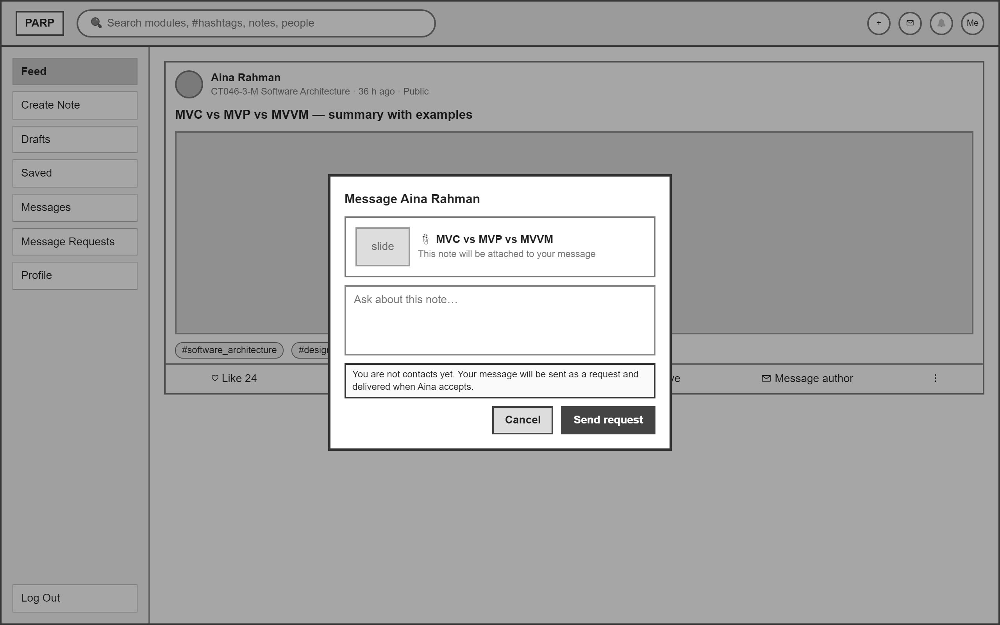

*Figure 4.32: Message author from a note*

	Selecting Message author on a note opens this dialog (UC15). The note card is attached automatically, and when the users are not contacts the dialog states that the message will be delivered as a request once accepted, so that the approval rule of FR6 is explained at the moment it applies rather than discovered afterwards.

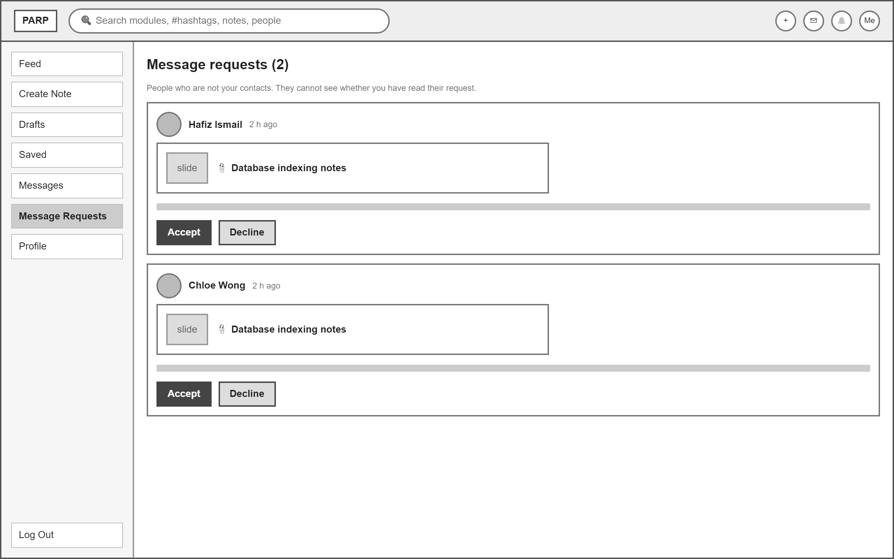

*Figure 4.33: Message requests*

	Pending requests from non-contacts are listed separately from conversations (UC16). Each shows the sender, the attached note and the first message, so the recipient can judge the request from its academic context. Accept and Decline are given equal weight, and the screen states that senders cannot see whether their request has been read.

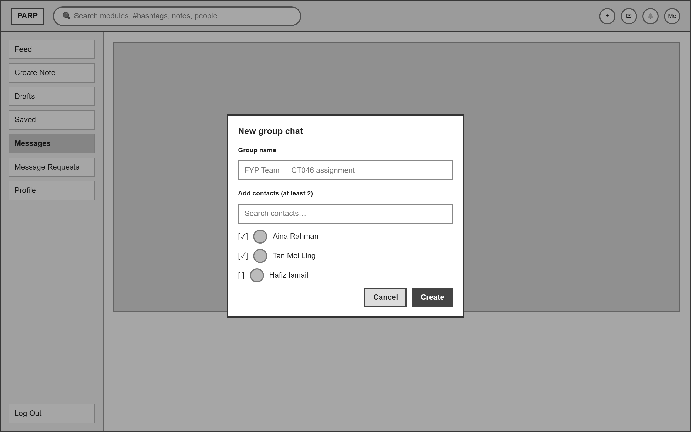

*Figure 4.34: Create group chat*

	The group creation dialog (UC18, FR13) requires a group name and at least two contacts selected from a searchable list. Restricting membership to contacts keeps the approval rule of FR6 intact, since a user cannot be added to a conversation with someone who has not accepted them.

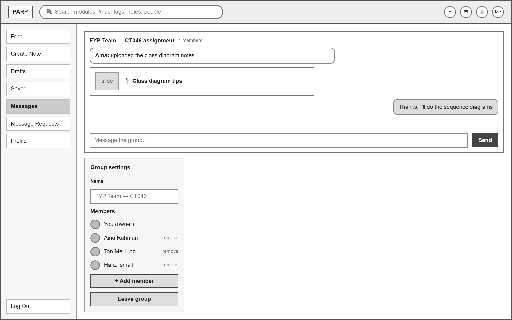

*Figure 4.35: Group chat with settings*

	A group conversation behaves like a direct conversation, including attached note cards. The settings panel lets the owner rename the group and add or remove members, and lets any member leave, matching the alternative processes of UC18.

## 4.4.5 Administration screens

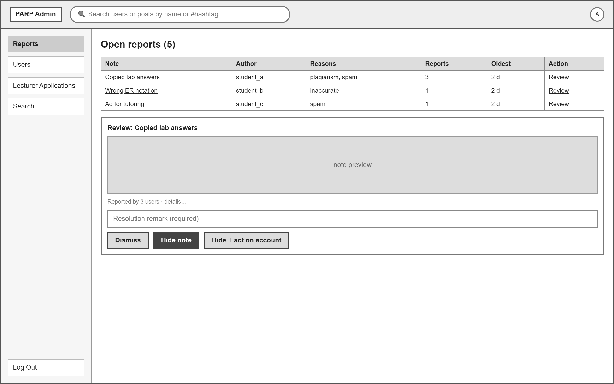

*Figure 4.36: Administrator — reported content*

	The reports queue (UC20) groups open reports by note, with reasons, report count and age, oldest first. Reviewing a report shows the note and reporter details, and every resolution requires a remark. The three outcomes, dismiss, hide note, and hide with account action, correspond to the standard and alternative processes of UC20.

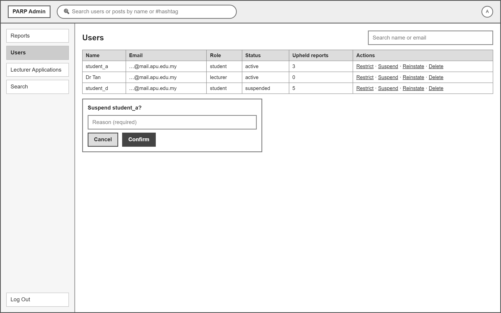

*Figure 4.37: Administrator — user management*

	The users screen (UC21) lists accounts with role, status and number of upheld reports, which gives the administrator the evidence for a decision on the same row. Restrict, suspend, reinstate and delete each require a recorded reason, which is stored in ACCOUNT_ACTION_T.

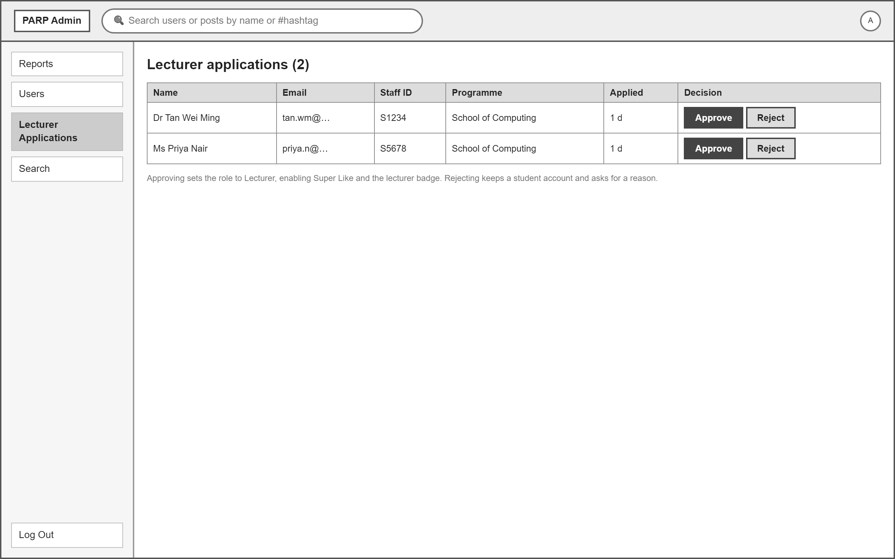

*Figure 4.38: Administrator — lecturer applications*

	Lecturer applications (UC22) list each pending account with its email and staff ID for checking against the staff directory. Approving changes the role to lecturer and enables the Super Like action and badge; rejecting keeps a student account. This screen is the control that protects the integrity of the lecturer validation signal in the ranking formula.

# 4.5 Test Case Preparation

	Testing is prepared at two levels. Unit and integration test cases verify each module against blank, invalid and valid input before release, and user acceptance testing verifies the complete system with representatives of the three target user groups. The test cases below were written before implementation so that each sprint has a fixed definition of done; the Actual Outcome and Pass/Fail columns are completed in Chapter 5 from real test runs. Each test case identifier is prefixed with its module code, for example AUTH-TC3, and the automated test that implements it carries the same identifier in its name, so that results can be transferred to the report directly from the test runner output. Where a test fails, the failure is recorded, the defect is fixed, and the re-test is added as the next number in the module sequence.

## 4.5.1 Unit Testing

*Table 4.24: Authentication module test cases (AUTH)*

| TC ID | Test description | Test data | Expected outcome | Actual outcome | Pass/Fail |
| --- | --- | --- | --- | --- | --- |
| AUTH-TC1 | Register with all fields blank | name, email, password, programme = "" | 400; an error is returned for each required field; no account created | | |
| AUTH-TC2 | Register with invalid email format | email = "student.apu" | 400 "Invalid email address" | | |
| AUTH-TC3 | Register with password shorter than 8 characters | password = "abc123" | 400 "Password must be at least 8 characters" | | |
| AUTH-TC4 | Register with mismatched confirmation | password = "Passw0rd!", confirm = "Passw0rd?" | 400 "Passwords do not match" | | |
| AUTH-TC5 | Register with valid student details | name "Test Student", email test1@mail.apu.edu.my, password "Passw0rd!" | 201; account created with role student, status active; password stored as 60-character bcrypt hash, not plain text | | |
| AUTH-TC6 | Register with an email already in use | email test1@mail.apu.edu.my (from TC5) | 409 "This email is already registered" | | |
| AUTH-TC7 | Register as lecturer | role lecturer, staff ID "S1234" | 201; role student, lecturer status pending; Super Like not permitted | | |
| AUTH-TC8 | Log in with wrong password | test1@mail.apu.edu.my / "wrong" | 401 with the same generic message as an unknown email; no token issued | | |
| AUTH-TC9 | Log in with valid credentials | test1@mail.apu.edu.my / "Passw0rd!" | 200; signed JWT containing user ID and role; GET /api/auth/me returns the user | | |
| AUTH-TC10 | Access protected route without, with tampered and with valid token; suspended and deleted users log in | no header; altered token; valid token; suspended account; deleted account | 401; 401; 200; suspended login returns 403 "This account is suspended"; deleted login returns 401 "Invalid email or password" | | |
| AUTH-TC11 | Log in and register with valid details | test1@mail.apu.edu.my / "Passw0rd!"; a new student | Login 200 with Set-Cookie `parp_token` (HttpOnly, SameSite=Lax, Path=/, Max-Age=3600); register 201 with no cookie; no token in either response body | | |
| AUTH-TC12 | Access a protected route with only an `Authorization: Bearer` header | valid JWT sent as a bearer header, no cookie | 401 "Unauthorized" | | |
| AUTH-TC13 | Log out with a valid and with an invalid cookie | valid `parp_token`; `parp_token=garbage` | 204 both times; Set-Cookie clears `parp_token` (empty value, expired) with the same attributes | | |
| AUTH-TC14 | Send state-changing requests without the CSRF header | POST login, POST like, DELETE note with no or a wrong `X-Requested-With` | 403 "Forbidden"; no cookie issued; GET requests are unaffected | | |
| AUTH-TC15 | Log in with COOKIE_SECURE=true | COOKIE_SECURE = true | Set-Cookie includes the Secure flag | | |
| AUTH-TC16 | Send several cookies whose names resemble the auth cookie | `xparp_token=garbage; other=1; parp_token=<valid>`; `xparp_token=<valid>` only | 200 (only the exact `parp_token` is read); 401 | | |
| AUTH-TC17 | List programmes | GET /api/programmes with no login; extra module added in an existing programme | 200; `items` holds each catalogue programme once, sorted | | |
| AUTH-TC18 | Register with a programme outside the catalogue | programme "Underwater Basket Weaving" | 400 "Choose a programme from the list"; no account created | | |
| AUTH-TC19 | Shared rate-limit store | two store instances; key k hit twice, another key once; one decrement; window start moved back 61 s; reset; purge; a test limiter of 2 per minute on the store | Hits 1 then 2 across instances (reset time about a minute ahead); the other key counts 1; decrement leaves 1; next hit starts a new window at 1; reset deletes the row; purge removes the expired counter; the third request to the test limiter gets 429 | | |
| AUTH-TC20 | Rate-limit key ignores invalid tokens | auth cookie from signToken for user 42; a token signed with another secret; an expired token; no cookie | tokenSubject returns "42" for the valid cookie and null for the forged, expired and missing ones | | |
| AUTH-TC21 | Guest reads are rate-limited by IP | guest GET /api/users/:id; the guest counter set to the limit (120 per minute); the same request again, then signed in | 200; 429 "Too many requests. Log in or try again in a minute."; signed-in request 200 (not counted) | | |

*Table 4.25: Note editor and publishing module test cases (NOTE)*

| TC ID | Test description | Test data | Expected outcome | Actual outcome | Pass/Fail |
| --- | --- | --- | --- | --- | --- |
| NOTE-TC1 | Publish with blank title and no slides | title "", slides [] | 400 listing title and slide content as missing | | |
| NOTE-TC2 | Publish without module | valid title and slides, modId null | 400 "Module is required to publish" | | |
| NOTE-TC3 | Publish without hashtags | hashtags [] | 400 "At least one hashtag is required" | | |
| NOTE-TC4 | Publish with invalid or too many hashtags | ["data base!"]; six hashtags | 400 naming the invalid hashtag; 400 "Maximum 5 hashtags" | | |
| NOTE-TC5 | Save incomplete note as draft | title "Draft 1", no module, no hashtags | 201; status draft; not returned by feed or search | | |
| NOTE-TC6 | Publish valid public note | title, 3 slides, module CT046-3-M, ["#MVC", "design_patterns"] | 201; status published, visibility public, published time set; hashtags stored as "mvc" and "design_patterns"; 3 slides in order | | |
| NOTE-TC7 | Publish contacts-only note | visibility contacts; viewers: a friend (mutual follow) and a one-way follower | Visible to the author's friends; not visible to a one-way follower or a stranger in feed, search or direct GET (404) | | |
| NOTE-TC8 | Edit own published note | change title and reorder slides 1 and 2 | 200; new title and order stored; updated time changes | | |
| NOTE-TC9 | Edit or delete another user's note | user B sends PUT and DELETE on user A's note | 403 for both; note unchanged | | |
| NOTE-TC10 | Slide content containing script | slide content `<b>ok</b>` | Stored and returned with the script removed and formatting kept | | |
| NOTE-TC11 | Slide with attributes, links and images | `
` with `<a href="javascript:..">` and `` | Attributes, link and image removed; text kept | | |
| NOTE-TC12 | Save draft with blank title | title "   ", status draft | 400 "Title is required" | | |
| NOTE-TC13 | Save note with 31 slides | 31 slides | 400 "Maximum 30 slides" | | |
| NOTE-TC14 | Publish with a module that does not exist | moduleId 99999 | 400 "Module not found" | | |
| NOTE-TC15 | Restricted user creates or edits a note | account status restricted; POST and PUT | 403 for both | | |
| NOTE-TC16 | Change a published note back to draft | PUT status draft on a published note | 400 "A published note cannot be changed back to a draft" | | |
| NOTE-TC17 | Author deletes own note | DELETE own published note | 204; status deleted in database; GET returns 404 | | |
| NOTE-TC18 | Publish a saved draft | PUT status published on an existing draft | 200; same note (no new row); published time set | | |
| NOTE-TC19 | Module list and missing token | GET /api/modules with and without token; POST /api/notes without token | 200 with module catalogue; 401; 401 | | |
| NOTE-TC20 | Stranger edits or deletes a draft or contacts-only note | PUT and DELETE by a non-contact | 404 for all four requests (existence not revealed) | | |
| NOTE-TC21 | Moderator-hidden note | status set to hidden in the database | Author PUT 403; other user GET 404; not on the author's profile | | |
| NOTE-TC22 | Numbered list start attribute | slide `<ol start="3" onclick="x()"><li>a</li></ol>` | Stored as `<ol start="3"><li>a</li></ol>`; other attributes removed | | |
| NOTE-TC23 | Note detail engagement state | Another user likes a published note, then GET /api/notes/:id as that user | `counts.likes` 1, `counts.comments` 0, `liked` true, `bookmarked` false, `verified` false | | |
| NOTE-TC25 | Template choices | template "fancy"; "howto"; none | 400 "Invalid template"; stored as howto; defaults to plain | | |
| NOTE-TC24 | Hashtag input rules (client) | Add `#Algebra, maths, Algebra`, then an invalid tag, then a sixth tag | `#` stripped, lowercased, duplicates ignored, invalid tag and a sixth tag rejected with a message | | |
| NOTE-TC26 | Drafts keyset paging | 5 drafts with one shared edit time; GET /api/notes/drafts?limit=2, following nextCursor; limit 101 | Pages of 2, 2 and 1 list every draft once, highest id first; nextCursor null on the last page; 400 for limit 101 | | |
| NOTE-TC27 | Guest opens notes | no cookie: a public note, a contacts-only note, a hidden note, a draft, a note by a suspended author; `parp_token=garbage`; an expired but validly signed token of the friend; a suspended author's valid cookie on their own draft | Public note 200 with liked and bookmarked false; 404 for each of the others; an invalid cookie is treated as a guest (200 public with `X-Viewer: guest`, 404 contacts-only); the author's friend gets the contacts-only note with no `X-Viewer` header; the expired token gets 404; the suspended author gets 404 | | |

*Table 4.26: User profile module test cases (USR)*

| TC ID | Test description | Test data | Expected outcome | Actual outcome | Pass/Fail |
| --- | --- | --- | --- | --- | --- |
| USR-TC1 | Update profile with blank display name | displayName "  " | 400 "Display name is required" | | |
| USR-TC2 | Update profile with a bio that is too long | bio of 301 characters | 400 "Bio must be at most 300 characters" | | |
| USR-TC3 | Update profile with valid details | displayName "Ann Lee", programme, bio "Hello" | 200; values stored and shown on the profile | | |
| USR-TC4 | View another user's profile | owner has a public note, a contacts-only note and a draft; viewers: stranger, friend (mutual follow), owner | Stranger sees the public note only; friend also sees the contacts-only note; draft never listed; draft count returned to the owner only | | |
| USR-TC5 | View unknown user; edit profile without token | user 99999; PUT /api/users/me with no cookie | 404; 401 | | |
| USR-TC6 | Update profile with over-long fields | displayName 51 characters, programme 101 characters | 400 naming both limits | | |
| USR-TC7 | Update profile with empty optional fields | programme "", bio "  " | 200; stored as NULL | | |
| USR-TC8 | View a deleted account | user with status deleted | 404 | | |
| USR-TC9 | View profile with a non-numeric id | GET /api/users/abc | 404 | | |
| USR-TC11 | Partial profile update | PUT with only displayName; then bio "" | programme and bio keep their values; empty bio becomes NULL, programme untouched | | |
| USR-TC10 | Hidden and deleted notes on a profile | owner has published, hidden and deleted notes | Only the published note is listed | | |
| USR-TC12 | Follow a user | user A follows user B | 201; B's follower count 1; A sees followedByMe true; B sees followsMe true | | |
| USR-TC13 | Follow the same user twice | repeat TC12 | 200; one follow row; count unchanged | | |
| USR-TC14 | Follow yourself | A follows A | 400 "You cannot follow yourself" | | |
| USR-TC15 | Unfollow, and follow while restricted | DELETE follow twice; restricted user unfollows then follows | 200 both times with the count back to 0; restricted user may unfollow (200) but not follow (403) | | |
| USR-TC16 | Follow or unfollow a suspended, deleted or unknown user | targets with status suspended, deleted; user 99999 | 404 "User not found" for POST and DELETE (the profile rule: only a profile you can open can be followed); no row stored. A user followed before their suspension can still be unfollowed: 204 and the row removed | | |
| USR-TC17 | Friends are a mutual follow | A follows B; then B follows A | isFriend false after the one-way follow, true for both after the mutual follow, also in the follower list | | |
| USR-TC18 | Contacts-only note and friendship | author has a friend, a one-way follower and a user the author follows; then the author unfollows the friend | Only the friend sees the note (others 404); after the unfollow the friend also gets 404 | | |
| USR-TC19 | Follower and following lists | 25 followers one second apart; GET followers, then with nextCursor; cursor "abc"; list of a deleted user | 20 newest first with nextCursor, then the last 5 with nextCursor null; 400 "Invalid cursor"; 404 | | |
| USR-TC20 | Counts exclude deleted and suspended users | target follows and is followed by an active, a suspended and a deleted user | followerCount 1 and followingCount 1; both lists show only the active user | | |
| USR-TC21 | Deleting an account clears its follows | admin deletes a user who has a friend; another follow exists | No FOLLOW_T row names the deleted user; the unrelated follow remains | | |
| USR-TC22 | Update profile with an unknown or valid programme | programme not in the catalogue; then "BSc (Hons) Information Technology" | 400 "Choose a programme from the list"; 200 with the programme stored | | |
| USR-TC23 | Save a profile whose stored programme left the catalogue | user holds "Legacy Programme"; PUT with that programme and a new bio; another user sends the same programme | 200 and programme kept; 400 for the other user | | |
| USR-TC24 | Follower paging with identical follow times | 23 followers inserted in one statement (same timestamp); GET followers, then with nextCursor | Pages 1 and 2 together list every follower exactly once, ordered by user id descending; nextCursor null after page 2 | | |
| USR-TC25 | Profile notes paging | 52 published notes with one shared publish time; GET /api/users/:id, then GET /api/users/:id/notes?cursor=notesNextCursor; unknown user; cursor "x" | Profile embeds 50 notes and a notesNextCursor; the follow-up returns the last 2 with nextCursor null, all 52 in id order descending; 404 for the unknown user; 400 for the bad cursor | | |
| USR-TC26 | Guest views a profile | no cookie: GET /api/users/:id and /api/users/:id/notes of an author with a public and a contacts-only note; user 99999 | 200 with follower and following counts, followedByMe false, no draftCount, and only the public note in both lists; 404; a signed-in friend sees both notes | | |
| USR-TC27 | Suspended profile hidden except from admins | user with a note and one follower is suspended; guest, the follower and an admin open the profile, its notes, followers and following, and the note | Guest: 404 for the profile and its notes; follower: 404 for all four and for the note; admin: 200 for all four and the note, the profile shows followerCount 1 and the note, while the admin's feed stays empty; the follower's following list is empty | | |

*Table 4.27: Blocking test cases (BLK). BLK covers user blocks (D49): the block endpoints and every path a block closes, each checked from both sides of the pair.*

| TC ID | Test description | Test data | Expected outcome | Actual outcome | Pass/Fail |
| --- | --- | --- | --- | --- | --- |
| BLK-TC1 | Block a user | A and B follow each other, C follows B; A blocks B twice; A and B open GET /api/users/me/blocks | 201 then 200 with blockedByMe true; only C's follow remains; A's list shows B with blockedAt and nextCursor null; B's list is empty | | |
| BLK-TC2 | Invalid block targets | A blocks themself, user 99999, a deleted user and an admin; then A blocks P and the admin bootstrap promotes P | 400; 404; 404; 403 "Administrators cannot be blocked"; no BLOCK_T row; A's block on P is removed by the promotion | | |
| BLK-TC3 | Restricted user and unblock | restricted R blocks B, then unblocks twice | 201 for the block; both unblocks 200 with blockedByMe false; B's note returns 404 before and 200 after; B's profile shows blockedByMe false | | |
| BLK-TC4 | Block list paging | A blocks 3 users; GET /api/users/me/blocks?limit=2 following nextCursor; guest | Pages [3rd, 2nd] and [1st], newest first; 401 for the guest | | |
| BLK-TC5 | Profiles across a block | A blocks B; each opens the other's profile, notes, followers and following | A gets 200 {id, displayName, blockedByMe: true} for B's profile; B gets 404 for A's profile; 404 both ways for the notes and both lists; after B also blocks A, each gets the minimal payload for the other | | |
| BLK-TC6 | Follow across a block | each side follows the other | 404 both ways; no FOLLOW_T row | | |
| BLK-TC7 | Notes hidden across a block | A blocks B; each has a public "Kernel" note tagged #kernel in the same module, bookmarked by the other; B's note is co-authored by C, whom A follows | Each side: 404 for the other's note; the For You feed and note search list only their own note; saved notes are empty; the #kernel and module noteCount is 1 (2 for a guest); A's following feed is empty; C still sees B's note on B's profile | | |
| BLK-TC8 | Engagement across a block | both sides are lecturers; each likes, comments on, lists comments of, Super Likes, bookmarks and reports the other's note | 404 for like, comment, comment list, Super Like and bookmark; 201 for both reports | | |
| BLK-TC9 | Comments across a block | on a third user's note, Y posts a comment with a reply from the owner and a lone comment; X (in a block with Y) lists, replies to and likes them; both directions | X sees Y's replied comment as "[comment unavailable]" with no author and the owner's reply, does not see the lone comment, gets 400 replying and 404 liking it; the owner still sees Y's comments | | |
| BLK-TC10 | People search across a block | A blocks B, both named "Kernel ..."; each and a guest search people for "kernel" | Each side finds only themself; the guest finds both | | |
| BLK-TC11 | Collaboration across a block | owner has an edit link and a pending request from U; U views a second note and edits a third, holding its lock; U blocks the owner, then (fresh data) the owner blocks U; each time the blocker then unblocks | Both directions: pending request deleted and U's lock released; owner's invite 404; approving a stale request 404; U gets 404 opening and joining the link, requesting and opening the shared note, and an empty shared list; U can still leave the third note (204); after unblock U is a view collaborator again, the shared list shows the second note, and U joins the link (200) | | |
| BLK-TC12 | Guests ignore blocks | A blocks B; guest opens both profiles, A's note, the feed and note search | 200 for every call; A's note is listed | | |
| BLK-TC13 | Admin views ignore blocks | Y blocks X and reports X's note; admin blocks X, then searches users, opens the report and the note | Report 201; admin finds X, the report group with 1 report, and the note (200) | | |
| BLK-TC14 | isBlocked helper | A blocks B; C is a stranger; guest id 0 | true for (A, B) and (B, A); false for (A, C) and (0, A) | | |

*Table 4.28: Ranking and feed module test cases (RANK)*

| TC ID | Test description | Test data | Expected outcome | Actual outcome | Pass/Fail |
| --- | --- | --- | --- | --- | --- |
| RANK-TC1 | Engagement with no likes or comments | likes 0, comments 0 | E = 0.000 | | |
| RANK-TC2 | Engagement weights comments twice | likes 10, comments 5 (raw 20) | E = log10(21) / log10(101) = 0.660 (±0.001) | | |
| RANK-TC3 | Engagement capped at 1 | likes 150, comments 30 (raw 210) | E = 1.000 | | |
| RANK-TC4 | Recency decay at 0, 72 and 144 hours | age 0 h, 72 h, 144 h | R = 1.000, 0.500, 0.250 | | |
| RANK-TC5 | Lecturer validation values | no lecturer interaction; lecturer author; Super Liked student post | V = 0.0, 0.5, 1.0 | | |
| RANK-TC6 | Relevance with empty interest vector and with hashtag padding | new viewer; viewer interest {sql: 1.0}, post tags [sql] vs [sql, a, b, c] | M = 0; M = 1.00 vs 0.25 (padding lowers relevance) | | |
| RANK-TC7 | Composite score reproduces IR worked example | E, R, V, M values of the five posts in Table 10 (IR §2.3.4.8) | Scores 0.860, 0.590, 0.544, 0.336, 0.248 (±0.002, as the table's inputs are rounded) in that order | | |
| RANK-TC8 | Weights read from configuration | change w3 in config to 0.40, w1 to 0.20 | Scores change accordingly without code change; weights that do not sum to 1 are rejected at start-up | | |
| RANK-TC9 | Feed excludes drafts, hidden, deleted and non-visible posts | one post of each status, one contacts-only from a non-friend | Only published, permitted posts returned | | |
| RANK-TC10 | Feed request with an invalid page, signed out and signed in | page = -1, 0, "abc", 1.5 | 400 "Invalid page" each time | | |
| RANK-TC11 | Verified student note outranks an identical unverified one | four student notes of equal age and tags; Super Liked by an approved active lecturer, by a restricted one, by a suspended one, and none | The active and restricted lecturers' notes first with V = 1.0 and a score higher by w3; the suspended lecturer's and the plain note have V = 0 | | |
| RANK-TC12 | Interest vector weighting, decay and normalisation | viewer view, like and comment today on #viewed, #liked, #commented; comment 14 days ago on #older; comment 91 days ago on #ancient | #commented 1.0, #liked 0.6, #viewed 0.2, #older 0.5, #ancient absent; maximum weight 1.0; no history gives an empty vector | | |
| RANK-TC13 | Verified, relevant note surfaced ahead of popular irrelevant note (NFR3) | viewer interested in #sql; verified #sql note 24 h old with no likes; unverified #art note with 10 likes | #sql note ranked above the #art note although its E is lower | | |
| RANK-TC14 | Old verified note stays a candidate | candidate window 2; two recent notes, an older unverified note and a still older verified note | Candidates are the two recent notes and the verified note; the older unverified note is excluded | | |
| RANK-TC15 | Ranking snapshot stable across pages | 20 notes; page 1 and page 2 fetched with the returned asOf; then 20 likes and a Super Like added to the last note of page 2; page 2 fetched again with the same asOf | Page 2 lists the same notes with the same components; the shown like count is 20 (live); a feed with a fresh asOf moves that note onto page 1 | | |
| RANK-TC16 | Lecturer-author bonus follows account status | notes by an approved lecturer who is active, one who is restricted and one who is suspended | Active and restricted authors' notes have the lecturer-author flag (V = 0.5); the suspended author's note is not a candidate for others and, for the author, has no flag | | |
| RANK-TC17 | Future asOf is capped at now | one 5-hour-old note; feed requested with asOf 9999-01-01 | Status 200; returned asOf is not later than the database clock; the note's recency R is above 0 | | |
| RANK-TC18 | Stale Super Like no longer makes an old note a candidate | candidate window 1; Super Liked notes 5000 h and 4000 h old, the first Super Like backdated beyond the verified window; one recent note | Candidates are the recent note and the note with the in-window Super Like | | |
| RANK-TC19 | Stale Super Like keeps V for a newest-window note | one 5-hour-old note whose only Super Like is older than the verified window | The candidate is flagged verified and its feed component V is 1 | | |
| RANK-TC20 | Old interactions are purged | interactions 100 and 95 days old and one 10 days old, interest window 90 days | Purge removes the two older rows and keeps the 10-day-old one; a second purge removes nothing | | |
| RANK-TC21 | Following feed shows only followed authors | viewer follows one author; another user follows the viewer; notes by the followed author, the other user and the viewer | GET /api/feed?tab=following lists the followed author's notes newest first, without score, with nextCursor null; unknown tab 400 "Invalid tab"; malformed cursor 400 | | |
| RANK-TC22 | Following feed keyset paging stable with asOf | 12 notes by a followed author; page 1, then a new note, then page 2 with page 1's nextCursor and the returned asOf | Page 1 has the 10 newest notes and a nextCursor; page 2 has the 2 oldest notes, excludes the new note and has nextCursor null | | |
| RANK-TC23 | Contacts-only notes in the Following feed | author with a friend and a one-way follower; a public and a contacts-only note | Friend sees both notes; one-way follower sees only the public note | | |
| RANK-TC24 | Later pages read the stored ranking | 20 notes, the oldest with 30 likes; page 1, then page 2 with asOf; the likes deleted and a 12-hour-old note added; page 2 again; snapshot deleted; page 2 again | One snapshot row after pages 1 and 2; page 2 unchanged after the changes; once the snapshot is deleted page 2 is recomputed, differs and includes the new note, and one snapshot is stored again | | |
| RANK-TC25 | Expired feed snapshots are purged | snapshots created 3 h and 1 h ago (TTL 2 h); purge; another 3-hour-old snapshot, then a feed request | Purge deletes 1; the feed request deletes the viewer's expired snapshot and stores a new one, leaving 2 | | |
| RANK-TC26 | Snapshots per viewer are capped | another viewer loads the feed once; the viewer loads page 1 six times (cap 4) | The viewer keeps exactly the 4 newest snapshots (by asOf); the other viewer keeps its 1 | | |
| RANK-TC27 | Hidden note never leaks through a snapshot | 20 notes; page 1, then page 2 with asOf; the first note of page 2 hidden; page 2 again with the same asOf | The hidden note is not returned; page 2 lists the other 9 notes | | |
| RANK-TC28 | Author's own hidden note never leaks through a snapshot | 20 notes by the viewer; page 1, then page 2 with asOf; the first note of page 2 hidden by a moderator; page 2 again with the same asOf | The hidden note is not returned to its author; page 2 lists the other 9 notes | | |
| RANK-TC29 | Guest feed shows only public notes with M = 0 | no cookie; a public note (hashtag #sql, liked by another user who interacted with it), a contacts-only, hidden, draft and suspended-author note; page 2 with asOf | Only the public note, with liked and bookmarked false and component M = 0; page 2 empty; no snapshot row stored; the signed-in friend still sees both of the author's visible notes, has M > 0 and gets one snapshot | | |
| RANK-TC30 | Guest requests the Following feed | no cookie; GET /api/feed?tab=following | 401 "Unauthorized" | | |
| RANK-TC31 | Later guest pages read the shared ranking | 12 notes, the oldest with 30 likes; guest page 1; all likes deleted; guest page 2 with page 1's asOf | Pages 1 and 2 together list all 12 notes once each; no snapshot row stored | | |
| RANK-TC32 | Own likes do not raise engagement | note liked by its author, an edit collaborator, a view collaborator and a stranger; another user loads the feed | Each like 201; the ranking candidate counts 2 likes; the feed shows likes 4 and E = engagement(2 likes, 0 comments) | | |

*Table 4.29: Engagement module test cases (ENG)*

| TC ID | Test description | Test data | Expected outcome | Actual outcome | Pass/Fail |
| --- | --- | --- | --- | --- | --- |
| ENG-TC1 | Like a note | user A likes post P | 201; like count +1; "like" interaction recorded | | |
| ENG-TC2 | Like the same note twice | repeat TC1 | Count unchanged (one like per user per note) | | |
| ENG-TC3 | Unlike a note | DELETE like on P | 200; like count −1 | | |
| ENG-TC4 | Post blank and over-length comments | body "   "; body of 1,001 characters | 400 for both | | |
| ENG-TC5 | Post valid comment referencing a slide | body "Check slide 3", slideNo 3 | 201; comment stored; "comment" interaction recorded | | |
| ENG-TC6 | Reply to a reply | reply to a comment that is itself a reply | 400 "Replies are limited to one level" | | |
| ENG-TC7 | Comment ordering | 1 lecturer comment (0 likes), student comments with 5, 2, 2 likes | Lecturer comment first; then 5; then the two 2-like comments, older first | | |
| ENG-TC8 | Report a note with invalid reason and own note | reason "boring"; reporter is author | 400; 400 "You cannot report your own note" | | |
| ENG-TC9 | Student selects lecturer-only reason; duplicate open report | student reason plagiarism; second report by same user | 403; 409 "You have already reported this note" | | |
| ENG-TC10 | Bookmark, list and remove | save P, GET /api/bookmarks, remove P | P listed newest first; removed after DELETE | | |
| ENG-TC11 | Feed paging and item shape | 12 published notes; one liked, bookmarked, commented and verified | Page 1 has 10 ordered by score (ties newest first) with nextPage 2; counts, liked, bookmarked, verified and slides present; page 2 has 2 and nextPage null | | |
| ENG-TC12 | View logging window | POST view twice, then after 31 minutes; view of a contacts-only note by a non-contact | One "view" interaction for the first two, a second after 31 minutes; 404 for the invisible note | | |
| ENG-TC13 | Engagement on invisible note; restricted user | like, comment, bookmark a contacts-only note and a draft; restricted user likes | 404 for each, and for liking or listing comments on the invisible note; its author can still delete their comment; 403 for the restricted like; restricted user can still read comments | | |
| ENG-TC14 | Replies and comment likes | two replies under one comment; comment liked twice, then unliked | Replies listed oldest first; second like leaves count 1; unlike gives 0 | | |
| ENG-TC16 | Self-engagement | author likes own note; author and a reader comment | 201 with likes 1 and no like interaction logged; feed shows likes 1 and comment count 1 (author's own comment excluded) while the thread lists both | | |
| ENG-TC17 | Author's own views and comments | author views and comments on own note; another user does too | No interaction rows for the author; one view and one comment interaction for the other user | | |
| ENG-TC15 | Delete comment | non-author deletes; author deletes a comment with a reply and one without | 403; parent shown as "[deleted]" with its reply; the other omitted and a second delete gives 404 | | |
| ENG-TC18 | Comments keyset paging | 5 student comments with one shared time, one liked, one deleted with no replies, one with a reply; a lecturer comment; limit 2 following nextCursor; no cursor; cursors "abc", "1_2", limits 0, 101, "x" | Pages of 2, 2, 1: lecturer, liked, then the rest by id, with the reply under its comment and the deleted one omitted; without a cursor all 5 and nextCursor null; 400 for each bad cursor or limit | | |
| ENG-TC19 | Saved notes keyset paging | 5 bookmarks with one shared save time; GET /api/bookmarks?limit=2 following nextCursor; cursor "1" | Pages of 2, 2, 1 list every note once, highest id first; 400 for the bad cursor | | |
| ENG-TC20 | Guest reads comments; views are not logged | no cookie: comments of a public note with one reply, and of the contacts-only, hidden, draft and suspended-author notes; POST view | 200 with the comment, likedByMe false, and its reply; 404 for each of the others; view 401 and no interaction row added | | |
| ENG-TC21 | Guest writes are refused | no cookie, with the CSRF header: like and unlike, save and unsave, comment, delete and like a comment, report, Super Like, follow and unfollow, create, edit and delete a note, edit profile; GET saved notes, drafts and follow lists; one like without the CSRF header | 401 for every write and list; 403 without the CSRF header; no like, bookmark or report rows created | | |
| ENG-TC22 | Comments by a suspended author | a lecturer writes a comment with a reader reply, a comment with no replies and a reply to a reader comment, then is suspended; guest, a reader and an admin read the thread | Guest and reader: the replied-to comment shows as "[comment unavailable]" with no author and no pin, its reply kept; the other comment and the reply are omitted; the note's comment count is 2; replying to or liking the hidden comment gives 400 and 404. Admin: every comment and reply with its text, the lecturer's two comments pinned | | |

*Table 4.30: Lecturer verification module test cases (VER)*

| TC ID | Test description | Test data | Expected outcome | Actual outcome | Pass/Fail |
| --- | --- | --- | --- | --- | --- |
| VER-TC1 | Student attempts Super Like | student token, POST /api/notes/P/verify | 403 Forbidden; no verification stored | | |
| VER-TC2 | Pending lecturer attempts Super Like | lecturer status pending | 403 Forbidden | | |
| VER-TC3 | Approved lecturer verifies non-existent post | post ID 999999 | 404 Not Found | | |
| VER-TC4 | Approved lecturer verifies own note | lecturer is author of P | 409 "Cannot verify own note" | | |
| VER-TC5 | Approved lecturer verifies a draft | P has status draft | 404 Not Found | | |
| VER-TC6 | Remark over 300 characters | remark of 301 characters | 400 | | |
| VER-TC7 | Approved lecturer verifies a student note | lecturer L, student post P, remark "Accurate" | 201; verification stored with remark; post shows "Verified by L" | | |
| VER-TC8 | Repeated Super Like by the same lecturer | repeat VER-TC7 | One verification only; 200 with existing verification | | |
| VER-TC9 | Verified post gains V in ranking | P before and after VER-TC7 | V changes 0.0 → 1.0; P ranks above an otherwise identical unverified post | | |
| VER-TC10 | Withdraw Super Like | lecturer L removes verification on P | 200; V returns to 0.0; verified frame removed | | |
| VER-TC11 | "Verified by" with two verifiers | lecturers F then S verify P; P bookmarked; F withdraws; S suspended | Feed, detail and saved list show "Verified by F"; after F withdraws "Verified by S"; after S is suspended P is no longer verified | | |
| VER-TC12 | Invisible note and restricted lecturer | contacts-only note; lecturer restricted after verifying P | 404 for the contacts-only note; restricted lecturer gets 403 on a new Super Like but can still withdraw (200) | | |

*Table 4.31: Search module test cases (SRCH)*

| TC ID | Test description | Test data | Expected outcome | Actual outcome | Pass/Fail |
| --- | --- | --- | --- | --- | --- |
| SRCH-TC1 | Empty or whitespace query | q = "", q = "   " | 400; no query executed | | |
| SRCH-TC2 | Query longer than 100 characters | q of 101 characters | 400 "Query too long" | | |
| SRCH-TC3 | Query with SQL metacharacters | q = "'; DROP TABLE \"POST_T\"; --" on every tab; q = "%" on people and "_" on hashtags while users and tags exist | 200 with no results; table intact (parameterised query); LIKE wildcards match literally | | |
| SRCH-TC4 | Hashtag search | q = "#Normalisation" | Only published, visible posts tagged "normalisation" | | |
| SRCH-TC5 | Module code search | q = "CT071-3-3" | Posts in module CT071-3-3 only | | |
| SRCH-TC6 | Keyword in slide text | q = "third normal form" (appears only in slide 2 of P) | P returned | | |
| SRCH-TC7 | Programme and people search | q = "Software Engineering"; q = "tan" | Posts in that programme's modules; users whose name contains "tan" | | |
| SRCH-TC8 | Lecturer content filter | lecturer=any; lecturer=<id of lecturer A>; lecturer=<id of a student> | Only posts authored or validly Super Liked by approved, non-suspended lecturers; only A's own or A-Super-Liked posts; no results | | |
| SRCH-TC9 | Date range filter, including invalid range | from 2026-10-01 to 2026-10-13; from after to | Only posts published in range (Malaysian calendar days, both ends inclusive); 400 "Invalid date range" | | |
| SRCH-TC10 | Search latency (NFR1) | 10,000 seeded posts, 50 mixed queries | Every response under 3,000 ms; median and maximum recorded | | |
| SRCH-TC11 | Note order blends text rank with E and V | five notes matching "deadlock": strongest text match, a Super Liked one, a liked one, two plain ones (one older, one self-liked) | Strong match, Super Liked, liked, newer plain, older plain; a self-like adds nothing; same order for a guest and a signed-in user | | |
| SRCH-TC12 | Keyset paging of notes | 25 matching notes, limit 10, follow nextCursor | 10, 10, 5 notes; each exactly once in score order; Top pages 20 by default | | |
| SRCH-TC13 | Invalid search parameters | tab=videos; lecturer=some, 0, 1.0, +1; term=abc, 2147483648; module=-1, 1e3; from=2026-13-01; asOf=yesterday; term with from; unknown term on top, people and modules; cursor abc | 400 with "Invalid tab", "Invalid lecturer", "Invalid term", "Invalid module", "Invalid date", "Invalid asOf", "Choose a term or a date range, not both", "Term not found", "Invalid cursor" | | |
| SRCH-TC14 | Academic term and module filters | term Sem 2 (2026-09-01 to 2026-12-20); notes in and outside it; module=CT050-3-2 | Only notes published within the term; with module only that module's | | |
| SRCH-TC15 | Top, people, hashtags and modules tabs | q "network": 5 matching people, tags on published notes and on a draft only, two matching modules | Top adds 3 people, the 2 published tags with note counts, 2 modules; people tab pages all 5; "ct060" finds CT060-3-2 only; "#" on hashtags is empty | | |
| SRCH-TC16 | Visibility in search | public, contacts-only, draft and hidden notes; a suspended author with a note and tag; guest, friend, author, admin | Guest: the public note only (X-Viewer guest); friend and author: public and contacts-only; nobody sees drafts, hidden notes or the suspended user, their notes or tags | | |
| SRCH-TC17 | Stable paging with asOf | 25 matching notes, limit 10; after page 1, 5 likes on a later-page note and a new stronger match; later pages sent with page 1's asOf | Each of the 25 notes exactly once; the new note absent until a fresh search, where it ranks first | | |

*Table 4.32: Messaging module test cases (MSG)*

| TC ID | Test description | Test data | Expected outcome | Actual outcome | Pass/Fail |
| --- | --- | --- | --- | --- | --- |
| MSG-TC1 | Socket connection without valid token | no cookie; expired token; token signed with another secret | Connection refused with "Unauthorized"; a valid cookie connects | | |
| MSG-TC2 | Send blank or over-length message | body ""; spaces only; control characters only; body of 2,001 characters | 400 "Message is required" or "Message must be at most 2000 characters"; nothing stored; 2,000 characters accepted | | |
| MSG-TC3 | Message to self | toUserId = own ID | 400 "You cannot message yourself"; nothing stored | | |
| MSG-TC4 | Non-friend sends post-anchored message | A (not a friend of B: no mutual follow) messages B from post P | 202; request stored as pending with post P; B receives "request:new" with the note card; no conversation created | | |
| MSG-TC5 | Second request while one is pending | repeat MSG-TC4; then B messages A | 409 "A message request between you is already pending" both ways; one pending request exists | | |
| MSG-TC6 | Recipient accepts request | B accepts A's request | Direct conversation created containing the held message with note card; A receives "request:accepted"; no follow rows created; both can then message without a new request | | |
| MSG-TC7 | Recipient declines request | B declines; A tries to decline; B accepts afterwards | 204; status declined; no conversation and no follow rows; A not notified; A's decline and the later accept 404 | | |
| MSG-TC8 | Friends exchange messages in real time | A and B follow each other; A sends "hello" to B (no request needed) | 201; stored; B receives "message:new" within 1 s; no request created | | |
| MSG-TC9 | Create group with invalid input | name ""; one member; a repeated member; self as member; a non-friend member | 400 with a message for each case; no group created | | |
| MSG-TC10 | Create group and leave | name "FYP Team", two friends; one member leaves | Group created with owner and members; both receive the first message; the leaver gets "conversation:removed" and no later group messages | | |
| MSG-TC11 | Socket handshake Origin check | valid cookie with Origin https://evil.example; with no Origin | Connection refused | | |
| MSG-TC12 | Messaging a suspended or deleted user | direct message to a suspended and to a deleted friend; send in a chat whose other member is later suspended | 404 "User not found"; 403 in the existing chat, whose history stays readable | | |
| MSG-TC13 | Blocked pair | A and B friends with a chat; C has a pending request to A; B blocks A, A blocks C; then B unblocks | Messages and requests 404 both ways; the chat leaves both lists and its history 404s; C's request leaves A's inbox and cannot be accepted; a member cannot add a user in a block with any member; unblocking restores the chat | | |
| MSG-TC14 | Restricted user | restricted R tries to send, start a chat, create a group, add a member; then reads, marks read, accepts a request, leaves a group | 403 "Your account is restricted and cannot perform this action" for the four writes; the rest succeed; others can still message R | | |
| MSG-TC15 | Note card visibility | attach a draft and an unknown note; attach a friends-only note seen by the sender only; delete it later | 400 "Note not found"; the card shows for the sender and is null with noteUnavailable for a reader who cannot see it, and for everyone after deletion | | |
| MSG-TC16 | Reply to a message | reply to a message in another chat; reply to a message in this chat; reply to it after it is deleted | 400; 201 with replyTo {id, senderId, body}; 400, and history shows the reply's quote with a null body | | |
| MSG-TC17 | Soft delete | B deletes A's message; A deletes it twice | 404; 204 then 404; history and the conversation list show it deleted with no body or note; the row keeps an empty body | | |
| MSG-TC18 | Conversation list and read receipts | two chats; B sends two messages to A; A marks read up to the first, then to the latest, then tries to move back | List ordered by last activity with last message and unread 2; unread 1 then 0; the receipt never moves back; a non-member gets 404 | | |
| MSG-TC19 | History paging | 120 messages | Pages of 50, 50, 20, newest first, each message once; bad cursor 400 | | |
| MSG-TC20 | Add group members | add a non-friend; a non-member adds; add a friend; add again; fill to 30; add a 31st; add to a direct chat | 400 "You can only add your friends"; 404; 201 with nothing unread; 409; 201s; 409 "A group has at most 30 members"; 404 | | |
| MSG-TC21 | Rename, remove and owner hand-over | member renames or removes; owner renames to "  Study Group "; owner leaves; last member leaves | 403 "Only the group owner can do this"; name trimmed; earliest-joined member becomes owner; the group is deleted when empty | | |
| MSG-TC22 | Suspended user's sockets | suspended and deleted users connect; an admin suspends a connected user | Connection refused; the open socket is disconnected by the server | | |
| MSG-TC23 | Typing indicator | A types in a chat with B; types again at once; types in a chat A is not in; B blocks A and A types | B receives "typing" once; the repeat is throttled and A never gets its own; nothing for non-members or across the block; nothing stored | | |
| MSG-TC24 | Live receipts and deletions | B marks a chat read; A deletes a message | A receives "conversation:read" with B's last-read id; B receives "message:deleted" | | |
| MSG-TC25 | Live note card per reader | group of A, B (author's friend) and C; A sends a friends-only note | B's "message:new" carries the card; C's has note null and noteUnavailable true | | |

*Table 4.33: Administration module test cases (ADM)*

| TC ID | Test description | Test data | Expected outcome | Actual outcome | Pass/Fail |
| --- | --- | --- | --- | --- | --- |
| ADM-TC1 | Non-admin calls admin endpoints | student and lecturer tokens on /api/admin/* | 403 for every endpoint | | |
| ADM-TC2 | Resolve report without remark | outcome hide, remark "" | 400 "Remark is required" | | |
| ADM-TC3 | Dismiss report | open report R, remark "Content accurate" | Report dismissed with resolver and time; note still visible | | |
| ADM-TC4 | Hide note from report | report on P, outcome hide | P hidden from feed, search and direct GET; all open reports on P resolved (search part re-tested in Sprint 4) | | |
| ADM-TC5 | Suspend user without reason | reason "" | 400 | | |
| ADM-TC6 | Suspend user | suspend student S with reason | Status suspended; S's next request with an existing token returns 401; action logged | | |
| ADM-TC7 | Restrict user | restrict S | S can read the feed but publishing, commenting and messaging return 403 (messaging part re-tested in Sprint 4) | | |
| ADM-TC8 | Act on an administrator account | suspend another admin | 403; status unchanged | | |
| ADM-TC9 | Approve lecturer application | pending lecturer L | Role lecturer, lecturer status approved, action logged; L can now Super Like | | |
| ADM-TC10 | Reject lecturer application | pending lecturer M with reason | Role remains student, lecturer status rejected; Super Like still 403 | | |
| ADM-TC11 | List pending applications | pending lecturers A (newer) and B (older), plus a rejected one and a student | Only A and B listed, oldest first | | |
| ADM-TC12 | Approve with invalid or unknown id | id "abc", id 99999, id of a non-pending student | 400, 404, 404 | | |
| ADM-TC13 | Create admin with missing or weak values | no ADMIN_EMAIL; password "short"; password with no uppercase | Each refused with a message naming the problem | | |
| ADM-TC14 | Create admin for an existing email | valid values, email matching an existing account | Account promoted to admin, email normalised, can log in as admin | | |
| ADM-TC15 | Lecturer applicants whose account is not active | pending applicants with status active, restricted, suspended, deleted; approve the non-active ones | Only the active applicant is listed (a restricted applicant waits until reinstated); approving the others returns 404 and changes nothing | | |
| ADM-TC16 | Report queue grouping and resolve validation | 2 open reports on P (older), 1 on Q, 1 dismissed on R; outcome "archive"; remark of 301 characters | P then Q listed with counts 2 and 1 and their reasons, without slides; R not listed; 400 for the bad outcome and the long remark | | |
| ADM-TC17 | Search users and reinstate | search "author" after one upheld report; suspend then reinstate; unknown action; unknown user | Author listed with role, status and upheld count 1; reinstated user can use the feed again; 404; 404 | | |
| ADM-TC18 | Delete account | delete student S who has a published note and a draft; then reinstate S | S anonymised ("Deleted user", deleted-id@invalid), published note hidden, draft untouched, token 401; reinstate returns 409 | | |
| ADM-TC19 | Reports on a deleted note | open report on note P; P's author deletes it; admin resolves P with outcome dismiss | P not in the report queue; resolve returns 404; the report stays open | | |
| ADM-TC20 | Suspension withdraws the author's content | viewer has bookmarked author A's public note P; admin suspends A, then reinstates A | While suspended: GET P 404, P absent from feed and saved list, A's profile 404; the report queue still loads. After reinstatement P is visible in all four again | | |
| ADM-TC21 | Module endpoints are admin-only | student and lecturer tokens call GET, POST and PATCH on /api/admin/modules | 403 each | | |
| ADM-TC22 | List modules with note counts | 12 seeded modules; 2 published and 1 draft note on one module | All 12 sorted by code; that module shows noteCount 2, others 0 | | |
| ADM-TC23 | Create a module | code "  tst-101-a ", name, programme | 201; code stored as TST-101-A; appears in the list with noteCount 0 | | |
| ADM-TC24 | Duplicate module code | create TST101, then "tst101" again | 409 "Module code already exists" | | |
| ADM-TC25 | Invalid module values | code "bad code!", empty name, 101-character programme; 21-character code; 151-character name; empty body | 400 with errors for code, name and programme; 400 for each of the others | | |
| ADM-TC26 | Rename a module | PATCH name and programme; then name only | 200; code unchanged; omitted field keeps its value | | |
| ADM-TC27 | Rename an unknown module | id 999999; id "abc" | 404; 404 | | |
| ADM-TC28 | Code is immutable | PATCH with code only; with {}; with a blank name | 400 each; stored code unchanged | | |
| ADM-TC29 | Report queue paging | 23 reported notes whose reports share one time; GET /api/admin/reports, then with nextCursor; cursor "abc" | 20 groups and a nextCursor, then the last 3 with nextCursor null, in note id order; 400 for the bad cursor | | |
| ADM-TC30 | Review panel loads the full note | GET /api/admin/reports/:noteId for a reported note, a note without reports, id "abc", the note after dismissal | Full note with 3 slides, report count 1 and the spam report; 404; 400; 404 | | |
| ADM-TC31 | Term endpoints by role | student and lecturer call GET, POST, PUT, DELETE /api/admin/terms; guest calls GET /api/terms | 403 on every admin endpoint; 200 with an empty list for the public list | | |
| ADM-TC32 | Create overlapping terms | "Semester 2 2026" 2026-09-01 to 2026-12-20; "Intake Oct 2026" 2026-10-05 to 2027-01-30 | 201 each; GET /api/terms lists both, latest start first, dates as YYYY-MM-DD | | |
| ADM-TC33 | Invalid term input | blank name; 51-character name; start 2026-02-30; end "01/12/2026"; end equal to start; duplicate name | 400 with a field error for each; 409 "A term with this name already exists"; one term stored | | |
| ADM-TC34 | Edit and delete a term | PUT new name and dates; PUT to a taken name; PUT end before start; unknown id; DELETE twice | 200 with the new values; 409; 400; 404; 204 then 404 | | |

*Table 4.34: Collaboration module test cases (COL). COL covers shared notes (R30): access through collaborators and share links, requests, the edit lock and the effect of edits on verification.*

| TC ID | Test description | Test data | Expected outcome | Actual outcome | Pass/Fail |
| --- | --- | --- | --- | --- | --- |
| COL-TC1 | Draft and friends-only notes readable by collaborators only | a draft and a published contacts-only note, each with an editor and a viewer; GET /api/notes/:id as owner, editor, viewer, a stranger and a guest | 200 for owner, editor and viewer; 404 for the stranger and the guest | | |
| COL-TC2 | Owner-only endpoints refuse everyone else | GET access, PUT collaborator, POST link, DELETE link, DELETE another collaborator and decide a request, as each of the five users | Owner 2xx; editor and viewer 403; stranger 404; guest 401 | | |
| COL-TC3 | Who may edit and delete a note | PUT /api/notes/:id with a valid body as each user; DELETE as editor, viewer and owner | PUT 200 for owner and editor, 403 viewer, 404 stranger, 401 guest; DELETE 403 for editor and viewer, 204 for the owner | | |
| COL-TC4 | Editor cannot change owner-only fields | editor PUT with visibility contacts, another module, status draft; without baseUpdatedAt; baseUpdatedAt "yesterday"; publishing a draft | 403 "Only the owner can change status, visibility or module" for each field change and for publishing; 400 "baseUpdatedAt is required"; 400 for the invalid value | | |
| COL-TC5 | Stale edit refused (optimistic check) | editor saves with the loaded baseUpdatedAt; owner then saves with the same, now old, value; owner saves without baseUpdatedAt | Editor 200; owner 409 and the title stays the editor's; owner without baseUpdatedAt 200 | | |
| COL-TC6 | Link token returned once, only its hash stored | POST /api/notes/:id/links {role: view}; read SHARE_LINK_T; GET access; role "owner" | 201 with a 43-character token and a /share/ URL; the table holds only the SHA-256 hex of the token; access lists role and date without the token; 400 for the bad role | | |
| COL-TC7 | View link opens a restricted note and nothing else | contacts-only note; view link opened by a guest and a stranger; stranger likes the note, opens it directly, POSTs the view link | 200 with the note for both, no collaborator row added; like 404; direct GET 404; POST 400 "A view link cannot be joined" | | |
| COL-TC8 | Edit link needs a signed-in active user | edit link: guest GET and POST; stranger GET; restricted user POST; stranger POST; viewer POST; owner POST | Guest 401 twice; stranger GET 200 role edit without joining; restricted 403; stranger and viewer become edit collaborators; owner gets role owner and no row | | |
| COL-TC9 | Revoked and regenerated links stop working | two view links in a row; DELETE /links/view; token "not-a-token"; DELETE /links/admin | First token 404 after regeneration, second 200; 404 after revoke; malformed 404; bad role 400 | | |
| COL-TC10 | No access to hidden notes or suspended authors | view link and collaborators on a note that is then hidden; then a draft whose owner is suspended | Link 404, editor GET 404, PUT 404, Shared with me empty; after suspension link and viewer GET 404 | | |
| COL-TC11 | Owner manages collaborators; a collaborator can leave | PUT view then edit for an invitee; PUT for the owner, id 999999, role admin; editor removes the viewer; viewer leaves; owner removes the invitee | 200, 200, 400, 404, 400; access lists editor, viewer, invitee in order; 403; 204; 204; only the editor remains | | |
| COL-TC12 | Requests to collaborate | stranger requests with a message, then again; owner and editor request; 301-character message; viewer requests; stranger requests on a draft; owner approves, declines, re-decides, sends "maybe" and an unknown id | 201, 409, 400, 409, 400, 201, 404; access lists both pending; approve gives role edit; re-decide 409; bad decision 400; decline 200; unknown 404; no pending left | | |
| COL-TC13 | Shared with me list | editor of one note and viewer of another; a stranger; a guest | Both notes with roles edit and view and the owner; stranger empty list; guest 401 | | |
| COL-TC14 | Soft lock and expiry | editor locks and renews; owner locks and PUTs; editor PUTs; viewer, stranger, guest lock; lock expired by SQL; releases; editor removed while holding it | 200, 200; owner 423 with lockedBy Editor and PUT 423; editor PUT 200; 403, 404, 401; owner takes the expired lock; release by a non-holder has no effect; removing the editor frees the lock | | |
| COL-TC15 | V removed by a slide edit until re-confirmed | published note Super Liked by an approved lecturer; editor replaces the slides; lecturer POSTs verify again | After the edit verified false, verifiedBy null, editedSinceVerification true and V = 0 in the ranking candidates; after re-confirm 200 with the new remark, verified true and V = 1 | | |
| COL-TC16 | Hashtag edits keep V; publish time never moves | verified published note: hashtag-only edit, then a title edit; a draft edited by its editor | Hashtags changed and still verified; title edit removes V; pst_published_at unchanged; the draft keeps null pst_content_edited_at and pst_published_at | | |
| COL-TC17 | Following feed reaches co-authors' followers after their first edit | a follower of an invited editor, before and after the editor saves; a follower of a view collaborator; the fan also follows the owner; a contacts-only note co-authored by a followed editor, before and after the fan befriends its owner | Nothing before the edit, the note after it; the viewer's follower sees nothing; the note is listed once; the contacts-only note appears only after the friendship | | |
| COL-TC18 | Co-author credit and the viewer's role | published note with an invited editor and a viewer; GET as a guest before and after the editor's first save, in the feed, as each user; editor then suspended | coauthors empty before the save, then only the editor (id, display name) in detail and feed; myRole owner, edit, view, null, null in the detail and absent from the feed; empty after the suspension | | |
| COL-TC19 | Co-author may like but not Super Like the note | an approved lecturer who is an edit collaborator likes and verifies the note | Like 201; Super Like 409 "Cannot verify own note" | | |
| COL-TC20 | Request id from another note (IDOR) | owner of note A decides a pending request made on note B | 404; the request stays pending and A gains no collaborator | | |
| COL-TC21 | V kept without a content change | verified note with formatted slides, a co-author holding the lock; then a hashtag-only save that resends the unchanged slides | verified true and editedSinceVerification false before and after; pst_content_edited_at stays null | | |
| COL-TC22 | Downgrade frees the lock; role re-checked in the save | editor holds the lock and is changed to view; replaceNote called for the former editor and a stranger | Owner can take the lock; both saves return forbidden | | |
| COL-TC23 | Restricted author blocks co-author edits | author restricted; editor PUT and lock; stranger joins an edit link; editor GET; stranger GET of the link | 403, 403, 403; reading 200 and 200 | | |
| COL-TC24 | Concurrent link regeneration | five simultaneous POST /links {role: view} | All 201; exactly one active link | | |

*Table 4.35: Operations module test cases (OPS). OPS covers non-functional checks (health, request tracing, log redaction), so it has fewer than 10 cases by design.*

| TC ID | Test description | Test data | Expected outcome | Actual outcome | Pass/Fail |
| --- | --- | --- | --- | --- | --- |
| OPS-TC1 | Health check with the database up | GET /api/health | 200 with status ok, db up | | |
| OPS-TC2 | Health check with the database unreachable | GET /api/health while the database query fails | 503 with status degraded, db down | | |
| OPS-TC3 | Request id reused or replaced | no X-Request-Id; "abc-123"; "bad id<script>" | Response carries a generated UUID; "abc-123" echoed; a new UUID instead of the unsafe value | | |
| OPS-TC4 | Logger redaction options hide set-cookie and password fields | a pino logger built with the app's redaction options logs a response with a set-cookie parp_token header and a body with a password | Log output shows [redacted] and contains neither the parp_token value nor the password | | |
| OPS-TC5 | Share-link tokens kept out of the request log | paths /api/share/AbC_-123?x=1, /api/notes/5?cursor=abc, no URL | /api/share/[token]; /api/notes/5; undefined | | |

*Table 4.36: Client module test cases (CLI). CLI covers browser-side logic (API wrapper, auth state, route guards, fetch hook); the tests run against mocked fetch, so no server is needed.*

| TC ID | Test description | Test data | Expected outcome | Actual outcome | Pass/Fail |
| --- | --- | --- | --- | --- | --- |
| CLI-TC1 | API calls send the cookie and CSRF header | GET, POST, PUT, PATCH and DELETE through the api wrapper | Every request has credentials include and X-Requested-With parp; bodies carry Content-Type application/json | | |
| CLI-TC2 | API base URL prefix | VITE_API_URL set to a host; VITE_API_URL empty | Request goes to the host plus /api/notes; to /api/notes when empty | | |
| CLI-TC3 | Expired session while signed in | 401 on an authenticated call after sign-in, twice | Browser is sent to /login?expired=1 once; both calls reject | | |
| CLI-TC4 | 401 while signed out | 401 from /auth/me with nobody signed in | Call rejects and there is no redirect, so no loop | | |
| CLI-TC5 | Server error text is surfaced | 400 with an error message and a field error | Thrown error carries the status, the message and the field errors | | |
| CLI-TC6 | Auth provider waits for /auth/me | /auth/me still pending, then resolved | Loading text shown, children hidden, then the signed-in page appears | | |
| CLI-TC7 | Signed-in state from /auth/me | /auth/me returns a student | The user is available to the page | | |
| CLI-TC8 | Logged out on 401 | /auth/me returns 401 | The user is null and the page renders as signed out | | |
| CLI-TC9 | Logout success | Sign in, then log out (204) | The user is cleared | | |
| CLI-TC10 | Logout failure keeps the session | Sign in, then log out and the server returns 500 | The user stays signed in and the error message is thrown to the caller | | |
| CLI-TC11 | Protected route, signed out | Open a protected route with no session | Redirected to /login; protected content is not shown | | |
| CLI-TC12 | Protected route, wrong role | A student opens an admin-only route; an admin opens it | Student sees the permission alert and no content; admin sees the content | | |
| CLI-TC13 | Approved lecturer type guard | Approved lecturer, pending lecturer, rejected lecturer, approved-status student, admin, null, undefined | True only for the approved lecturer | | |
| CLI-TC14 | Stale fetch response ignored | useFetch path changes from /a to /b before /a answers | The /a response is dropped; data stays empty and loading until /b answers | | |
| CLI-TC15 | Programme select lists the catalogue | Open a form with the programme select while /api/programmes returns two programmes | Options are the placeholder "Choose a programme" followed by the two programmes | | |
| CLI-TC16 | Stored programme missing from the catalogue | Render the select with a stored value the catalogue no longer has | The stored value stays as a selected option so it is not silently changed | | |
| CLI-TC17 | Register submits the chosen programme | Pick a programme from the select and press Register | register is called with the chosen programme | | |
| CLI-TC18 | Programme list load failure | /api/programmes returns 500 | An alert says the programmes could not be loaded and a Retry button is shown | | |
| CLI-TC19 | Guest answer while signed in | GET /feed answered 200 with `X-Viewer: guest`, first signed out, then signed in | Signed out: data returned, no redirect; signed in: redirect to /login?expired=1 | | |

## 4.5.2 User Acceptance Testing

	User acceptance testing will be conducted with at least three participants, one matching each persona of Section 1.6.3: a student, a lecturer and an administrator. Each participant completes the scenario tasks for their role in a moderated session and then rates the system on four categories using a five-point scale, where 1 is very poor and 5 is excellent. Tester feedback and the developer's response are recorded for every participant. Where feedback is negative, the issue is fixed and the same participant re-tests the affected task, and both iterations are documented. The ranking weights are re-evaluated using the student and lecturer feedback, with particular attention to w₁ and w₄, as required by NFR5.

*Table 4.37: UAT tester details*

| Tester | Name | Position | Role tested | Date | Start time | End time |
| --- | --- | --- | --- | --- | --- | --- |
| UAT-1 | | | Student | | | |
| UAT-2 | | | Lecturer | | | |
| UAT-3 | | | Administrator | | | |

*Table 4.38: UAT scenario tasks*

| Task ID | Role | Task | Completed (Y/N) | Comment |
| --- | --- | --- | --- | --- |
| UAT-S1 | Student | Register, log in and complete your profile | | |
| UAT-S2 | Student | Create a three-slide note, save it as a draft, then publish it publicly with a module and two hashtags | | |
| UAT-S3 | Student | Browse the feed for five minutes; like, comment on and save at least one note | | |
| UAT-S4 | Student | Find notes for a given module code and for a given hashtag | | |
| UAT-S5 | Student | Message the author of a note you are not connected to; then accept a request sent to you | | |
| UAT-S6 | Student | Create a group chat with two friends and share a note in it | | |
| UAT-L1 | Lecturer | Register as a lecturer and log in after approval | | |
| UAT-L2 | Lecturer | Review a student note and Super Like it with a remark | | |
| UAT-L3 | Lecturer | Comment on a student note and confirm your comment is pinned | | |
| UAT-L4 | Lecturer | Filter search results to lecturer content for one module | | |
| UAT-L5 | Lecturer | Report a note for plagiarism | | |
| UAT-A1 | Administrator | Approve one lecturer application and reject another | | |
| UAT-A2 | Administrator | Resolve three reports: dismiss one, hide one, hide and suspend one | | |
| UAT-A3 | Administrator | Find a user by name, restrict the account, then reinstate it | | |

*Table 4.39: UAT evaluation scores (1 = very poor, 5 = excellent)*

| Category | Criterion | UAT-1 Student | UAT-2 Lecturer | UAT-3 Administrator | Average |
| --- | --- | --- | --- | --- | --- |
| Objectives Met | The system lets me complete my tasks and addresses the problems it targets (overload, trust, discovery, fragmentation, isolation) | | | | |
| Performance | Pages, feed and search respond quickly; search returns results within 3 seconds | | | | |
| Security | Only I can change my content; role-restricted actions are unavailable to other roles; I trust how messages from strangers are handled | | | | |
| Error-Free | I did not encounter errors, crashes or incorrect results | | | | |
| **Total** | | /20 | /20 | /20 | |

*Table 4.40: UAT feedback and developer response*

| Tester | Iteration | Tester feedback | Developer response | Re-test result |
| --- | --- | --- | --- | --- |
| UAT-1 | 1 | | | |
| UAT-1 | 2 | | | |
| UAT-2 | 1 | | | |
| UAT-2 | 2 | | | |
| UAT-3 | 1 | | | |
| UAT-3 | 2 | | | |

*Table 4.41: Ranking weight re-evaluation (NFR5)*

| Weight | Initial value | Observation from UAT | Revised value | Justification |
| --- | --- | --- | --- | --- |
| w₁ Engagement | 0.30 | | | |
| w₂ Recency | 0.25 | | | |
| w₃ Lecturer validation | 0.30 | | | |
| w₄ Relevance match | 0.15 | | | |