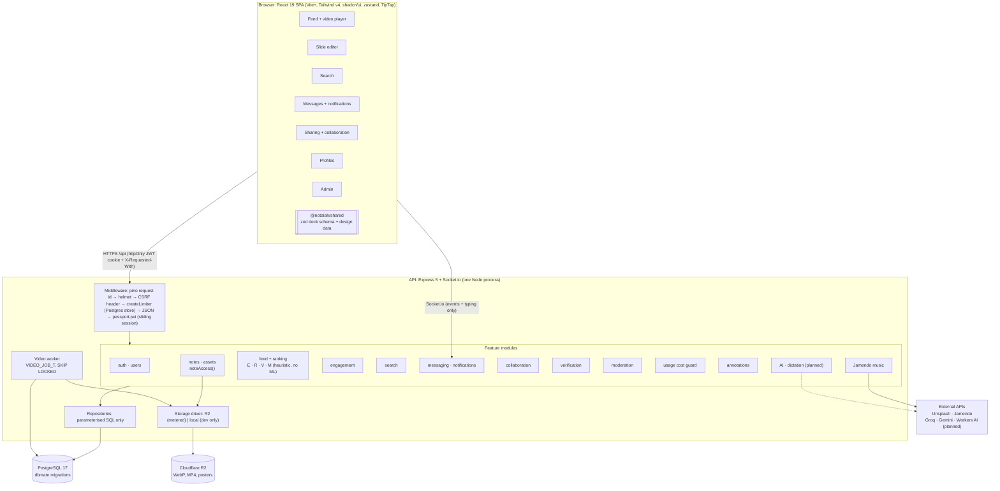
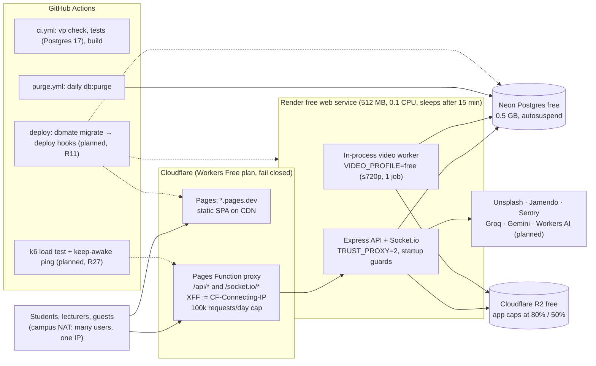
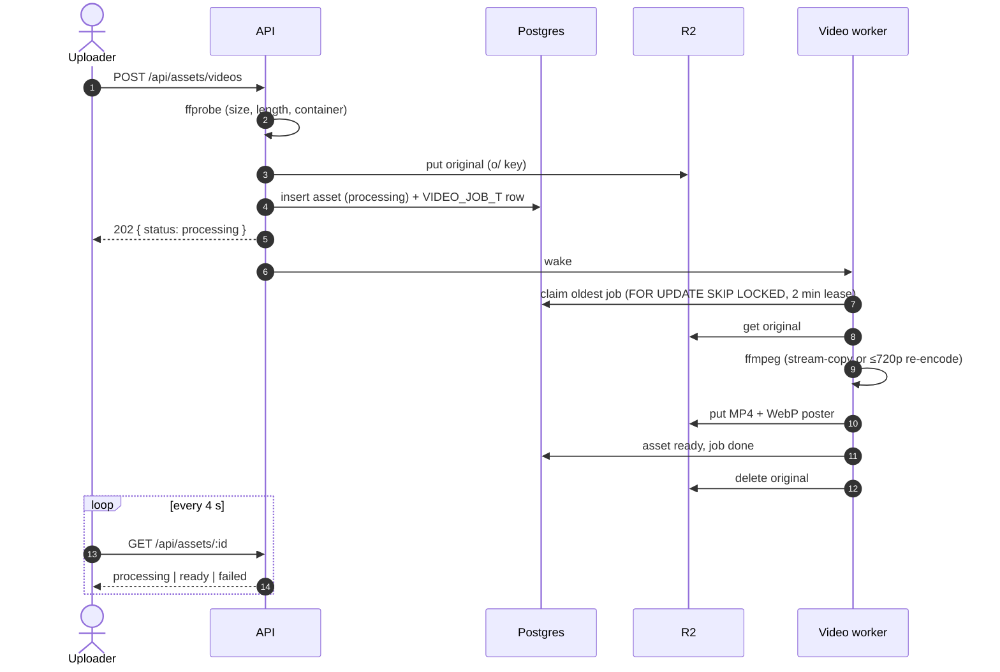

# NotaLah architecture (Mermaid)

State as of 22 Oct 2026 (main @ 69e331b), after the 20 Oct review fixes (D65-D68, D71, D74).
Dashed edges and `planned` nodes are not built yet (R11 deploy, R27, R28, R35, R36).
Paste each block into https://mermaid.live to render and style.

## 1. High-level architecture

## 2. Deployment (D74: one free origin)

## 3. Async video upload (D67)

